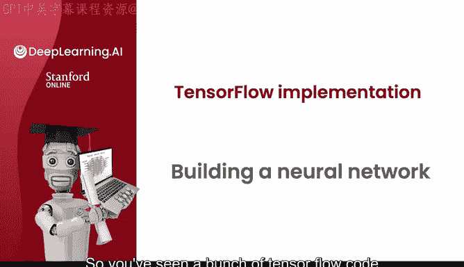
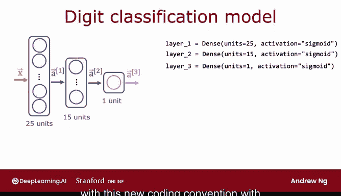

# 吴恩达《机器学习》｜machine-learning（中英字幕-deepseek翻译） - P52：10_01_03_构建神经网络.zh_en - GPT中英字幕课程资源 - BV1MN4y1S7DE

So you've seen a bunch of Tensorflow Covi now learned about how to build a layer in TensorFlow。

 how to do foI prop through a single layer in TensorFlow。

 and also learned about data in TensorFlow let's put it all together and talk about how to build a neural network in TensorFlow。

This is also the last video on TenorFlow for this week and in this video you also learn about a different way of building a neural network that would be even a little bit simpler than what you've seen so far so let's dive in what you saw previously was if you want to do for a prop you initialize the data X。

Create layer  one like so then compute a1， then create layer 2 and compute a2。

 So this was an explicit way of carrying out for prop one layer。Of computation at a time。

It turns out that TensorFlow has a different way of implementing forrop as well as learning。

 Let me show you a different way of building a neural network in TensorF。Which is that？

Same as before， you're going to create layer one and create layer 2。

But now instead of you manually taking the data and passing it to layer 1 and then taking the activations from layer1 and passing it to layer  two。

We can instead tell Tensorflow that we would like it to take layer one and layer 2 and string them together to form a neural network。

 That's what the sequential function。Intensorflow does， which as it says the Tensorflow。

 please create a neural network for me by sequentially stringing together these two layers that I just created。

It turns out that with the sequential framework。Tens offlow can do a lot of work for you。

Let's say you have a training set like this on the left， this is for the coffee example。

 you can then take the training data inputs X and put them into a nuy array This here is a 4 by2 matrix。

And the target labels why？Can then be written。As follows。

 and this is just a one dimensional array of length 4。

 why this set targets can then be stored as a 1 D array like this，10，0。

1 corresponding to four training examples。And it turns out that given the data。

X and Y is stored in this matrix X and this array Y， if you want to train this neural network。

 all you need to do is call two functions， you need to call model do compileo with some parameters We'll talk more about this next week so don't worry about it for now。

 and then you need to call model do fit X Y， which tells Tensorflow to take this neural network that is created by sequentially strain together layers1 and2。

And to train it on the data， X and Y。But we'll learn the details of how to do this next week。

And then finally， how do you do inference on this neural network， How do you do forwardpro。

 If you have a new example， say x new， which is NP array with these two features。

 then to carry out forward prop instead of having to do it one layer at a time yourself。

 you just have to call model predict on。X new， and this will output the corresponding value of a2 for you。

 given this input value of x。So model predict carries out for propagation or carries out inference for you using this neural network that you compiled using the sequential function。

Now I want to take these three lines of code on top and just simplify it a little bit further。

 which is when coding intensives flow by convention， we don't explicitly assign。

The two layers to two variables， layer1 and layer two as follows， but by convention。

 I would usually just write the code like this where we say the model is a sequential model of a few layers strung together sequentially where the first layer layer1 is a dense layer with three units and activation of sigmoid and a second layer is a dense layer with one unit and again a sigmoid activation function So if you look at others tensorflow code。

 you often see it look more like this rather than having an explicit assignment to these layer1 and layer two variables。

And so that's it， this is pretty much the code you need in order to train as well as do inference on。

A neural network in Tensorflow， where again we'll talk more about the training bits of this。

 the combined， the compound and the fit function next week。

Let's redo this for the digit classification example as well。So previously we had x is this input。

 layer 1 is a layer， a1 equals layer 1 applied to x and so on through layer 2 and layer 3 in order to try to classify a digit。

With this new coding convention。With using Tensorflowlow's sequential function。

 you can specify what layer 1， layer 2， layer 3， and tell Tensorflowlow to string the layers together for you into a neural network and same as before you can then store the data in a matrix。

And run the compile function and fit the model as follows again more on this next week。And finally。

 to do inference or to make predictions， you can use model or predict on x new。

And similar to what you saw before with the coffee classification network by convention。

 instead of assigning layer one， layer two， layer three explicitly like this。

 we would more commonly just take these layers and put them directly into the sequential function so you end up with this more compact code where you just tell Tensorflow。

Create a model for me that sequentially strings together these three layers and then the rest of the code works same as before So that's how you would build a neural network in tens of flow Now I know that when you're learning about these techniques sometimes someone may ask you to hey implement these five lines of code and then you type five lines of code and then someone says。

 congratulations with just five lines of code you built this crazy complicated state of the odd neural network and sometimes that makes you wonder what exactly did I do with just these five lines of code。

One thing I want you to take away from the machine learning specialization is the ability to use cutting edge libraries like TensorFlow to do your work efficiently but I don't really want you to just call five lines of Co and not really also know what the code is actually doing underneath the hood so in the next video I'd like to go back and share with you how you can implement from scratch by yourself for propagation in Python so that you can understand the whole thing for yourself。

In practice， most machine learning engineers don't actually implement for arop in Python that often。

 we just use libraries like Tensorflow and Pytororch。

 but because I want you to understand how these algorithms work yourself so that if something goes wrong。

 you can think through for yourself what you might need to change what' likely to work was less likely to work。

Let's also go through what it would take for you to implement for propag from scratch。

 because that way， even when you're calling a library and having it run efficiently and do great things in your application。

 I want you in the back of your mind to also have that deeper understanding of what your code is actually doing。

So that let's go on to the next video。