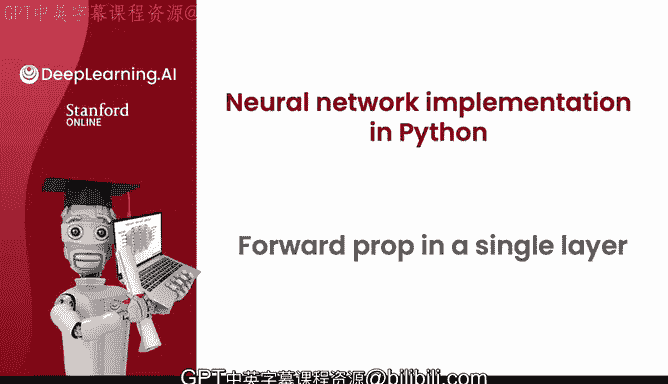
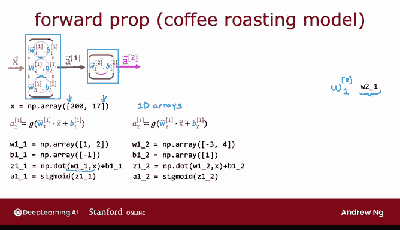

# 吴恩达《机器学习》｜machine-learning（中英字幕-deepseek翻译） - P53：11_01_01_单层正向传播.zh_en - GPT中英字幕课程资源 - BV1MN4y1S7DE

If you had to implement for propagation yourself from scratch and Python。

 how would you go about doing so In addition to gaininga intuition about what's really going on in libraries like Tensorflow and Pytorch if ever someday you decide you want to build something even better than Tensorflow and Pytorch maybe now you'd have a better variety hall I don't really recommend doing this for most people but maybe someday someone would come up with an even better framework than Tensorflow and Pytorch and whoever does that may end up having to implement these things from scratch themselves so let's take a look。

On this slide I'm going to go through quite a bit of code and you'll see all this code again later in the optional lab as was in the practice lab so don't worry about having to take notes on every line of code or memorize every line of code you see this code written down in the Jupipyter notebook in the lab and the goal of this video is to just show you the code to make sure you can understand what it's doing so that when you go to the optional lab in the practice lab and see the code there you know what to do so don't worry about taking detailed notes on every line if you can read through the code on this slide and understand what it's doing that's all you need。

So let's take a look at how you implement forrop in a single layer。

We're going to continue using the coffee roasting model shown here。

And let's look at how you would take and input feature vector x。

And implement for prompt to get this output A2 in this Python implementationation。

 I'm going to use1D arrays to represent all of these vectors and parameters。

 which is why there's only a single square bracket here。

 This is a one D in Python rather than a 2D matrix。

 which is what we had when we had double square brackets。

So the first value you need to compute is a superscript square bracket1 subscript 1。

 which is the first activation value of a1 and thats G of this expression over here。

 so I'm going to use the convention on this slide that a term like W21 I'm going to represent as a variable W2。

And then subscript1， this underscore  one denotes subscript 1。

 so W2 means w superscript2 in square bracket and then subscript 1。So。To compute a11。

We have parameters W11 and B11， which are， say1，2 and negative 1。You would then compute Z11。

As the dot product between that parameter w11 and the inputex and add it to B11。And then finally。

 a11 is equal to G， the safe point function applied to Z11。Next let's go on to compute a12。

 which again， by the convention I described here is going to be a12 written like that。

So similar as what we did on the left， W12 is2 parameters minus the4， B12 is the term。B12 over there。

 So you compute Z as determined term in the middle and then apply to Sig my function。

 and then you end up with a12。And finally， you do the same thing to compute a13。

Now you've computed these S values a11。A one，2。And a13。

 and we'd like to take these three numbers and group them together into an array to give you a1 up here。

 which is the output of the first layer， And so you do that by grouping them together using a nuier array as follows。

 So now you compute a1。 let's implement the second layer as well to compute the output A2。

So A2 is computed using this expression， and so we would have parameters W21 and B21 corresponding to these parameters。

And then you would compute Z as the dot product between W21 and a1 and add B21 and then apply the sleeppoint function to get a21。

 And that's it。 That's how you implement forward prop using just Python and nupy Now there are a lot of expressions in this page of code that you just saw。

 Let's in the next video look at how you can simplify this to implement forward prop for a more general neural network rather than hard coding it for every single neuron like we just did。

 So let's go see that in the next video。