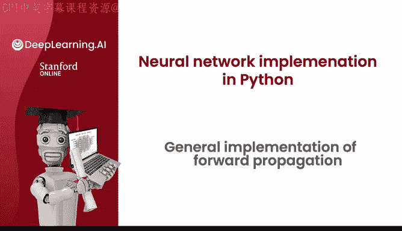
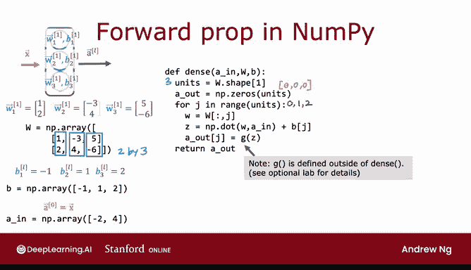

# 吴恩达《机器学习》｜machine-learning（中英字幕-deepseek翻译） - P54：12_01_02_正向传播的通用实现.zh_en - GPT中英字幕课程资源 - BV1MN4y1S7DE

In the last video you saw how to implement forrop in Python but by hardcoding lines of code for every single neuron。

 let's now take a look at the more general implementation of Forrop in Python similar to the previous video my goal in this video is to show you the code so that when you see it again in the practice lab in the optional labs you know how to interpret it so as we walk through this example don't worry about taking those on every single line of code。

 if you can read through the code and understand it that's definitely enough so what you can do is write a function to implement a dense layer that is a single layer of a neural network。

So I'm going to define the dense function， which takes us input the activation from the previous layer。

 as well as the parameters W and B for the neurons in a given layer。

Using the example from the previous video if layer1。Has three neurons。And if W1。

And W 2 and W3 are these。 Then what we'll do is stack all of these wave vectors into a matrix。

 This is going to be a2。By3。Matrix。Where the first column is the parameter W11。

 the second column is the parameter W12， and the third column is the parameter W13。

And then in a similar way， if you have。Prameterters B， B1，1 equals negative 1， B1。

2 equals1 and so on。 Then we're going to stack these three numbers into1 D B as follows negative 11。

2。 So what the dense function will do is take as input， deactivation from the previous layer。

 And a here could be a 0， which is equal to x or the activation from a later layer。

 as well as the W parameters。Stacked in columns like shown on the right。

 as was the B parameters also stacked into one D array like shown to the left over there。

 and what this function would do is input。A， the activation from the previous layer and will output the activations from the currents layer。

 so let's step through the code for doing this here's the code。First， units equals w dot shape1。

 so W here is a2 by3 matrix， and so the number of columns is3 that's equal to the number of units in this layer。

 so here units would be equal to3。And looking at the shape of W is just a way of pulling out the number of hidden units or the number of units in this layer。

Next， we set a to be an array of zeros with as many elements as there are units， so in this example。

 we need to output three activation values， so this just initializes a to be 000。

An array of three zeros Next we go through a full loop to compute the first second and third elements of a So if the J and range units So J goes from0 to units minus1。

 So it goes from0，12 indexing from 0 and Python as usual this command W equals capital w colon comma J。

 This is how you pull out the J column of a matrix in Python。So the first time through this loop。

 this will pull the first column of W， and so it' pull W11。The second time through this loop。

 when you're computing the activation of the second unit。

ll pull the second column corresponding to W12 and so on for the third time through this loop。

And then you compute Z using the usual formula is a thought product between that parameter W and the activation that you had received plus BJ。

And then you compute the activation Aj equals G sigoid function applied to z so three times through this loop。

 you compute the values for all three values of this vector of activation A。

 and then finally you return a。So what the dense function does is it inputs the activations from the previous layer。

 and given the parameters for the current layer， it returns the activations for the next layer。

So given the dense function， here's how you can string together a few dense layers sequentially in order to implement forrop in a neural network。

Given the input features x， you can then compute the activations a1 to be a1 equals den of x。

W1 B1 where here W1 B1 are the parameters sometimes also called the weights of the first hidden layer。

Then you can compute A2。As dense of now a1， which you just computed above and W2 P2。

 which are the parameters or weights of this second hidden layer and then compute A3 and A4 and if this is a neural network with four layers。

 then the final output F of x is just equal to a4 and so you return F of x。

Notice that here I'm using a capital W because one of the notational conventions from linear algebra is the used uppercase or a capital alphabet when it's referring to a matrix and lowercase refer to vectors and scalrs。

 so because there's a matrix this is capital W。So that's it。

 you now know how to implement forpro yourself from scratch and you get to see all this code and run it and practice it yourself in the practice lab coming after this as well。

I think that even when you're using powerful libraries like Tensorflowlow。

 it's helpful to know how it works under the hood because in case something goes wrong。

 in case something runs really slowly or you have a strange result or it looks like there's a bug。

Your ability to understand what's actually going on will make you much more effective when debugging your code when I run machine learning algorithm a lot of the time。

 frankly it doesn't work， certainly not the first time and so I find that my ability to debug my code to be a Tensorflowlow code or something else is really important to being an effective machine learning engineer So even when you're using Tensorflowlow or some other framework。

 I hope that you find this deeper understanding useful for your own applications and for debugging your own machine learning algorithm as well。

So， that's it。That's the last required video of this week with Code in it In the next video I'd like to dive into what I think is a fun and fascinating topic。

 which is what is the relationship between neural networks and AI or AGI artificial general intelligence？

This is a controversial topic but because it's been so widely discussed。

 I want to share with you some thoughts on this， so when you are asked neural networks at all on a path to human level intelligence you have a framework for thinking about that question let's go take a look at that fun topic I think in the next video。

