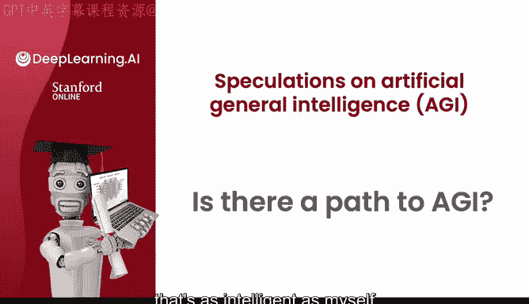
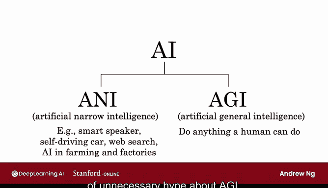
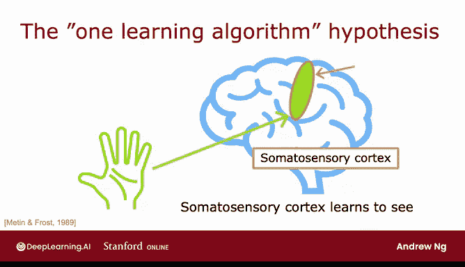
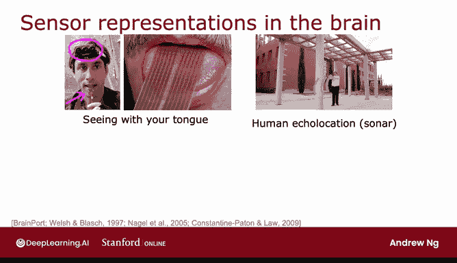

# 吴恩达《机器学习》｜machine-learning（中英字幕-deepseek翻译） - P55：13_01_01_是否存在通往通用人工智能的路径.zh_en - GPT中英字幕课程资源 - BV1MN4y1S7DE

Ever since I was a teenager starting to play around with neural networks。

 I always felt through the dream of maybe someday building an AI system that's as intelligent as myself or as intelligent as a typical human。

 that that was one of the most inspiring dreams of AI I still hold that dream alive today but I think that the path to get there is not clear and could be very difficult。

 and I don't know whether it'll take us mere decades and whether will see breakthroughs within our lifetimes。

 or if it may take centuries or even longer to get there。

 but let's take a look at what this AGI artificial general intelligence dream is like and speculate a little bit on what might be possible past。

 unclear path， difficult path to get there someday。

I think there's been a lot of unnecessary hype about AGI or artificial and general intelligence。

And maybe one reason for that is AI actually includes two。

Veryry different things one is A NI which stands for artificial narrow intelligence。

 This is an AI system that does one thing a narrow task， sometimes really。

 really well and can be incredibly valuable such as a smart speaker or self-driving car or web search or AI applied to specific applications such as farming or factories。

Over the last several years， ANI has made tremendous progress and is treating， as you know。

 tremendous value in the world today。Because ANI is a subset of AI。

 the rapid progress in ANI makes it logically true that AI has also made tremendous progress in the last decade。

There's a different idea in AI， which is AGI， artificial general intelligence。

 this hope of building AI systems， that could do anything a typical human can do。

 and despite all the progress in ANI and therefore tremendous progress in AI。

 I'm not sure how much progress if any were really making toward AGI。

And I think all the progress in ANI has made people conclude correctly that there's tremendous progress in AI。

 but that has caused some people to conclude， I think， incorrectly。

 that a lot of progress in AI necessarily means that there's a lot of progress toward AGI。

So if you ever are asked about AI and AGI， sometimes you might find drawing this picture useful for explaining some of the things going on in AI as well and some of the sources of unnecessary hype。

About AGI。

And with the rise of modern deep learning， we started to simulate neurons and with faster and faster computers and even GPUs we could simulate even more neurons so I think there was this vague hope many years ago that boy if only we could simulate a lot of neurons。

 then we could simulate the human brain or something like a human brain and with really intelligent systems right sadly it turned out not to be quite as simple as that。

And。I think two reasons for this is first， if you look at the artificial neural networks we're building。

 they are so simple that a logistic regression unit is really nothing like what any biological neuron is doing is so much simpler than what any neuron in your brain or mind is doing and second。

 even to this day I think we have almost no idea how the brain works。

 there's no fundamental questions about how exactly there a neuron map from inputs the outputs that we just don't know today so trying to simulate that in a computer much less a single logistic function is just so far from an accurate model of what the human brain actually does。

Given our very limited understanding， both now and probably for the near future of how the human brain works。

 I think just trying to simulate the human brain as a path to AGI will be an incredibly difficult path。

Having said that。Is there any hope of within our lifetimes seeing breakthroughs in AGI？

Let me share with you some evidence that helps me keep that hope alive， at least for myself。

There have been some fascinating experiments done on animals that shows or strongly suggest that the same piece of。

Biological brain tissue can do a surprisingly wide range of tasks。

 and this has led to the one learning algorithm hypothesis that maybe a lot of intelligence could be due to one or a small handful of learning algorithms and if only we could figure out what that one or small handful of algorithms are。

We may be able to implement that in a computer someday。

Let me share a you some details of those experiments。

This is a result due to row atal from many decades ago。

The part of your brain shown here is your auditory cortex and your brain is wired to feed signals from your ears in the form of electrical impulses。

 depending on what sound your ear is detecting to that auditory cortex。

It turns out that if you were to rewire a animal brain to cut the wire between the ear and the auditory cortex and instead feeding images to the audit cortex。

 then the auditory cortex learns to see auditory refers to sound and so this piece of the brain that in most people learns to hear when it is fed different data it instead learns to see here's another example。

This part of your brain is your somatosensory cortex somatosory refers to touch processing if you were to similarly rewire the brain to cut to connection from the touch sensors to that part of the brain and instead rewire the brain to feed in images then does somatosensory cortex learn to see So there's been a sequence of experiments like this showing that many different parts of the brain just depending on what data it is given can learn to see or learn to feel or learn to hear as if there was one maybe one algorithm that just depending on what data it is given learns to process that input accordingly。

There have been systems built， which take a camera， maybe mounted to someone's forehead。

 and maps it to a pattern of voltages in a grid on someone's tongue。

 and by mapping a grayscale image to a pattern of voltages on your tongue。

 this can help people that are not sightted line individuals， learn to see with your tongue。

Or there have been fascinating experiments with human echolocation or human sonar。

 So animals like dolphins and bats use soar to see and。

Researchers have found that if you train humans to make cring cells。

And listen to how that bounces off surroundings， humans can sometimes learn some degree of human echolocation。

Or this is a haptic belt and my research lab at Stanford once built something like this before as well。

 but if you mount a ring of buzzes around your waist and program it using a magnetic compass so that say the buzzes to the northmost direction are always vibrating slightly。

 then you somehow gain a direction sense which some animals have but humans built。

 then it just feels like you're walking around and you just know where north is。

 it doesn't feel like oh that part of my waist is buzzing， it feels like。

 oh I know where that north is。Or surgery to implant a third eye onto frog and the brain just learns the deal with this input。

There have been a variety of experiments like these showing that the human brain is amazingly adaptable。

😊，Neuroscientists say it's amazingly plastic that just means adaptable to deal with a bewildering range of sensor inputs and so the question is if the same piece of brain tissue can learn to see or touch or feel or even other things。

 what is the algorithm uses and can we replicate this algorithm and implement it in a computer。

 I do feel bad for the frog and other animals on which these experiments were done。

 although I think the conclusions are also quite fascinating？😊，So even to this day。

 I think working on AGI is one of the most fascinating signs and injury problems of all time。

 and maybe you will choose someday to do research on it。However。

 I think it's important to avoid overhyping。I don't know if the brain is really one or a small handful of algorithms。

 and even if it were， I have no idea and I don't think anyone knows what the algorithm is。

 but I still hold this hope alive and maybe it is and maybe we could through a lot of hard work someday discover an approximation to it。

I still find this one of the most fascinating topics and I still often eitherly think about it in my spare time。

 and maybe someday you be the one to make a contribution to this problem。So in the short term。

 I think even without pursuing AGI， machine learning and neural networks are a very powerful tool。

 and even without trying to go all the way to build human level intelligence。

 I think you find neural networks to be an incredibly powerful and useful set of tools for applications that you might build。

And so that's it for the required videos of this week congratulations on getting to this the lessons after this we'll also have a few optional videos to dive a little bit more deeply into efficient implementations of neural networks and in particular in the optional videos to come I'd like to share with you some details of how to implement vectorized implementations of neural networks so I hope you also take a look at those videos。

😊。