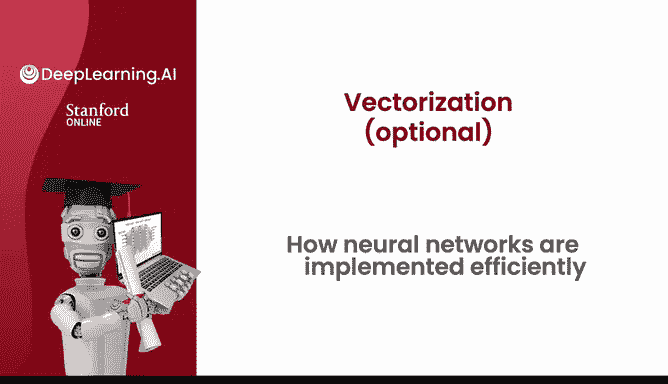
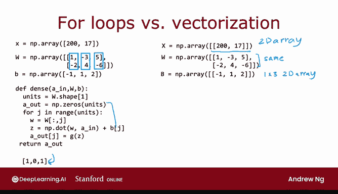

# 吴恩达《机器学习》｜machine-learning（中英字幕-deepseek翻译） - P56：14_01_01_神经网络如何高效实现.zh_en - GPT中英字幕课程资源 - BV1MN4y1S7DE

One of the reasons that deep learning researchers have been able to scale up neural networks and build really large neural networks over the last decade is because neural networks can be vectorized。

 they can be implemented very efficiently using matrix multis。

And it turns out that parallel computing hardware including GPUus but also some CPU functions。

 are very good at doing very large matrix multiplications In this video。

 we'll take a look at how these vectorized implementations of neural networks work without these ideas I don't think the learning would be anywhere near success and scale today Here on the left is the code that you had seen previously。

Of how you would implement for prop or for propagation in a single layer。X here is the input。W。

 the weights of the first， second and third neurose parameters B。

 and then this is the same code as what you saw before。And this will output three numbers。

 say like that， and if you actually implement this computation， you get 101。

It turns out you can develop a vectorized implementation of this function as follows。

Set x to be equal to this notice a double square bracket， so this is now a 2D array。

Like in Tensorflow。W is the same as before， and B， I'm now using capital B is also a1 by3 to d array。

 and then it turns out that all of these steps this for loop inside can be replaced with just a couple lines of code z equals。

NP thought matmal， Maimmal is howy carries out matrix multiplication where now X and W are both matrices。

 and so you just multiply them together。And it turns out that this fold loop。

 all of these lines of code， can be replaced with just a couple lines of code。

 which gives a vectorized implementation of this function。So you compute Z。

 which is now a matrix again as nuumpy do mat M between AN and W。Where here。

 A in and W are both matrices， and maxo is how nuI carries out a matrix matrix multiplication and it multiplies two matrices together。

 and then adds the matrix B to it。And then a here or a out is equal to the activation function G that is a soid function。

 applied elementminwise to this matrix z， and then you finally return a out。

So this is what the code looks like。Notice that in the vectorized implementation。

 all of these quantities X， which is fed into the value of AN， as well as W B， as well as Z and A al。

 all of these are now 2D arrays， all of these are matrices， and this turns out。

To be a very efficient implementation of one step four propagation through a dense layer in the neural network。

So this is called for a vectorized implementation of forward prop in a neural network。

But what is this code doing and how does it actually work and what is this Matt now actually doing in the next two videos both also optional。

 we'll go over matrix multiplication and how that works if you're familiar with linear algebra if you're familiar with vectors matrices transposes and matrix matrix multiplications you can safely just quickly skim over these two videos and jump to the loss video this week。

And then in the last video of this week， also optional。

 we'll dive into more detail to explain how MAmal gives you this vectorized implementation and so that let's go on to the next video where we'll take a look at what matrix multiplication is。

