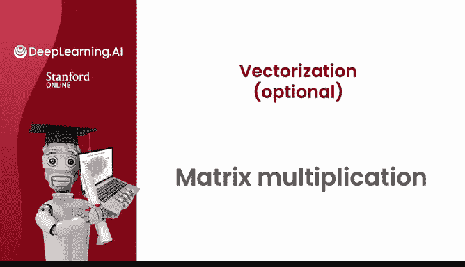
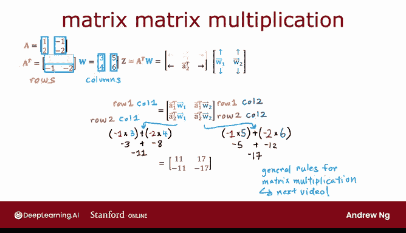

# 吴恩达《机器学习》｜machine-learning（中英字幕-deepseek翻译） - P57：15_01_02_矩阵乘法.zh_en - GPT中英字幕课程资源 - BV1MN4y1S7DE

So you know that a matrix is just a block or 2D array of numbers what does it mean to multiply two matrices let's take a look。

In order to build up to multiplying matrices， let's start by looking at how we take dot products between vectors。

Let's use the example of taking the dot product between this vector 12 and this vector 34 If z is the dot product between these two vectors。

 then you compute z by multiplying the first element by this first element here。

 so it's one times 3 plus the second element times the second element plus 2 times 4 and so that's just3 plus8 which is equal to 11。

In the more general case， if Z is the dot product between a vector A and a vector W。

 then you compute z by multiplying the first element together and then the second elements together and the third and so on and then adding up all of these products。

 so that's the vector vector dot product。It turns out there's another equivalent way of writing a dot product。

 which is given a vector a that is  one， two written as a column。

You can turn this into a row that is， you can turn it from what's called a column vector to a row vector by taking the transpose of a。

 so the transpose of a vector A means you take this vector and lay its elements on the side like this。

And it turns out that if you multiply a transpose， this is a row vector。

 or you can think of this as a one by2 matrix with w。

 which you can now think of as a two by one matrix。Then z equals a transpose times w。

 and this is the same as taking the dot product between a and W。So recap。

Z equals the dot product between A and W is the same as z equals a transpose that is a laid on the side。

 multiply by W。And this will be useful for understanding matrix multiplication that these are just two ways of writing the exact same computation to arrive at Z。

Now let's look at vector matrix multiplication， which is when you take a vector and you multiply a vector by a matrix。

Here again is the vector a12， and a transpose is a laid on side。

 so rather than just kind of think of this as a two by one matrix， it becomes a one by two matrix。

And let me now create a2 by2 matrix W with these four elements， V4，56。

If you want to compute capital Z。As a transpose times。W so let's see how you would go about doing so。

It turns out that。Z is going to be a one by two matrix and to compute the first value of z。

 we're going to take。A transpose one2 here and multiply that by the first column of W， so that's34。

And so。To compute the first element of z， you end up with1 times3 plus 2 times 4。

 which we saw earlier is equal to 11， and so the first element of z is 11。

Let's figure out what's the second element of Z？Turns out you just repeat this process。

 but now multiplying a transpose by the second column of W。 and so to do that computation you have。

One times5 plus two times6。Which is equal to 5 plus 12， which is 17， so that's equal to 17。

 so z is equal to this one by2 matrix 11 and 17。Now just one last thing。

 and then they'll take us to the end of this video。

 which is how to take vector matrix multi and generalize it to matrix matrix multi。

 I have a matrix a of these four elements。 The first column is one two and the second column is negative one negative2。

And I want to know how to compute a transpose times W。Unlike the previous slide。

 a now is a matrix rather than just a vector， but the matrix is just a set of different vectors stacked together in columns。

So first， let's figure out what is a transpose。In order to compute a transfers。

 we're going to take the columns of a。And similar to what happened when you transpose a vector。

 we're going to take the columns and lay them on the side one column at a time。

 So the first column12 becomes the first row， one2 becauses just laid on the side and this second column negative one negative2 becomes laid on the side negative one negative2 like this So the way you transpose the matrix is you take the columns and you just lay the columns on the side one column at a time so you end up with this being a transpose。

Next we have this matrix W whichre going to write as 34，56， so there's a column 34 and a column56。

One way I encourage you to think of matrices， at least as's useful for neural network implementation is if you see a matrix。

 think of the columns of the matrix， and if you see the transpose of a matrix。

 think of the rules of that matrix as being grouped together as illustrated here with A and A transpose as well as W。

And now let me show you how to multiply a transpose and W。In order to carry out this computation。

 let me call the columns of a a1 and a2， and that means that a1 transpose is the first row of a transpose and a2 transpose is。

The second row of a transpose。And then same as before， let me call the columns of W to be W1 and W2。

So it turns out that to compute a transpose W。The first thing we need to do is。

 let's just ignore the second。Row of a and let's just pay attention to the first row of a and let's take this row12 that is a1 transpos and multiply that with w so you already know how to do that from the previous slide the first element is12 in a product of dot product with34 so that ends up with v times 1 plus2 times4 which is 11。

And then the second element is。One，2， a transpose in a product with 56。

 so that's five times1 plus6 times2。Which is 5 plus 12， which is 17。

 So that gives you the first row of Z equals a transpose W。 So all we've done is take a 1。

Transpose and multiply that by W。 that's exactly what we did on the previous slide。Next。

 let's forget A1 for now and let's just look at A2。And take A2 transpose and multiply that by W。

So now we have a2 transpose times w and to compute that first we take negative1 and negative2 and dot product back with 34 so that's negative 1 times 3 plus negative 2 times 4。

 and that turns out to be negative 11。And then we have to compute a2 transpose times the second column。

 and that's negative 1 times 5 plus negative2 times 6， and that turns out to be negative 17。

So you end up with a transpose times w is equal to this2 by 2 matrix over here。

Let's talk about the general form of matrix multiplication NIs， so let's go see that in the NI video。

So this was an example of how you multiply a vector with a matrix or a matrix with a matrix is a lot of dot products between vectors but ordered in a certain way to construct the elements of the output Z one element at a time。

I know this was a lot， but in the next video let's look at the general form of how a matrix matrix multiplication is defined and I hope that that will make all this clearer as well let's go on to the next video。

