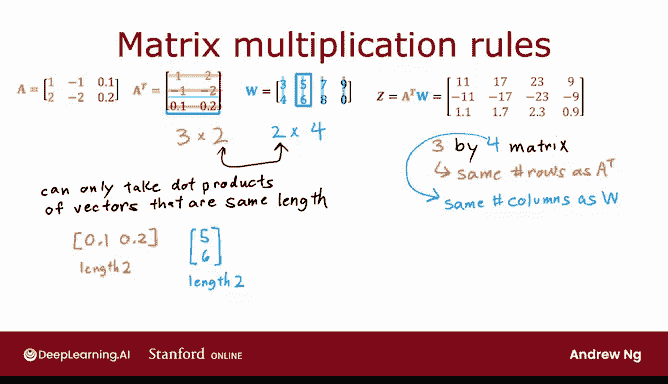

# 吴恩达《机器学习》｜machine-learning（中英字幕-deepseek翻译） - P58：16_01_03_矩阵乘法规则.zh_en - GPT中英字幕课程资源 - BV1MN4y1S7DE

So let's take a look at the general form of how you multiply two matrices together and then in the last video after this one。

 we'll take this and apply it to the vectorized implementation of a neural network let's dive in。

 here's a matrix a， which is a two by three matrix because it has two rows and three columns as before I encourage you to think of the columns of this matrix as three vectors vectors a1。

 a2 and a3。

And。What we're going to do is take a transpose and multiply that with a matrix W The first what is a transpose well a transpose is obtained by taking the first column of a and laying it on a side like this and then taking the second column of a and laying it on this side like this and then the third column of a and laying it on the side like that and so these rows are now a1 transpose a2 transpose and a3 transpose。

Next， here's a Matrix W。Encourage you to think of w as vectors， w1， W2。

 W3 and W4 stack together as so let's look at how you then compute a transpose times w。Now。

 notice that I've also used slightly different shades of。Orange to denote the different columns of a。

Where the same shade corresponds to numbers that we think of as group together into a vector。

And that same shade is used to indicate different rows of a transpose because the different rows of a transpose are a1 transpose A2 transpose and A3 transpose and in a similar way I've used different shades to denote the different columns of W because the numbers are the same shade of blue。

 are ones that grouped together to form the vectors， W1 or W2 or W3 or W4。

Now let's look at how you can compute a transpose times W。

I'm going to draw vertical bond with the different shades of blue and horizontal bond with the different shades of orange to indicate which。

Elements of Z。That is a transs W。Are influenced or affected by the different roles of a transpose and which are influenced or affected by the different columns of W。

So for example， let's look at the first column of w。

 so that's w1 as indicated by the lightest shade of blue here。

So W1 will influence or will correspond to。This first column of z shown here by this lighter shade of blue and the values of this second column of w that is W2 as indicated by this second lighter shade of blue will affect the values computed into second column of Z and so on。

For the third and fourth columns。Corspondingly， let's look at aranfis。

A1 transpose is the first row of a transpose， as indicated by the lightest shade of orange and a1 transpose will。

Effect or influence or correspond to the values in the first row of z。

 and A2 transpos will influence the second row of z and A3 transpose will influence or correspond to this third row of z。

So let's figure out how to compute the matrix Z， which is going to be a three by four matrix。

 so we've told numbers all together。This starts off。

And figure out how to compute the number in the first row in the first column of Z。

 So this upper leftmost element here。Because this is the first row in the first column corresponding to the lighter shade of orange and the lighter shade of blue。

 the way you compute that is to grab the first row of a transpose and the first column of W and take their inner product or the do product。

And so this number is going to be12 dot product with 34， which is one times 3 plus2 times 4。

 which is equal to 11。Let's look at the second example， how would you compute this？Number。

This element of Z， so this is in the third row， row 1， row  two， row3。

 so this is in row 3 and the second column column one， column 2。So to compute the number in row v。

 column2 of z。You would now grab row3 of a transpose and column2 of W and dot product those together notice that this corresponds to the darkest shade of orange and the second lightest shade of blue。

And to compute this， this is 0。1 times 5 plus 0。2 times 6， which is 0。5 plus 1。2。

 which is equal to 1。7， so to compute the number in row 3 column 2 of z。

 you grab the third row row 3 of a transpose and column 2 of W。

Let's look at one more example and let's see if you can figure this one out。This is。Row 2。

Cotlumn3 of the matrix Z。why don't you take a look and see if you can figure out which row and which column to grab to dot product together and therefore what is the number that will go in this element of this matrix hopefully you got that you should be grabbing row2 of a transpose and column3 of w and when you dot product that together you have a2 transpose W3 this negative1 times 7 plus negative 2 times 8。

 which is negative 7 plus negative 16 which is equal to negative 23 and so that's how you compute this elements of the matrix Z。

And it turns out if you do this for every element of the matrix Z。

 then you can computefuse all of the numbers in this matrix， which turns out to look like that。

Feel free to pause the video if you want and pick any element and double check that the formula we've been going through gives you the right value for Z。

I just want to point out one last interesting requirement for multiplying matrices together。

Which is that x transpose here is a three by two matrix because it has three rows in two columns and W here is a two by four matrix because it has two rows and four columns one requirement in order to multiply two mates together is that this number must match that number and that's because you can only take dot products between vectors that are the same length so you can take the dot product between a vector with two numbers and that's because you can take the inner product between a vector of length2 only with another vector of length2 you can't take the inner product between a vector of length2 with a vector of length 3 for example。

And that's why matrix multiplication is valid only if the number of columns of the first matrix that is a transpose here。

Is equal to the number of rows of the second matrix that is the number of rows of W here so that when you take dot products during this process。

 you're taking dot products of vectors of the same size and then the other observation is that the output z equals a transpose W。

 the dimensions of z is3 by4， and so the output of this multiplication will have the same number of rows as x transpose and the same number of columns as w and so that too is another property of matrix multiplication。

So that's matrix multiplication all these videos are optional so thank you for sticking with me through these and if you're interested later in this week there are also some purely optional quizzes to let you practice some of more of these calculations yourself as well。

So of that， let's take what we've learned about matrix multi and apply back to the vectorized implementation of a neural network。

I have to say the first time I understood the vectorized implementation。

 I thought it actually really cool I've been implementing neural networks for a while myself without the vectorized implementation and when I finally understood the vectorized implementation and implemented it that way for the first time it ran blazingly much faster than anything I'd ever done before and I thought wow。

 I wish I had figured this out earlier。😊，The vectorize implementation。

 it is a little bit complicated， but it makes neural networks run much faster。

 so let's take a look at that in the next video。