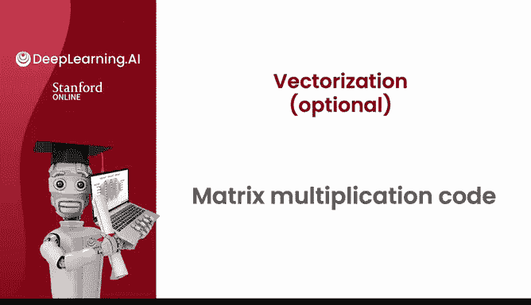
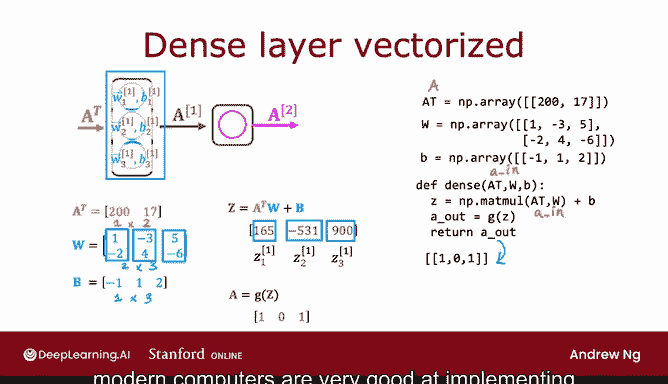

# 吴恩达《机器学习》｜machine-learning（中英字幕-deepseek翻译） - P59：17_01_04_矩阵乘法代码.zh_en - GPT中英字幕课程资源 - BV1MN4y1S7DE

So without further ado， let's jump into the vectorized implementation of a neural network We'll look at the code that you had seen in an earlier video and hopefully Matt Ma that is that matrix multiplication calculation will make more sense let's jump in so you saw previously how you can take the matrix A and compute a transpose times W resulting in this matrix here Z。

En code。If this is the matrix A， this is a nuier array with the elements corresponding to what wrote on top。

 then a transpose， which I'm going to write as at is going to be this matrix here with again。

 the columns of a now laid out in rows instead。And by the way， instead of setting up A this way。

 another way to compute A in NI would be the right A equals A dot T。

 that's the transpose function that takes the columns of the matrix and lays them on the side。

In code， here's how you initialize the matrix W is another 2D nuier array。

And then to compute z equals a transpose times w， you would write z equals NP p dot matmal A commmer W。

And that will compute this matrix Z over here。Giving you this result down here。And by the way。

 if you read others code， sometimes you see Z equals A and then the at symbol W。

 this is an alternative way of calling the mat malfunction。

 although I find using NP dot matM to be clearer， and so in the code you see in this class we just use the MA malfunction like this rather than this at symbol。

So let's look at what a vectorized implementation of Fordrop looks like。

I'm going to set a transpose to be equal to the input feature values 217。

 so these are just the usual input feature values， 200 degrees roast in coffee for 17 minutes。

So this is a one by two matrix， and I'm going to take the parameters W1。

 W2 and W3 and stack them in columns like this to form this matrix capital W。And the value is B1， B2。

 B3， I'm going to put into a1 by3 matrix that is this matrix B as follows。

Then it turns out that if you were to compute z equals a transpose W plus B。

 that will result in these three numbers。And that's computed by taking the input feature values and multiplying that by the first column and then adding B to get 165。

Taking these feature values， dot product with the second column that is weights W2 and adding B2 to get negative 531。

And。These feature values dot product with the weights， W3 plus B3 to get 900。

Feel free to pause the video if you wish to double check these calculations。

 but this gives you the values of Z11， Z12 and Z13。And then finally。

 if the function G applies the sigmoid function to these three numbers element wise。

 that it applies to sigmoid function to 165 to negative 531 into 900 then you end up with a equals G of this matrix z ends up being 101 and its 101 because sigmoid to 165 is so close to one that you up to numerical roundoff is basically one and these are basically0 and1 Let's look at how you implement this in code a transpose is equal to this is this1 by2 array of 217。

 the matrix W is this2 by3 matrix and B is this 1 by3 matrix。

And so the way you can implement what prop in a layer is。

Dense input a transpose WB is equal to z equals matmal a transpose times W plus B。

 So that just implements this line of code。And then a alt that is the output of this layer is equal to G。

 the activation function applied element wise to this matrix z。

 and you return a alt and that gives you this value。

In case you're comparing the slide with the slide a few videos back。

 there was just one little difference， which was by convention。

 the way this is implemented in TensorF and rather than calling this variable AT。

 we were calling it AN， which is why this too is a correct implementation of the code。

And there is a convention in TensorF that individual examples are actually laid out in rows in the matrix X。

 rather than in the matrix x transpos， which is why the code implementation actually looks like this intensorflow。

But this explains why with just a few lines code， you can implement ForIrop in the neural network and moreover。

 get a huge bonus because modern computers are very good at implementing matrix multis such as Man Ma efficiently。

That's the last video of this week。 Thanks for sticking with me all the way through the end of these optional videos。

 For the rest of this week， I hope you also take a look at the quizzes and the practice labs and also the optional labs to exercise this material even more deeply。

 You now know how to do inference and for prop in the neural network， which I think is really cool。

 So congratulations。😊，After you have gone through the quizzes in the labs。

 please also come back and in the next week we'll look at how to actually train a neural network。

 so I look forward to seeing you next week。