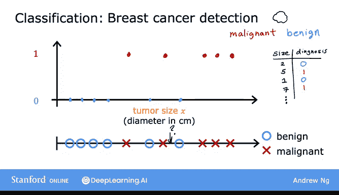
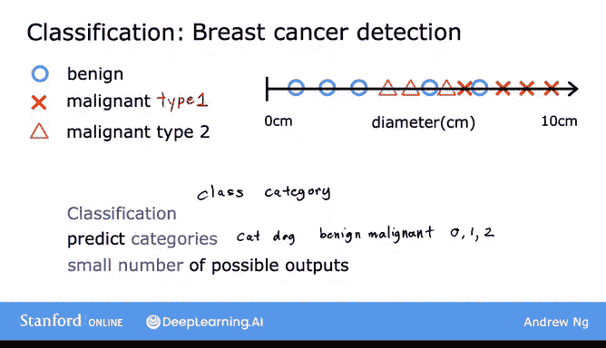
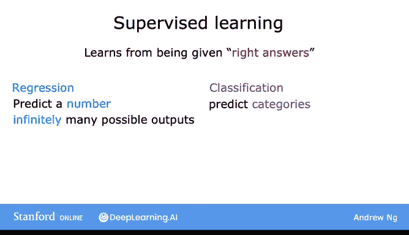

# 吴恩达《机器学习》｜machine-learning（中英字幕-deepseek翻译） - P5：05_01_03_监督学习第二部分.zh_en - GPT中英字幕课程资源 - BV1MN4y1S7DE

So supervised learning algorithms learn to predict input to output or X to Y mappings。

 and in the last video you saw that regression algorithms。

 which is a type of supervised learning algorithm， learns to predict numbers out of infinitely many possible numbers。

There's a second major type of civilized learning algorithm called a classification in the algorithm。

 let's take a look at what this means。Take breast cancer detection as an example of a classification problem。

 say you're building a machine learning system so that doctors can have a diagnostic tool to detect breast cancer。

 this is important because early detection could potentially save a patient's life。

Using a patient's medical records， your machine learning system tries to figure out if a tumor that is a lump is malignant。

 meaning cancerous or dangerous， or if that tumor， that lump is benign。

 meaning that you it's just a lump that isn't cancerous and isn't that dangerous。

 some of my friends have actually been working on this specific problem。

So maybe your dataset has tumors of various sizes and these tumors are labeled as either benign。

 which I will designate in this example with a zero or malignant。

 which I'll designate in this example with a one。You can then plot your data on a graph like this where the horizontal axis represents the size of the tumor。

 and the vertical axis takes on only two values， 0 or1， depending on whether the tumor is benign。

 zero or malignant1。One reason that this is different from regression is that we're trying to predict only a small number of possible outputs or categories。

 in this case， two possible outputs， 01， the nine old lateignment。This is different from regression。

 which tries to predict any number although of the infinitely many number of possible numbers。

And so the fact that there are only two possible outputs is what makes this classification。

Because there are only two possible outputs or two possible categories in this example。

 you can also plot this data on a line like this， where now I'm going to use two different symbols to denote the category using a circle and O to denote the benign examples and across to denote the malignant examples。

 and if a new patient walks in for a diagnosis and they have a lump that is this size。

Then the question is， will your system classify this tumor as benign or malignant？

It turns out that in classification problems， you can also have more than two possible output categories。

Maybe a learning algorithm can output multiple types of cancer diagnoses if it turns out to be malignant。

So let's call two different types of cancer type1 and type 2。

 in this case the abram would have three possible output categories it could predict。And by the way。

 in classification， the terms output classes and output categories are often used interchangeably。

 So whenever I say class or category， when referring to the output， it means the same thing。

So to summarize， classification algorithms predict categories。Caorries don't have to be numbers。

 It could be non numeric。 for example， it can predict whether a picture。Is that of a cat or a dog。

 And it can predict if a tumor is benign or malignant。

Categories can also be numbers like 01 or 001 or2， but what makes classification different from regression when you're interpreting the numbers is that classification predicts a small finite。

 limited set of possible output categories such as 01 and2。

 but not all possible numbers in between like 0。5 or 1。7。

In the example of supervised learning that we've been looking at， we had only one input value。

The size of the tumor。But you can also use more than one input value to predict an output。

Here's an example， instead of just knowing the tumormic。

 say you also have each patient's age in years， your new data set now has two inputs。

 age and tumormas。Fing this new data we're going to use circles to show patients whose tumors are be and crosses to show the patients with a tumor that was malignant。

So when a new patient comes in， the doctor can measure the patient's tumor size and also record the patient's age。

And so given this， how can we predict if this patient's tumor is benign or malignant？Well。

 given the data set like this， what the learning algorithm might do is find some boundary that separates out the malignant tumors from the benign ones。

So the learningarrow has to decide how to fit a boundary line to this data。

The boundaryun line found by the learning algorithm would help the doctor with the diagnosis in this case the tum is more likely to be benign。

From this example， we've seen how two inputs the patient's age and tumor size can be used。

In other machine learning problems， often many more input values are required。

 My friends who worked on breast cancer detection use many additional inputs like the thickness of the tumor clump。

 uniformity of the cell size， uniformity of the cell shape and so on。So to recap。

Supervised learning maps in to output Y， where the learning algorithm learns from the quoteright answers。

The two major types of supervised learning are regression and classification in a regression application like predicting prices of houses。

 the learning algorithm has to predict numbers from infinitely many possible output numbers。

 Where in classification， the learning algorithm has to make a prediction of category。

 all of a small set of possible outputs。 So you now know what is supervised learning。

 including both regression and classification， I hope you're having fun。

Next there's a second major type of machine learning called unsupervised learning。

 let's go on to the next video to see what that is。

