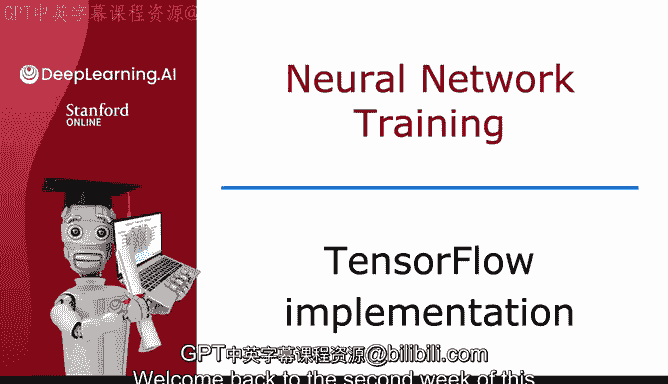
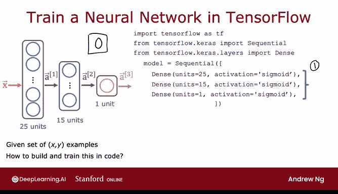

# 吴恩达《机器学习》｜machine-learning（中英字幕-deepseek翻译） - P60：18_02_01_TensorFlow实现.zh_en - GPT中英字幕课程资源 - BV1MN4y1S7DE

Welcome back to the second week of this course on advanced learning algorithms Last week you learned how to carry out inference in the neural network this week we're going to go over training of a neural network。

I think being able to take your own data and train your own neural network on it is really fun This week we'll look at how you could do that let's dive in let's continue with our running example of handwritten digit recognition recognizing this image a zero or a one and here we're using the neural network architecture that you saw last week where you have an input X that is the image and then the first hidden layer with 25 units。

 second hidden layer with 15 units and then one output unit。

If you had given a training set of examples comprising Image X as well as the ground truth label Y。

How would you train the parameters of this new network？

Let me go ahead and show you the code that you can use in TensorF to train this network。

 and then in the next few videos after this we'll dive in the details。

 explain what the code is actually doing。So this is the code you would write this first part may look familiar from the previous week where you are asking Tensorflow to sequentially string together these three layers of a neural network。

 the first in the layer with 25 units and sin activation。

 the second hidden the layer and then finally the output layer。

 so nothing new here relative to what you saw last week。

Second step is yet ask Tensorflow to compile the model and the key step in asking Tensorflowlow to compile the model is to specify what is the loss function you want to use in this case we'll use something that goes by the binaryary cross entropy loss function we' say more in the next video what this really is and then having specified the loss function。

 the third step is to call the fit function which tells Tensorflow to fit the model that you specified in step one using the loss or the cost function that you specified in step 2。

To the data X Y。And back in the first course， when we talked about gradient descent。

 we had to decide how many steps to run gradient descent or how long to run gradient descent。

 so EpoX is a technical term for how many steps of learning algorithm like gradient descent you may want to run。

And that's it， step one is to specify the model which tells TensorF how to compute for the inference。

Step two compiles the model using a specific loss function， and step three is to train the model。

So that's how you can train a neural network intensivetensorflow As usual。

 I hope that you'd be able to not just call these lines of code to train the model。

 but that you also understand what's actually going on behind these lines of code so you don't just call it without really understanding what's going on and I think this is important because when you're running a learning algorithm if it doesn't work initially having that conceptual mental framework of what's really going on will help you debug whenever things don't work the way you expect。

So with that， let's go on to the next video where we'll dive more deeply into what these steps in the Tensorflow implementation are actually doing。

 I'll see you in the next video。