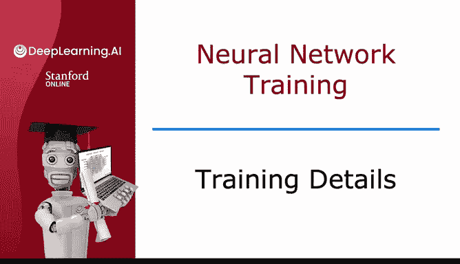
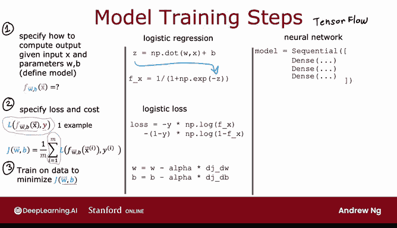
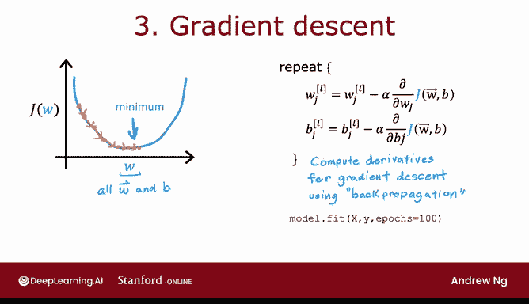
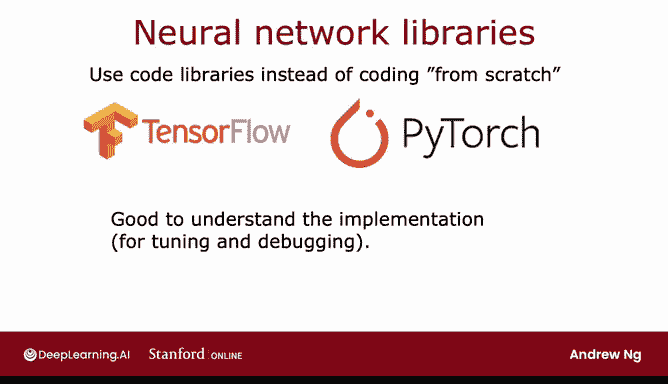

# 吴恩达《机器学习》｜machine-learning（中英字幕-deepseek翻译） - P61：19_02_02_训练细节.zh_en - GPT中英字幕课程资源 - BV1MN4y1S7DE

Let's take a look at the details of what the TensorF code for training a neural network is actually doing let's dive in before looking at the details of training a neural network。

 let's recall how you had trained a logistic regression model in the previous course。

Step one of building a liter regression model was you would specify how to compute the output given the input feature x and the parameters W and B。

 So in the first course we said the lit regression function predicts F of x is equal to G。

 the sigmoid function applied to w dot product x plus B。

 which was the sigmoid function applied to W dot x plus B So if z is the dot product of W of x plus B。

Then F of x is1 over1 plus e to the negative z。So those first step we had to specify what is the input to output function of logistic regression。

 and that depends on both the inputex and the parameters of the model。

The second step we had to do to train the logistic regression model was to specify the loss function and also the cost function。

 so you may recall that the loss function said if logistic regression outputs F of x and the ground truth label the actual label and the training set was y。

 then the loss on that single training example was negative y log f of x minus1 minus y times log of1 minus f of x。

 so this was a measure of how well is logistic regression doing on a single training example x comma y。

Given this definition of a loss function， we identified the cause function。

And the cost function was a function of the parameters W andB。

 and that was just the average that is taking an average overall M training examples of the loss function computed on the M training examples。

 X1， Y1 through XM，YM。And remember that in the convention where using the loss function is a function of the output of the learning algorithm and the ground truth label as computed over a single training example。

 whereas the cost function J is an average of the loss function computed over your entire training set。

So that was step two of what we did when building up logistic regression。

And then the third and final step to train a religious regression model was to use an algorithm。

 specifically gradient in descent to minimize that cost function， J of WB。

To minimize it as a function that the parameters W andB。

And we minimize the cost J as a function of the parameters using gradient in descent。

 where w is updated as w minus the learning rate alpha times the derivative of J with respect to W。

And B similarly， is updated as b minus the learning rate alpha times the derivative of J with respect to B。

So of these three steps， step one， specifying how to compute the output， given the in and parameters。

 step two， specify loss in costs and step three， minimize the cost function。

 wetrain logistic regression the same three steps is how we can train a neural network in Tensorflow。

Now let's look at how these three steps map to training a neural network We'll go over this in greater detail on the next three slides。

 but really briefly step one of specifying how to compute the output given the inputX and parameters WNB that's done with this code snippet which should be familiar from last week of specifying the neural network and this was actually enough to specify the computations needed in forward propagation over the inference algorithm for example。

The second step is to compile the model and to tell it what loss you want to use。

 and here's a code that you use to specify this loss function。

 which is the binary cross HHP loss function。

And once you specified this loss， taking an average over the entire trading set also gives you the cost function for the neural network。

 And then step3 is the call function to try to minimize。

The cost as a function of the parameters of the neural network。

Let's look in greater detail in these three steps in the context of training a neural network。

The first step， specify how to compute the output giving the input x and parameters WMB。

 This co snippet specifies the entire architecture of the neural network。

 It tells you that there are 25 hidden units in the first hidden layer。

 then 15 and next one and in one output unit and that we're using the same point activation value and so based on this co snippet we know also what are the parameters W1 b1 of the first layer parameters of the second layer and parameters of the third layer so this co snippet specifies the entire architecture of the neural network and therefore tells tensor flow everything in needs in order the compute the output a3 or F of x。

As a function of the inputex and the parameters here we have written WL and BL。

 let's go on to step two in the second step， we have to specify what is the loss function and that will also define the cost function we use to train the neural network。

So for the handwritten digit classification problem where images are either of a0 or1 and the most common by far loss function to use is this one is actually the same loss function as what we had for logistic regression is negative y log f of x minus1 minus y times log 1 minus F of x。

Where why is the ground truth label sometimes also called the target label Y and F of x is now the output of the neural network and in Tensorflow this is called the binary cross entropy loss function where does that name come from well it turns out is statistics this function on top is called the cross entropy loss function so that's where cross entropy means and the word binary just reemphasizes or points out that this is a binary reclassification problem because each image is either a zero or a one。

And the syntax is to ask TensorFlow to compile the neural network using this loss function。

 and another historical note， Carris was originally a library that had developed independently of TensorFlow。

 it was actually a totally separate project from TensorFlow。

But eventually it got merged into TensorFlow， which is why we have Tf。 CArislibry。 lossessses。

 do the name of this lost function。And by the way， I don't always remember the names of all the loss functions in TensorF。

 but I just do a quick web search myself to find the right name and then I plug that into my code。

Having specified the loss with respect to a single training example。

Tenssorflow knows that the cost you want to minimize is then the average taking the average over all M training examples of the loss on all of the training examples and optimizing this cost function will result in fitting the neural network to your binary classification data in case you want to solve a regression problem rather than a classification problem。

 you can also tell Tensorflow to compile your model using a different loss function。 For example。

 if you have a regression problem and if you want to minimize the squared error loss。

 So here is the square error loss the loss with respect to if you're learning algorithm outputs F of x with a target or ground truth label of Y that's one half of the squared error。

 then you can use this loss function in Tensorflow， which is to use the。

Maybe more intuitively named the mean squared error loss function。

 and then Tensorflow will try to minimize the mean squared error In this expression。

 I'm using J of capital W comma capital B to denote the cost function。

The cost function is a function of all of the parameters in the neural network。

 so you can think of capital W as including W1， W2， W3。

 so all the w parameters in the entire neural network and B as including B1， B2。In B。

So if you are optimizing the cost function with respect to W and B。

 you'd be trying to optimize it with respect to all of the parameters in the neural network and up on top as well。

 I have written F of x as the output of the neural network but you want， we can also write F of WB。

 if we want to emphasize that the output of the neural network as a function of x depends on all the parameters in all the layers of the neural network。

So that's the loss function and the cost function。Finally。

 you will ask Tensorflow to minimize the cost function。

 you might remember the gradient descent algorithm。From the first course。

 if you are using gradient descent to train the parameters of a neural network。

 then you would repeatedly for every layer L and for every unit J。

 update WLJ according to WLJ minus the learning rate alpha times the partial derivative respect to that parameter of the cost function J of WB。

 and similarly for the parameters B as well。And after doing， say， 100 iterations of gradient decent。

 hopefully you get to a good value of the parameters。So in order to use gradient descent。

 the key thing you need to compute is these partial derivative terms。And what Tensorflow does。

 and in fact， what is standard in neural network training is to use an algorithm called back propagation in order to compute these partial derivative terms。

Tensor to can do all of these things for you It implements back propagation all within dysfunction called fit。

 so all you have to do is call model dot fit X Y， that's your training set for and tell it to do so for 100 iterations or 100 epos。

In fact， what you see later is that TensorFlow can use an algorithm that is even a little bit faster than gradient descent and you see more about that later this week as well Now I know that we're relying heavily on the TensorFlow library in order to implement a neural network。

One pattern I've seen across multiple ideas is as the technology evolves。

 libraries become more mature and most engineers will use libraries rather than implement code from scratch and there have been many other examples of this in the history of computing once many many decades ago。

 programmers had to implement their own sorting function from scratch。

 but now sorting libraries are quite mature that you probably call someone else's sorting function rather than implement it yourself unless you're taking a computing classes asked you to do it as an exercise and today if you want to compute the square root of a number like what is the square root of seven well once programmers had to write their own code to compute this。

 but now pretty much everyone just calls the library to take square roots。

Or matrix operations such as multiplying two matrices together。

So when deep learning was younger and less mature， many developers， including me。

 were implementing things from scratch using Python or C++ or some of the library。

 but today deep learning libraries have mature enough that most developers will use these libraries and in fact。

 most commercial implementations of neural networks today use a library like Tensorflowlow or Pythtorch。

 but as I've mentioned it' so useful to understand how they work under the hood so that there' something unexpected happens which still does with today's libraries you have a better chance of knowing how to fix it Now that you know how to train a basic neural network also called a multilayer perceptron。

 there are some things you can change about the neural network that will make it even more powerful。

In the next video， let's take a look at how you can swap in different activation functions as an alternative to the sigmoid activation function we'll be using。

 This will make your neural networks work even much better。

 so let's go take a look at that in the next video。😊。

