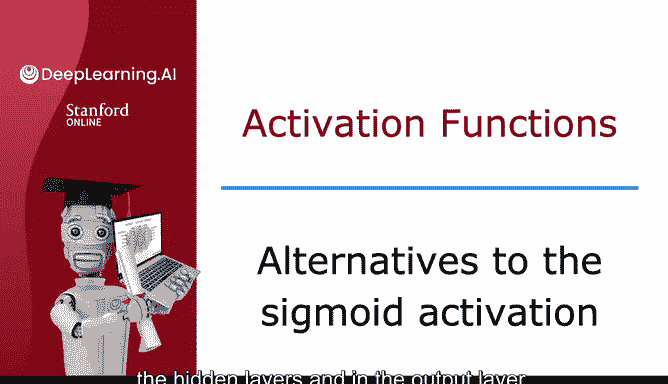
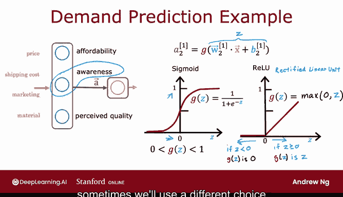
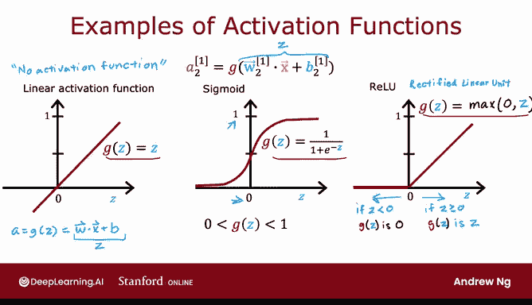

# 吴恩达《机器学习》｜machine-learning（中英字幕-deepseek翻译） - P62：20_02_01_Sigmoid激活函数的替代方案.zh_en - GPT中英字幕课程资源 - BV1MN4y1S7DE

So far， we've been using the sigmoid activation function in all the nose in the hidden layers and in the output layer。

And we had started that way because we were building up neural networks by taking logistic regression and creating a lot of logistic regression units and stringing them together。

But if you use other activation functions， your neural network can become much more powerful。

 Let's take a look at how to do that。 recall the demand prediction example from last week where given price shipping cost marketing material。

 you would try to predict if something is highly affordable if that's good awareness and highpro quality and based on that try to predict is a top seller。

But this assumes that awareness is maybe binary， is either people are aware or they are not。

But it seems like the degree to which possible buyers are aware of the T-shirt you're selling may not be binary。

 they can be a little bit aware， somewhat aware， extremely aware or it could have gone completely viral。

 so rather than modeling awareness as a binary number。

01 that you try to estimate the probability of awareness or rather than modeling awareness is just a number between0 and1。

 maybe awareness should be any non-ne number because they can be any non- negative value of awareness going from zero up to very。

 very large numbers。So whereas previously we had used。

This equation to calculate the activation of that second hidden unit， estim matating awareness。

Where G was the sigoid function and thus goes between0 and1。

 if you want to allow a12 to potentially take on much larger positive values。

 we can instead swap in a different activation function。

It turns out that a very common choice of activation function in neural networks is this function。

 it looks like this。Because if z is this， then G of z。Is zero to the left？

And then it's this straight line 45 degrees to the right of0。

 and so when z is greater than or equal to0， G of z is just equal to z。

That is to the right half of this diagram。And the mathematical equation for this is G of z equals max of0 comma Z。

 Feel free to verify for yourself that max of0 comma Z results in this curve that。

I've drawn over here and if a12 is G of z for this value of z， then then a。

 the activation value can now take on0 or any non negative。Value。This activation function has a name。

 it goes by the name Relu with this funny capitalization。

 and Relu stands for again a somewhat arcane term， but it stands for a rectified linear unit don't worry too much about what rectified means and what linear unit means this was just the name that the authors had given to this particular activation function when they came up with it。

 but most people in deep learning， just say Relu to refer to this G of Z more generally you have a choice of what to use for G of Z and sometimes will use a different choice than the sigoid activation function。

Here are the most commonly used activation functions。 You saw the sigmoid activation function。

 G of Z equals the sigmoid function。 On the last slide。

 weve just looked at the relu or rectify linear unit。 G of Z equals max of0 comma Z。

 There's one other activation function， which is worth mentioning。

 which is called the linear activation function， which is just G of Z equals to Z。

 Sometimes if you use the linear activation function。

 people will say we're not using any activation function， because。

If a is G of Z where G of z equals z， then a is just equal to this W dot x plus B save。

 And so it's as if there was no G in there at all。 So when you are using this linear activation function。

 G of Z， sometimes people say， well we're not using any activation function， although in this class。

 I will refer to using the linear activation function rather than no activation function but if you hear someone else use that terminology。

 that's what they mean， it just refers to the linear activation function。

And these three are probably by far the most commonly used activation functions in neural networks Later this week we'll touch on the fourth one called the softftmax activation function。

 but with these activation functions you'd be able to build a rich variety of powerful neural networks So when building a neural network for each neuron do you want to use the sigma activation function or the re activation function or a linear activation function how do you choose between these different activation functions。

 let's take a look at that in the next video。

