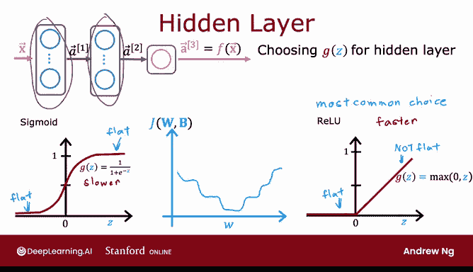
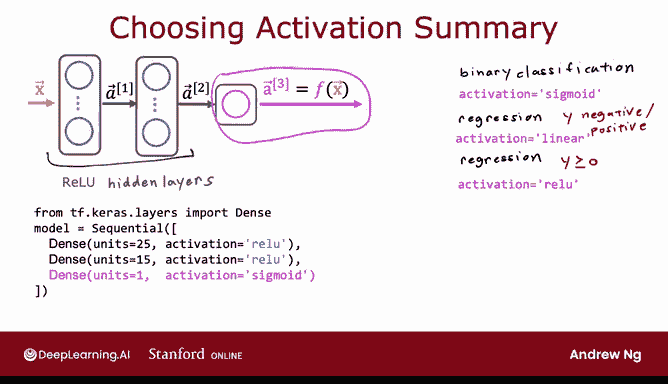

# 吴恩达《机器学习》｜machine-learning（中英字幕-deepseek翻译） - P63：21_02_02_选择激活函数.zh_en - GPT中英字幕课程资源 - BV1MN4y1S7DE

Let's take a look at how you can choose the activation function for different neurons in your neural network。

 we'll start to some guidance for how to choose it for the output layer。

 it turns out that depending on what the target label or the ground truth label wire is。

 there will be one fairly natural choice for the activation function for the output layer。

And we'll then go and look at the choice of the activation function also for the hidden layers of your neural network。

 Let's take a look。 You can choose different activation functions for different neurons in your neural network。

And when considering the activation function for the output layer。

 it turns out that there'll often be one fairly natural choice depending on what is the target of the ground truth label y specifically if you are working on a classification problem where y is either zero or1 so a binary classification problem。

 then the sigmoid activation function will almost always be the most natural choice。

 because then the neural network learns to predict the probability that y is equal to one just like we had for logistic regression so my recommendation is if you're working on a binary classification problem use sigmoid at the output layer。

Alternatively， if you're solving a regression problem。

 then you might choose a different activation function。For example。

 if you are trying to predict how tomorrow's stock price will change compared to today's stock price。

 well it can go up or down and so in this case y would be a number that can be either positive or negative and in that case I would recommend you use the linear activation function Why is that Well that's because then the output of your neural network F of x which is equal to a3 in the example above。

Would be G applied to Z3 and with the linear activation function。

G O Z can take on either positive or negative values。

 so y can be positive or negative use a linear activation function。And finally。

 if y can only take on non-neg values， such as if you're predicting the price of a house that can never be negative。

 then the most natural choice would the re activation function， because as you see here。

 this activation function only takes on non-neg values， either zero or positive values。

 so when choosing the activation function to use for your output layer。

 usually depending on what is the label Y you're trying to predict。

 there'll be one fairly natural choice。And in fact。

 the guidance on this slide is how I pretty much always choose my activation function as well for the output layer of a neural network。

How about the hidden layers of a neural network？It turns out that the Ra activation function is by far the most common choice in how neural networks are trained by many。

 many practitioners today。Even though we had initially described neural networks using the sigmoid activation function。

And in fact， in the early history of the development of neural networks。

 people use sigmoid activation functions in many places。

The field has evolved to use relu much more often and sickoids hardly ever。

What the one exception that you do use a sig and activation function in the output layer if you have a binary reclassification problem？

So why is that， well there are few reasons。First， if you compare the relu and the sigmoid activation functions。

 the relu is a bit faster to compute because it just requires computing max of0 comma Z。

 whereas a sigmoid requires taking an exponiation and an inverse and so on and so it's a little bit less efficient。

But the second reason， which turns out to be even more important。

 is that the rail loop function kind of goes flat only in one part of the graph here on the left is completely flat。

Whereas the sigmoid activation function， it kind of goes flat in two places， it goes flat。

To the left of the graph and it goes flat to the right of the graph。

And if you're using gradient descent to train a neural network。

 then when you have a function that is flat in a lot of places， gradient descent will be really slow。

I know that gradient descent optimizes the cost function J of WB rather than optimizes the activation function。

 but the activation function is a piece of what goes into computing。

 and there results in more places in the cost function J of WB that are flat as well and with a small gradients and it slows down learning。

 I know that that was just an intuitive explanation。

 but researchers have found that using the regular activation function can cause your neural network to learn a bit faster as well。

 which is why for most practitioners if you're trying to decide what activation function to use for an hidden layer。

The value activation function has become now by far， the most common choice。In fact。

 as I'm building a neural network， this is how I choose activation functions for the hidden layers as well。

So to summarize， here's what I recommend in terms of how you choose the activation functions for your neural network for the output layer。

 use a sigmoid if you have a binary classification problem。

 linear if y is a number that can take on positive or negative values or use revenue if y can take on only positive values or zero positive values or nonne values。

Then for the hidden layers。I would recommend just using Reou as a default。Actation function。

And in TensorFlow， this is how you would implement it。

Rather than saying activation equals sigmoid as we had previously。

 you can then for the hidden layers， that's the first hidden layer。

 the second hidden layer ask Tensorflow to use the relu activation function and then for the output layer in this example I've asked it to use the sigmoid activation function but if you wanted to use the linear activation function instead that's the syntax for it。

 or if you wanted to use the relu activation function that shows the syntax for it。

With this richer set of activation functions， you'd be well positioned to build much more powerful neural networks than just once using only the Sigmoid activation function。

By the way， if you look at the research literature。

 you sometimes hear of authors using even other activation functions such as the tananch activation function or the leaky Relu activation function or the Swis activation function。

Every few years， researchers sometimes come up with another interesting activation function。

 and sometimes they do work a little bit better。For example。

 I've used the leaky re activation function a few times in my work。

 and sometimes it works a little bit better than the re activation function you learned about in this video。

But I think for the most part， and for the vast majority of applications。

 what you learned about in this video would be good enough。Of course。

 if you want to learn more about other activation functions。

 feel free to look on the internet and there are just a small handful of cases where these other activation functions could be even more powerful as well。

With that， I hope you also enjoy practicing these ideas。

 these activation functions in the optional labs and in the practice labs。

But this raises yet another question， why do we even need activation functions at all。

 why don't we just use the linear activation function or use no activation function anywhere It turns out this does not work at all。

And in the next video， let's take a look at why that's the case and why activation functions are so important for getting your neural networks to work。

