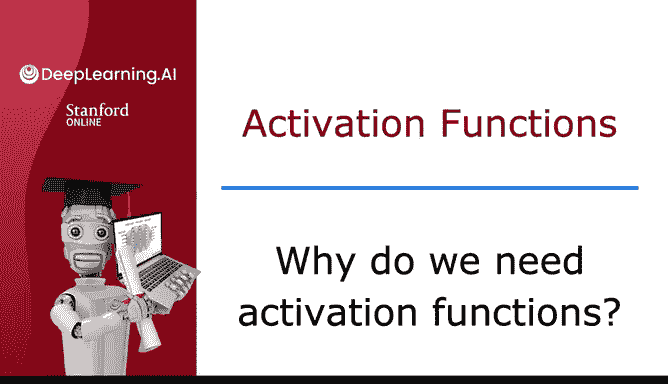
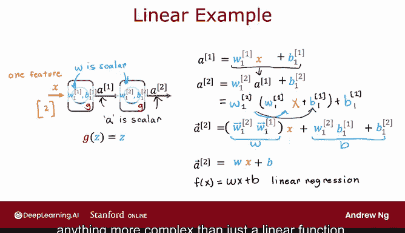
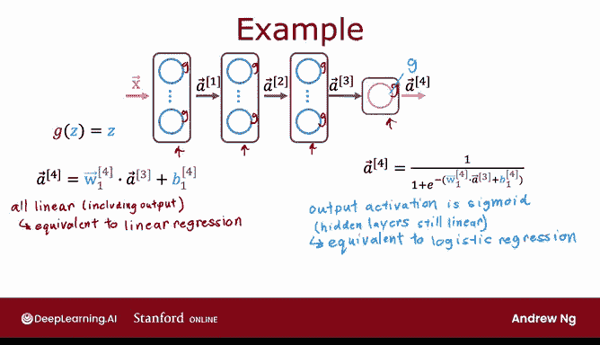

# 吴恩达《机器学习》｜machine-learning（中英字幕-deepseek翻译） - P64：22_02_03_为什么需要激活函数.zh_en - GPT中英字幕课程资源 - BV1MN4y1S7DE

Let's take a look at why neural networks need activation functions and why they just don't work if we were to use the linear activation function in every neuron in the neural network。

Recall this demand prediction example。What would happen if we were to use a linear activation function for all of the nodes in this neural network。

 it turns out that this big neural network will become no different than just linear regression and so this would defeat the entire purpose of using a neural network。

Because it would then just not be able to fit anything more complex than the linear regression model that we learned about in the first course。

Let's illustrate this with a simpler example。Let's look at the example of a neural network where the input x is just a number。

And we have one hidden unit。With parameters W1 and B1。That outputs a1， which is here just a number。

And then the second layer is the output layer， and it has also just one output unit with parameters W2 and B2。

 and that output is A2， which is also just a number， just a scalar。

 which is the outputed the neural your network F of x。

Let's see what this neural network would do if we were to use the linear activation function。

 G of z equals z everywhere。So to compute a1 as a function of x。

 the neural network would use a1 equals g of w1 times x plus B1， but G of z is equal to z。

 so this is just w1 times x plus B1。Then a2 is equal to W2 times a1 plus B2 because G of z equals z。

And let me take this expression for a1 and substitute it in there。

 So that becomes W2 times W1 X plus B1。Plus。B2。 and if we simplify this becomes W2。

 W1 times x plus W2。B1 plus。B2。And it turns out that if I were to set w equals w2 times w1 and set B equals this quantity over here。

 then what we've just shown is that a2 is equal to W X plus B。

 So a2 is just a linear function of the input X。And rather than using a neural network with one hidden layer and one output layer。

 we might as well have just used a linear regression model。If you're familiar with linear algebra。

 this result comes from the fact that a linear function of a linear function is itself a linear function。

 and this is why having multiple layers in the neural network doesn't let the neural network compute any more complex features or learn anything more complex than just a linear function。

So in the general case， if you had a neural network with multiple layers like this。

And say you were to use a linear activation function for all the hidden layers and also use a linear activation function for the output layer。

Then it turns out this model will compute an output that is completely equivalent to linear regression。

 the output A4 can be expressed as a linear function of the input features X plus B or alternatively if we were to still use a linear activation function for all the hidden layers for these three hidden layers here。

 but we were to use a logistic activation function for the output layer。

 then it turns out you can show that this model becomes equivalent to logistic regression and a4。

In this case can be expressed as1 over one plus e to negative Wx plus B for some values of W andB and so this big neural network doesn't do anything that you can't also do with logistic regression that's why a common rule thumb is don't use the linear activation function in the hidden layers of your neural network and in fact I recommend typically using the radio activation function should do just fine。

So that's why a neural network needs activation functions other than just the linear activation function everywhere。

So far， you've learned to build neural networks for binary reclassification problems where y is either 01。

 as well as for regression problems where y can take negative or positive values or maybe just positive and non negative values。

In the next video， I'd like to share with you a generalization of what you've seen so far for classification。

In particular， when y doesn't just take on two values but may take on three or four or10 or even more categorical values。

 let's take a look at how you can build a neural network for that type of classificationsec problem。

