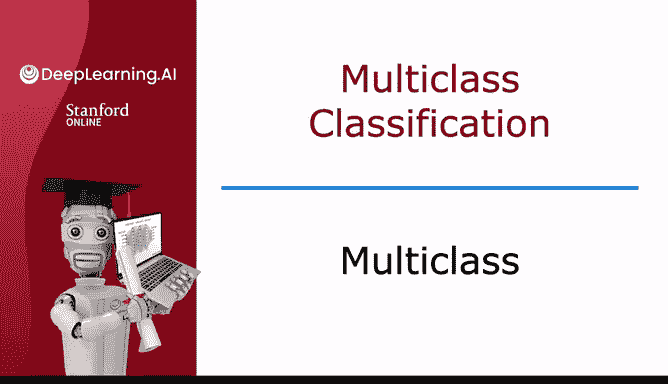
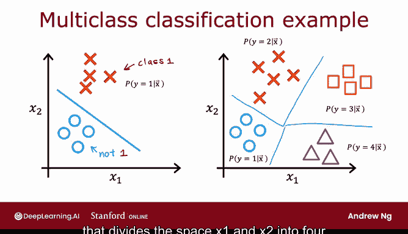

# 吴恩达《机器学习》｜machine-learning（中英字幕-deepseek翻译） - P65：23_02_01_多类别分类.zh_en - GPT中英字幕课程资源 - BV1MN4y1S7DE

Multiclass classification refers to classification problems where you can have more than just two possible output labels。

 so not just zero or one。Let's take a look at what that means for the handwritten digit classification problems we've looked at so far。

 we were just trying to distinguish between the handwritten digits0 and1。

But if you're trying to read pulseicles or zip codes on an envelope， well。

 there are actually 10 possible digits you might want to recognize。Or alternatively。

 in the first course， you saw the example if。If you're trying to classify whether patients may have any of three or five different possible diseases。

 that too would be a multiclass classification problem。

Or one thing I've worked on a lot is visual defect inspection of parts manufacture in the factory where you might look at a picture of a pill that a pharmaceutical company has manufactured and try to figure out does it have a scratch defect or discoloration defect or a chip defect and this would again be multiple classes or multiple different types of defects that you could classify this pole is having？

So a multiclass classification problem is still a classification problem in that y can take on only a small number of discrete categories is not any number。

 but now y can take on more than just two possible values。

So whereas previously for binary classification， you may have had a data set like this with features X1 and X2。

 in which case logistic regression would fit a model to estimate what's the probability of y being1 given the features x。

 because y was either01。With multiclass classification problems。

 you would instead have a data set that maybe looks like this。Where we have four clause。

 where the Os represent one class， the x's represent another class。

 the triangles represent the third class， and the squares represent a fourth class。

And instead of just estimating the chance of y being equal to one。

 we'll now want to estimate what's the chance that y is equal to one。

Or what's the chance that y is equal to  two？Or what's the chance of y is equal to 3 or the chance of y being equal to4？

And it turns out that the algorithm you learn about in the next video can learn a decision boundary that maybe looks like this that divides the space X1 and x2 into four categories rather than just two categories。

So that's the definition of the multi classification problem。

In the next video we'll look at the softmax regression algorithm。

 which is a generalization of the logistic regression algorithm and using that you' be able to carry out multiclass classification problems and after that we'll take softmax regression and fit it into a new neural network so that you also be able to train a neural network to carry out multiclass classification problems let's go on to the next video。

