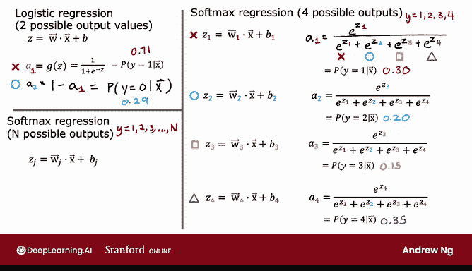
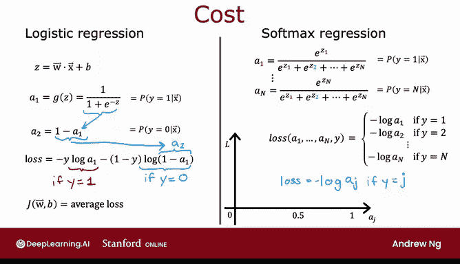

# 吴恩达《机器学习》｜machine-learning（中英字幕-deepseek翻译） - P66：24_02_02_Softmax函数.zh_en - GPT中英字幕课程资源 - BV1MN4y1S7DE

The softm regression algorithm is a generalization of logistic regression。

 which is a binary re classification algorithm。

To the multi class classification context， let's take a look at how it works recall that liter regression applies when y can take on two possible output values。

 either zero or one。And the way it computes output is you at first calculate z equals w dot product with x plus B。

And then you would compute what I'm going to call here， a equals G of z。

 which is a sigmoid function applied to z。And we interpreted this as logistic regressions estimate of the probability of y being equal to one。

 given those input features X。Now。Quick quiz question if the probability if y equals one is 0。71。

Then what is the probability that y is equal to zero？Well。

 the chance of y being to 1 and the chance of y being equal to 0。

 they've got to add up to1 right so if there's a 71% chance of it being1。

 there has to be a 29% or a 0。29 chance of it being equal to 0。

So to embellish logistic regression a little bit in order to set us up for the generalization to solve best regression。

 I'm going to think of logistic regression as actually computing two numbers。First a1。

 which is this quantity that we had previously of the chance of y being equal to 1 given x。

 and second， I'm going to think of logistic regression as also computing a2， which is1 minus this。

Which is just the chance of y being equal to zero。Given the input features X， and so A1 and A2。

 of course， have to add up to1。Let's now generalize this to softmax regression。

 and I'm going to do this with a concrete example of when y can take on four possible outputs so y can take on the values1。

2，3， or4。Here's what soft mass regression will do。It will compute Z1 as。W1 dot product of x plus B1。

 and then z2 equals w2 dot product of x plus B2 and so on for z3 and Z4 here， W1 W2 W3， W4。

 as well as B1， B2 B3 b4， these are the parameters of softmax regression。Next。

Here's the formula for soft mass regression。Well compute a1 equals E to the Z1 divided by E to the Z1 plus E to the Z2 plus e to the Z3 plus E to the Z4。

And a1 will be interpreted as the average estimate of the chance of y being equal to one given the input features x。

Then the formula for soft mass regression will compute a2 equals e to the z2 divided by the same denominator e to the z1 plus to the z2 plus e to z3 plus e to z4。

 and will interpret a2 as the averages estimate of the chance that y is equal to2。

 given name proious x。And similarly for a3， where here the numerator is now e to the z3 divided by the same denominator。

 that's the estimated chance of y being 3 and similarly a4 takes on this expression whereas on the left。

 we wrote down the specification for the logistic regression model。

These equations on the right are specification for the softmax regression model。

It has parameters w1 through W4 and B1 through B4。And if you can learn appropriate choices for all these parameters。

 then this gives you a way of predicting what's the chance of y being one，2， three， or4。

 given a set of input features X。Quick quiz， let's say you run soft regression on a new input X and you find that a1 is 0。

30， a2 is 0。20， a3 is 0。15。What do you think a4 will be。

 why don't you take a look at this quiz and see if you can figure out the right answer。

So you might have realized that because the chance of why taking on the values of one， two， three。

 or four， they have to add up to one。A4， the chance of y be over the 4 has to be 0。35。

 which is 1 minus。3 minus。2 minus。15。 So here I wrote down the formulas for softmax regression in the case of four possible outputs and let's now write down the formula for the general case for softmax regression In the general case y can take on n possible values。

 so y can be 123 and so on up to n In that case， softmax regression where compute Zj equals Wj dot product with x plus Bj where now the parameters of softmax regression are W1 W2 through WN as was B1 B2 through BN。

 and then finally a compute AJ。

Eals e to the Z J divided by sum from K equals1 to n of E to the Z sub K。

Well here I'm using another variable K to index the summation because here J refers to a specific fixed number like j equals 1 Aj is interpreted as the models estimate that y is equal to J given the input features X and notice that by construction of this formula if you add up a1 a2 all the way through AN。

 these numbers always will end up adding up to1。 So with specified how you would compute the softmax regression model and I won't prove it in this video。

 but it turns out that if you apply softmax regression with n equals2 So there are only two possible output classes。

 then softmax regression ends up computing basically the same thing as logistic regression the parameters end up being a little bit different。

 but it ends up reducing to a logistic regression model but that's why the softmax regression model is a generalization of which。

Sa regression。Having defined how softmax regression confuses outputs。

 let's now take a look at how to specify the cost function for softmax regression。

Recall for logistic regression， this is what we had， we said z is equal to this。

 and then I wrote earlier that a1 is G of z that was interpreted as a probability of y is 1。

 and we also wrote a2 is the probability that y is equal to clause  zero。So previously。

 we had written the loss of logistic regression as negative y log a1 minus1 minus y log 1 minus a1。

But1 minus a1 is also equal to just a2 because a2 is1 minus a1 according to this expression over here。

So I can rewrite or simplify the loss for the regression little bit to be negative y log a1 minus1 minus y log of a2。

And in other words， the loss if y is equal to one is negative log。A one。And if y is equal to zero。

 then the loss is。Negative log， a2。And then same as before。

 the cost function for all the parametersuns in the model is the average loss average over the entire training set。

So that was the cost function for this situation。Let's write down the cost function that is conventionally used for softmax regression。

Recall that these are the equations we use for softmax regression。

The loss we're going to use for softmax regression is just this。

 the loss for if the algorithm outputs A1 through AN。And the ground truth label is why is。

If Michaels 1， the loss is negative log A1 says negative log of the probability that it thought。

Why was equal to one？Or if y is equal to 2， then the loss I'm going to define I'm going to define as negative log a2。

 so y is equal to 2， the loss of the algorithm on this example is negative log of the probability it thought y was equal to 2 and so on all the way down to if y is equal to n。

 then the loss is negative log of A N。And to illustrate what this is doing， if y is equal to J。

 then the loss is negative log of AJ， and that's what this function looks like。

Nectative log of AJ is a curve that looks like this， and so if AJ was very close to one。

Then you be on this part of the curve and the loss may be very small。But if it thought。

 say AJ had only a 50% chance， then the loss gets a little bit bigger and the smaller AJ is the bigger the loss。

 And so this incentivizes the algorithm to make AJ as large as possible as close the one as possible because whatever the actual value Y was you want the algorithm to say hopefully that the chance of why being that value was pretty large。

 noticeice that in this loss function。W in each training example can take on only one value and so you end up computing this negative log of AJ only for one value of AJ。

 which is whatever was the actual value of y equals J in that particular training example。

 For example， if y was equal to2， you end up computing negative log of a2。

 but not any of the other negative log of a1 or the other terms here So that's the form of the model。

 as well as the cost function for softm regression， and if you were to train this model。

 you can start to build multiclass classification algorithms and what we like to do next is take this softm regression model and fit it into a neural network so that you better do something even better which is to train a neural network the multico classification let's go do that in the next video。

