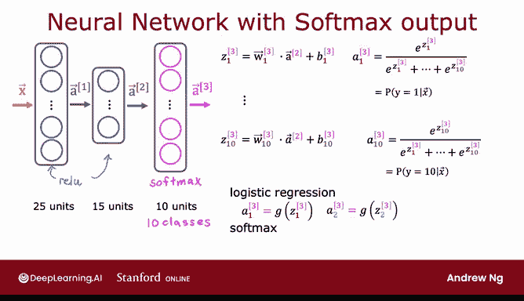
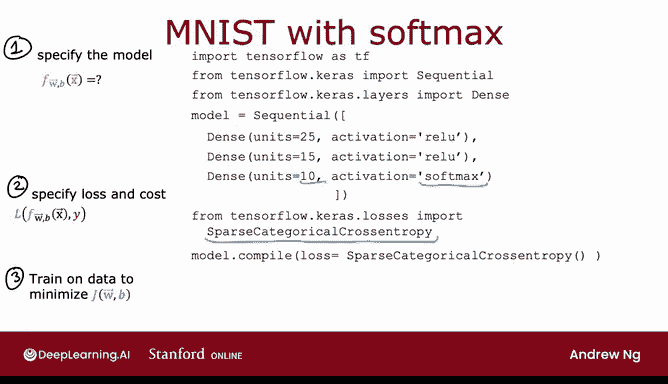

# 吴恩达《机器学习》｜machine-learning（中英字幕-deepseek翻译） - P67：25_02_03_具有Softmax输出的神经网络.zh_en - GPT中英字幕课程资源 - BV1MN4y1S7DE

In order to build a neural network that can carry out multiclass classification。

 we're going to take the softmax regression model and put it into essentially the output layer of a neural network let's take a look at how to do that previously when we were doing handwritten digit recognition with just two clause we used a neural network with this architecture。

If you now want to do Hamiltonwritten digit classification with 10。Classes。

 all the digits from zero to9， then we're going to change this neural network to have 10 output units like so。

And this new output layer will be a softmax output layer。

 So sometimes we'll say this neural network has a softmax output or that this output layer is a softmax layer。

And the way forward propagation works in this neural network is given a input X。

 a1 gets computed exactly the same as before， and then a2。

 the activations for the second hidden layer also get computed exactly the same as before。

And we now have to compute the activations for this output layer。That is a3。This is how it works。

If you have 10 of causes we will compute Z1 Z2 through Z10 using these expressions。

 so this is actually very similar to what we had previously for the formula you were used to compute Z Z1 is w1 dot product with a2 the activations from the previous layer plus B1 and so on for Z1 through Z10 then a1 is equal to E to the Z1 divided by E to the Z1 plus dot dot dot plus up to E to the Z10 and that's our estimate of the chance that y is equal to1。

And similarly， for a2 and similarly， all the way up to a10。

And so this gives you your estimates of the chance of y being equal the1，2。

 and so on up through the 10th possible label for Y。And just for completeness。

 if you want to indicate that these are the quantities associatedsociative of layer 3， technically。

 I should add these superscript3s there， it does make the notation a little bit more cluttered。

 but this makes explicit that this is， for example， the Z31 value， and this is the。

Pmmeterters associated with the first unit of layer 3 of this neural network。And with this。

 your softm Op layer now gives you estimates of the chance of wiping any of these 10 possible output labels。

I do want to mention that the softmax layer will sometimes also call the softmax activation function。

 it is a little bit unusual in one respect compared to the other activation functions we've seen so far like sigmoid Ra and linear。

 which is that when we're looking at sigoidoid or Ra or linear activation functions。

 a1 was a function of Z1。And A2 was a function of Z2 and only Z2 In other words。

 to obtain the activation values， we could apply the activation function G。

 be it sigmoid or R or something else， element wise to Z1 and Z2 and so on to get a1 and A2 and A3 and A4。

But with the softmax activation function， notice that a1 is a function of Z1 and Z2 and Z3 all the way up to Z10。

 so each of these activation values depends on all of the values of Z and this is a property that's a bit unique to the softmax output or the softmax activation function or stated it differently if you want to compute a1 through a10。

That is a function of Z1 all the way up to Z10 simultaneously。

And this is unlike the other activation functions we've seen so far。 Finally。

 let's look at how you would implement this in Tensor though。

If you want to implement the neural network that I've shown here on this slide。

This is the code to do so。Similar as before， there are three steps to specifying and training a model The first step is to tell Tensorflow to sequentially string together three layers First layer is this 25 units with value activation function。

 second layer 15 units with re activation function。

 the third layer because there are now 10 output units you want to output a1 through a10 so they're now 10 output units and willll tell Tensorflowlow to use the softm activation function。

And the cost function that you saw in the last video。

TenssorFlow calls that dis spae categorical cross entropy function。

So I know this name is a bit of a mouthful。Whereas for logistic regression。

 we had the binary cross entropy function here we're using the sparse categor cross enpy function and what spae categorical refers to is that you're still classifying y into categories so it's categorical takes on values from one to10 and spae refers to that y can only take on one of these 10 values。

 so each image is either0 or one or two or so on up to9。

 you're not going to see a picture that is simultaneously the number two and the number7。

 So sparse refers to that each dig is only one of these categories。

 but so that's why the loss function that you saw in the loss video is called intensive of the sparse categorical cross entropy loss function。

And then the code if we training them model is just the same as the。

And if you use this code， you can train a neural network on a multiclass classification problem。

Just one important note， if you use this code exactly as I've written here。

 it will work but don't actually use this code because it turns out that in Tensorflowlow there's a better version of the code that makes Tensorflow work better so even though the code shown in this slide works don't use this code the way I've written it here because in a later video this week you see a different version there's actually the recommended version of implementing this that will work better but we'll take a look at that in a later video。

So now you know how to train a neural network with a softmax Op layer with one caveat There's a different version of the code that would make TensorF able to compute these probabilities much more accurately Let's take a look at that in the next video which will also show you the actual code that I recommend you use if you're training a softmax neural network Let's go on to the next video。

