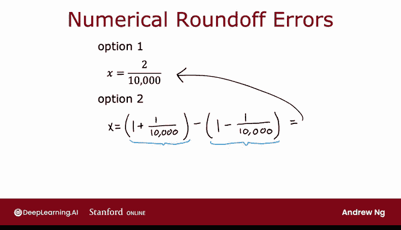
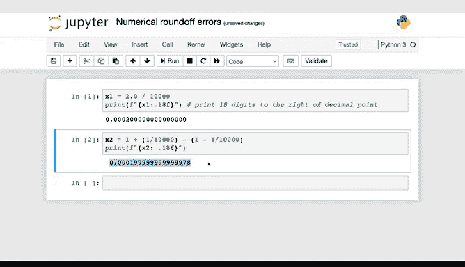
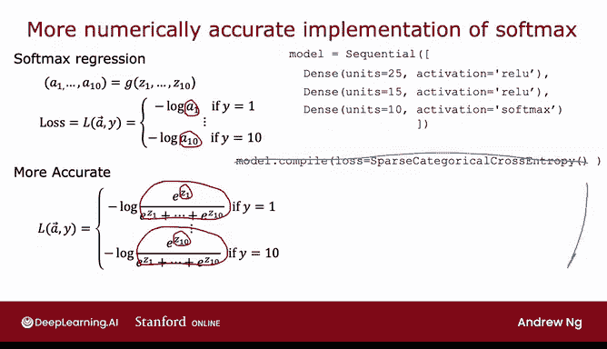
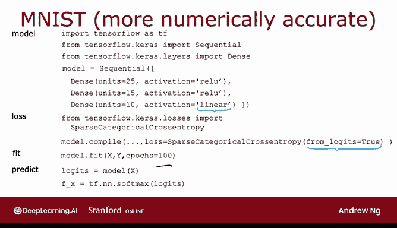
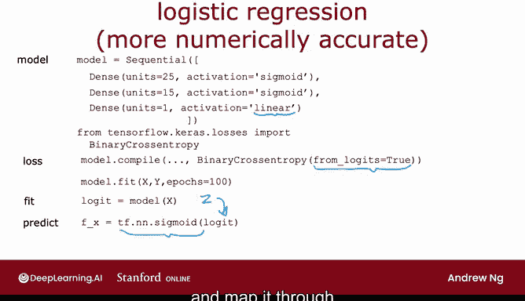

# 吴恩达《机器学习》｜machine-learning（中英字幕-deepseek翻译） - P68：26_02_04_Softmax的改进实现.zh_en - GPT中英字幕课程资源 - BV1MN4y1S7DE

The implementation that you saw in the last video of a neural network with a softmax layer will work OK。

 but there's an even better way to implement it let's take a look at what can go wrong with that implementation and also how to make it better。

Let me show you two different ways of computing the same quantity in a computer。Option one。

 we can set x equals to2 over 10，000， option 2。We can set x equals 1 plus1 over 10。

000 minus1 minus1 over。10，000， I wish you first compute this and then compute this and you take the difference and if you simplify this expression。

 this turns out to be equal to two over。1000 let me illustrate this in this notebook so first let's set x equals2 over 10000 and print a result to a lot of decimal points of accuracy Okay。

 that looks pretty good。

Second， let me set x equals， I'm going to insist on computing1 over 1 plus 10，000。

 and then subtract from that one minus1 over 10，000， and let's print that out。And oh， okay。

 just looks a little bit off as if there's some roundoff error because a computer has only a finite amount of memory to store each number called a floatinging point number in this case。

Depending on how you decide to compute the value to over 10，000。

 the result can have more or less numerical roundoff error。

And it turns out that while the way we have been computing the cost function for Somax is correct。

 there's a different way of formulating it that reduces these numerical roundoff errors leading to more accurate computations within Tensorflow Let me first explain this a little bit more detail using logistic regression and then we will show how these ideas apply to improving our implementation of Somax。

 So first let me illustrate these ideas using logistic regression and then we'll move on to show how to improve your implementation of Somax as well。

Recall that for logistic regression， if you want to compute the loss function， for give an example。

 you would first compute this output activation A， which is G of Z or1 over 1 plus e's negative z。

And then you compute the loss using。This expression over here。And， in fact， this is。

What the code would look like for a logistic upper layer with this binary cross entropy loss and for logistic regression。

 this works okay and usually the numerical roundoff errors aren't that bad。

But it turns out that if you allow Tensorflow to not have to compute a as an intermediate term。

But instead， if you tell TensorF that the loss is this expression down here。

 and allve done is I've taken a and expanded it。Into this expression down here。

Then Tensorflow can rearrange terms in this expression and come up with a more numerically accurate way to compute this loss function。

And so whereas the original procedure was like existing on computing as an intermediate value。

 1 plus 1 over 10，000 and another intermediate value，1 minus 1 over 10。

000 and then manipulating these two to get two over 10，000。

 this original implementation was insist on explicitly computing a as an intermediate quantity。

But instead， by specifying this expression at the bottom directly as a loss function。

 it gives Tensorflow more flexibility in terms of how to compute this and whether or not it wants to compute a explicitly and so。

The code you can use to do this， is shown here。 And what this does is it。

Seets the output layer to just use a linear activation function and it puts both the activation function one over1 plus e negative z as well as this crossenttropy loss into the specification of the loss function over here and that's what this from logs equals true argument causes Tensorflow to do and in case you're wondering what the logs are is basically this number Z so Tensorflow will compute Z as a intermediate value but it can rearrange terms to become compute more accurately one downside of this code is it becomes a little bit less legible but this causes Tensorflow to have a little bit less numerical roundoff error Now in the case of logistic regression。

 either of these implementations actually works okay but the numerical roundoff errors can get worse when it comes to softmax now。

Let's take this idea and apply it to softm regression recall what you saw in the last video was you compute the activations as follows。

 the activations is G of Z1 through Z10， where a1 for example。

 is e to the Z1 divided by the sum of the E to the Z Js。And then the loss was this。

 depending on what is the actual value of y this negative log of AJ for one of the AJs。

And so this was the code that we had to do this computation in two separate steps。But once again。

 if you instead specify that the loss is if y is equal to one is negative log of this formula and so on。

 if y is equal to 10 is。This formula。Then。This gives TensorFlow the ability to rearrange terms and compute this in a more numerically accurate way。

Just to give you some intuition for why Tensorflow might want to do this。

 it turns out if one of the Z is very small， then E to a negative small number becomes very。

 very small， or if one of the is a very large number， then E to the Z can become a very。

 very large number。And by rearranging terms， Tensorflow can avoid some of these very small or very large numbers and therefore come up with a more accurate computation for the loss function。

So the code for doing this is shown here in the output layer。

 we're now just using a linear activation function， so the output layer just computes Z1 through Z10。

And。😊，This whole computation of the loss is then captured in the loss function over here。

 where again we have the ferlogs equals true parameter。So once again。

 these two pieces of code do pretty much the same thing except that the version that is recommended。

Is more numerically accurate， although unfortunately it is a little bit harder to read as well so if you're reading someone else's code and you see this and you wonder what's going on is actually equivalent to the original implementation at least in concept except that is more numerically accurate the numerical roundoff errors for logistic regression aren't that bad。

 but it is recommended that you use this implementation down at the bottom instead。And conceptually。

 this code does the same thing as the first version that you had previously。

 except that it is a little bit more numerically accurate。

Although the downside is maybe just a little bit harder to interpret as well。

Now there's just one more detail， which is that we've now changed the neural network to use a linear activation function rather than a softmax activation function。

 and so the neural network's final layer no longer outputs these probabilities A1 through A10。

 it is instead outputting Z1 through Z10。

And I didn't talk about it in the case of logistic regression。

 but if you were combining the output logistic function with the loss function。

 then for logistic regression， you also have to change the code this way to take the output value and map it through the logistic function in order to actually get the probability。

So you now know how to do multiclass classification with a soft max output layer and also how to do it in a numerically stable way。

Before wrapping up multiclass classification， I want to share with you one other type of classification problem called a multila classification problem let's talk about that in the next video。

