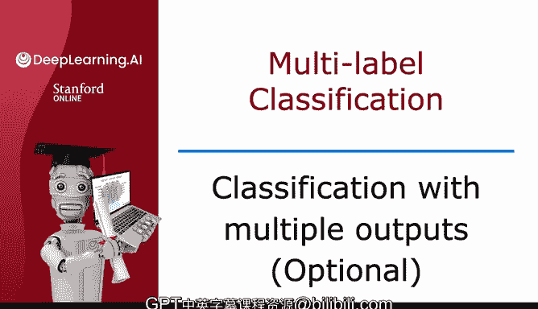
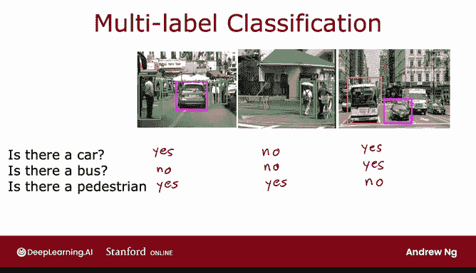
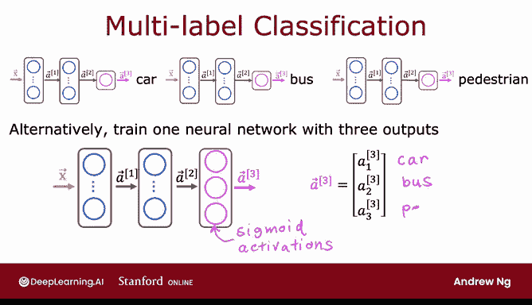

# 吴恩达《机器学习》｜machine-learning（中英字幕-deepseek翻译） - P69：27_02_05_多输出分类（可选）.zh_en - GPT中英字幕课程资源 - BV1MN4y1S7DE

You've learned about multiclass classification where the output label Y can be any one of two or potentially many more than two possible categories There's a different type of classification problem called a multilabel classification problem which is where associated with each image they could be multiple labels。

 let me show you what I mean by that If you're building a self driving car or maybe a driver assistance system then given a picture of what's in front of your car you may want to ask a question like is there a car or at least one car or is there a bus or is there a pedestrian or are there any pedestrians。

So in this case， there is a car， there is no bus， and there is at least one pedestrian。

 or in this second image， no cars， no buses and yes to pedestrians， and yes car， yes bus。

 and no pedestrians。So these are examples of multi label classification problems because associated with a single input。

 image X are three different labels。

Corresponding to whether or not during any calls buses or pedestrians in the image。So in this case。

 the target of the Y is actually a vector of three numbers。

 and this is as distinct from multiclass classification where for say heritagewritten and digit classification。

 y was just a single number， even if that number could take on 10 different possible values。

So how do you build a neural network for multila classification？

One way to go about it is to just treat this as three completely separate machine there are any problems you could build one neural network to decide are there any cars。

 a second one to detect buses and the third one to detect pedestrians and that's actually not an unreasonable approach here's the first neural network to detect cars。

 second one to detect buses， third one to detect pedestrians。But there's another way to do this。

 which is to train a single neural network to simultaneously detect all three of cars。

 buses and pedestrians。Which is if your neural network architecture looks like this。

 let you input X first hidden layer outputs a1， second hidden layer outputs a2。

 and then the final output layer in this case will have three output neurons and will output a3。

 which is going to be a vector of three numbers。And because we're solving three binary classification problems。

 so is there a car as robust as a pedestrian， you can use a sigmoid activation function for each of these three nodes in the upper layer。

 and so A3 in this case will be A31， A32 and A33 corresponding to whether or not the learning algorithm thinks is a car and robust and or pedestrians in the image。

So multiclass classification and multilabel classification are sometimes confused with each other。

 and that's why in this video I want to share with you just a definition of multilabel classification problems as well so that depending on your application。

 you could choose the right one for the job you want to do。So that's it for multila classification。

I find that sometimes multiclass classification and multilabel classification are confused with each other。

 which is why I wanted to explicitly in this video share with you what is multilabel classification so that depending on your application。

 you can choose to write to for the job that you want to do and that wraps up the section on multiclass and multilabel classification。

In the next video， we'll start to look at some more advanced neural network concepts。

 including an optimization algorithm that is even better than gradient descent so let's take a look at that algorithm in the next video because it'll help you to get your learning algorithms to learn much faster so let's go on to the next video。

