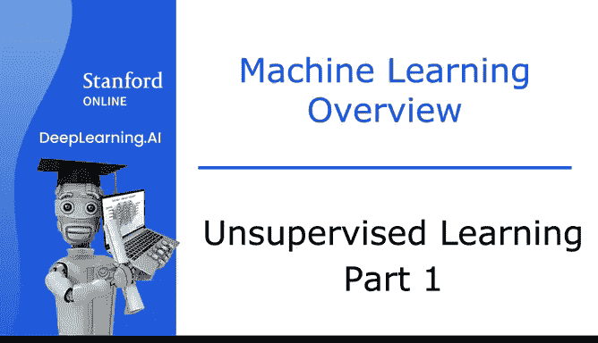
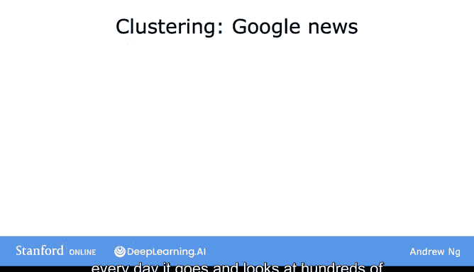
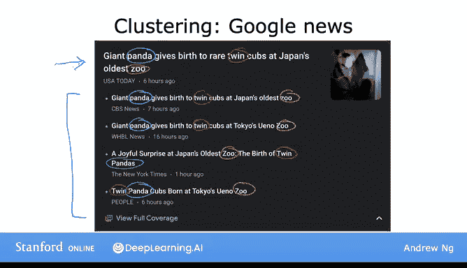
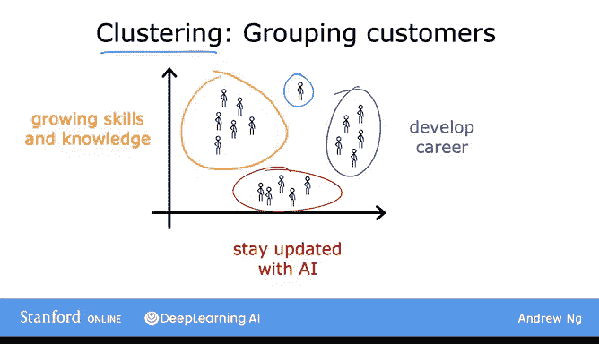

# 吴恩达《机器学习》｜machine-learning（中英字幕-deepseek翻译） - P6：06_01_04_无监督学习第一部分.zh_en - GPT中英字幕课程资源 - BV1MN4y1S7DE

After supervised learning， the most widely used form of machine learning is unsupervised learning。

 let's take a look at what that means。We've talked about supervised learning and this video is about unsupervised learning。

 but don't let the name unsupervised fool you unsupervised learning is I think just as super as supervised learning。

When we're looking at supervised learning in the last video， recall that looks something like this。

 in the case of a classification problem， each example was associated with an output label Y。

 such as benign or malignant designated by the Os and crosses。In unsupervised learning。

 we're given data that isn't associated with any output labels Y。

Say you're given data on patients and their tumor size and the patient's age。

 but not whether the tumor was benign or malignant。So the data looks like this on the right。

Were not asked to diagnose whether the tumor。Is benign or malignant？

Because we're not given any labels Y in the data set。 Instead。

 our job is to find some structure or some pattern or just find something interesting in the data。

 This is unsupervised learning。 We call it unsupervised because we're not trying to supervise the algorithm room to give some quote right answer for every input。

Instead， we asked the algorithm room to figure out all by yourself what's interesting or what patterns or structures there might be in this data。

With this particular data， an unsupervised learning algorithm might decide that the data can be assigned to two different groups or two different clusters。

And so it might decide that there's one cluster。Or group over here。

And there's another cluster or group over here。This is a particular type of unsupervised learning called a clustering algorithm because it places the unlabeled data into different clusters。

And this turns out to be used in many applications。For example， clustering is used in Google news。

 What Google News does is every day it goes and looks at hundreds of thousands of news articles on the internet and groups related stories together。

 For example， here's a sample from Google New where the headline of the top article is giant Pada gives birth to real twin Cubs at Japan's older zoo。

 This article had actually caught my eye because my daughter loves pandas and so their lot of stuff panda toys and watching of Pada videos in my house。

 and looking at this you might notice that below this are other related articles。

Maybe from the headlines alone， you can start to guess what clustering might be doing。

Notice that the wordpada appears here。Here， here， here and here。

And notice that the word twin also appears in all five articles。

And the word zoo also appears in all of these articles。

So the clustering algorithm is finding articles， all of all the hundreds of thousands of news articles on the internet that day。

Finding the articles that mention similar words and grouping them into clusters。Now。

 what's cool is that this clustering algorithm figures out on his own。

 which words suggest that certain articles are in the same group。

 What I mean is there isn't an employee at Google News who is telling the algorithm to find articles that the word panda and twins and zoo to put them into the same cluster。

 The news topics change every day。 and there are so many news stories。

 It just isn't feasible to people doing this every single day for all the topics the news covers。

 Instead， the algorithm has to figure out on his own without supervision what are the clusters of news articles today。

 So that's why this clustering algorithm is a type of unsupervised learning algorithm。😊。

Let's look at the second example of unsupervised learning applied to clustering genetic or DNA data。

This image shows a picture of DNA microarray data These look like tiny grids of a spreadsheet and each tiny column represents the genetic or DNA activity of one person。

 so for example， this entire column here is from one person's DNA and this other column is of another person。

 Each row represents a particular gene， so just as an example。

 perhaps this row here might represent a gene that affects eye color。

Or this row here is a gene that affects how tall someone is。

Researchers have even found a genetic link to whether someone dislikes certain vegetables。

 such as broccoli or Bruss sps or asparagus。So next time someone asks you。

 why didn't you finish a salad， you can tell them， oh， maybe it's genetic。For DNA microarrays。

 the idea is to measure how much certain genes are expressed for each individual person。

 so these colors， red， green， gray， and so on show the degree to which different individuals do or do not have a specific gene active。

And what you can do is then run a clustering algorithm to group individuals into different categories or different types of people。

 like maybe these individuals are grouped together， and let's just call this type1。

And these people are grouped into type two， and these people are grouped。As type 3。

 this is unsupervised learning because we're not telling the algorithm in advance that there is a type 1 person with certain characteristics or a type 2 person with certain characteristics instead what we're saying is here's a bunch of data。

 I don't know where the different types of people are。

 but can you automatically find structure into data and automatically figure out whether are the major types of individuals since we're not giving the algorithm the right answer for the examples in advance。

 this is unsupervised learning。Here's a third example。

Many companies have huge databases of customer information。Given this data。

 can you automatically group your customers into different market segments so that you can more efficiently serve your customers？

Conretely， the Deep learningning。 AI team did some research to better understand the deep learningning AI community and why different individuals take these classes。

 subscribe to the batchch weekly newsletter， or attend our Pone AI events。

Let's visualize the deep learning of AI community as this collection of people running clustering that is market segmentation。

Found a few distinct groups of individuals。One group's primary motivation is seeking knowledge to grow their skills Perhaps this is you and so that's great a second group's primary motivation is looking for a way to develop their career。

 maybe you want to get a promotion or a new job or makes on career progression if this describes you that's great too。

 and yet another group wants to stay updated on how AI impacts their field of work。

Perhaps this is you that's great too This is a cluster that our team use to try to better serve our community as we're trying to figure out what are the major categories of learners in the deep and Daan community。

So if any of these is your top motivation for learning。

 that're straight and I hope I'll be able to help you on your journey or in case this is you and you want something totally different than the other three categories。

 that's fine too and I want you to know I love you all the same。

So to summarize a clustering algorithm， which is type of unsupervised learning algorithm。

 takes data without labels and tries to automatically group them into clusters。

 and so maybe the next time you see or think of a panda maybe you think of clustering as well。

And besides clustering， there are other types of unsuitupvised learning as well。

 let's go on to the next video to take a look at some other types of unsupvised learning algorithms。

