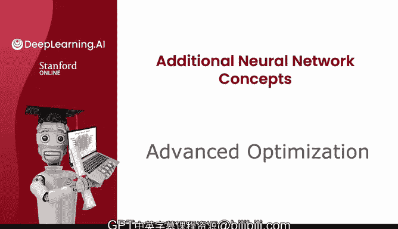
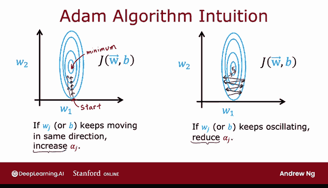
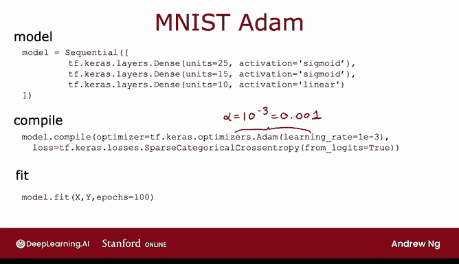

# 吴恩达《机器学习》｜machine-learning（中英字幕-deepseek翻译） - P70：28_02_01_高级优化.zh_en - GPT中英字幕课程资源 - BV1MN4y1S7DE

Creating Descent is an optimization algorithm that is widely used in machine learning and was the foundation of many algorithms like linear regression and logistic regression and early implementations of neural networks。

But it turns out that there are now some other optimization algorithms for minimizing the cost function that are even better than gradient descent In this video we'll take a look at an algorithm that can help you train your neural network much faster than gradient descent recall that this is the expression for one step of gradient descent a parameter Wj is updated as Wj minus the learning rate alpha times this partial derivative term。

How can we make this work even better？In this example。

 I plotted the cost function J using a contour plot comprising these ellipses。

 and so the minimum of this cost function is at the center of these ellipses down here。Now。

 if you were to start gradient descent down here， one step of gradient descent。

 if alpha is small may take you a little bit in that direction， then another step， then another step。

 then another step， then another step and you notice that every single step of gradient descent is pretty much going in the same direction and if you see this degree be the case。

 you might wonder well one't we make alpha bigger， can we have an algorithm to automatically increase alpha。

 they just make it take bigger steps and get to the minimum faster。There's an algorithm。

callled the atom algorithm that can do that if it sees that the learning rate is too small and we are just taking tiny little steps in a similar direction over and over。

 which should just make the learning rate healthier bigger。In contrast。

 here again is the same cost function if we were starting here and had a relatively big learning rate alpha。

 then maybe one step of gradient descent takes us here and the second step takes us here。

 third step and a fourth step and a fifth step and a sixth step and if you see gradient descent doing this is's oscillating back and forth。

 you'd be tempted to say well why don't we make the learning rate smaller and the atom album can also do that automatically and with a smaller learning rate。

 you can then take a more smooth path toward the minimum of the cost function。

So depending on how gradient descent is proceeding。

 sometimes you wish you had a bigger learning rate alpha and sometimes you wish you had a smaller learning rate alpha。

So the Adam algorithm can adjust the learning rate automatically Adam stands for adaptive moment estimation。

Or ADAM， and don't worry too much about what this name means。

 it's just what the authors had called this algorithm。But interestingly。

 the Adamom algorithm doesn't use a single global learning rate alpha。

 it uses a different learning rate for every single parameter of your model。

 so if you have parameters W1 through W10 as was B， then it actually has 11 learning rate parameters。

 Alpha 1 alpha2 all the way through Alpha 10。For W1 through W 10。

 as well I'll call Al 11 for the parameter B。And the intuition behind the atom algorithm is if a parameter WJ orB seems to keep on moving in roughly the same direction。

 this is what we saw on the first example on the previous slide。

 but if it seems to keep on moving in roughly the same direction。

 let's increase the learning rate for that parameter， let's go faster in that direction。Conversely。

 if a parameter keeps oscillating back and forth， this is what you saw in the second example on the previous slide。

 then let's not have it keep on oscillating or bouncing back and forth。

 let's reduce alpha J for that parameter a little bit。

The details of how Adam does this are a bit complicated and beyond the scope of this course。

 but if you take some more advanced deep learning classes later。

 you may learn more about the details of this Adam algorithm。

 but in code this is how you would implement it The model is exactly the same as before。

And the way you compile the model is very similar to what we had before。

 except that we now add one extra argument to the compile function。

 which is that we specify that the optimizer you want to use is Tf do carriesis do optimizes do the Adam optimizer。

 So the Adam optimization algorithm does need some default initial learning rate alpha。

 and in this example I've set that initial learning rate to be。10 to the negative three。

 but when you're using the Adam algorithm in practice it's worth trying a few values for this initial this default global learning rate。

 try some large and some smaller values to see what gives you the fastest learning performance。

Compared to the original gradient descent algorithm that you had learned in the previous course。

 though， the Adam algorithm， because you can adapt the learning rate a bit automatically。

 it is more robust to the exact choice of learning rate that you pick。

 though it is still worth tuning this parameter a little bit to see if you can get somewhat faster learning。

So that's it for the Adamom optimization algorithm。

 it typically works much faster than gradient descent and it become a de facto stand in how practitioners train their neural networks。

 so if you're trying to decide what learning algorithm to use。

 what optimization algorithm to use to train your neural network a safe choice would be to just use the atom optimization algorithm。

And most practitioners today will use Adamom rather than the original gradient tocent algorithm。

And with this， I hope that your learning algorithm rooms will be able to learn much more quickly。Now。

 in the next couple videos， I'd like to touch on some more advanced concepts for neural networks and in particular in the next video。

 let's take a look at some alternative layer types。

