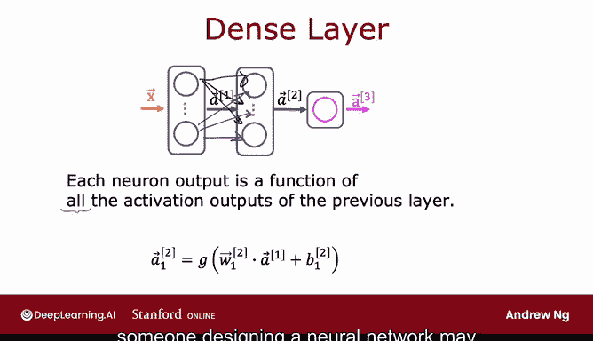
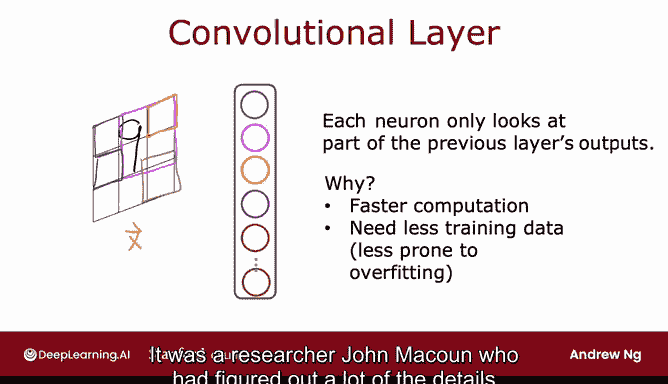
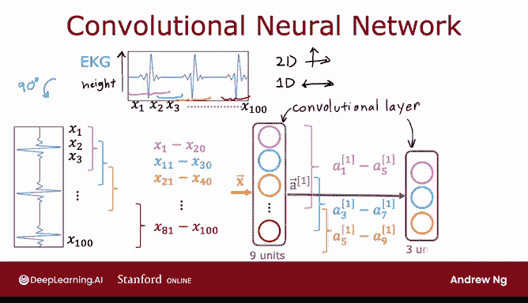

# 吴恩达《机器学习》｜machine-learning（中英字幕-deepseek翻译） - P71：29_02_02_其他层类型.zh_en - GPT中英字幕课程资源 - BV1MN4y1S7DE

All the neural network layers weve used so far have been the dense layer type in which every neuron in a layer gets access inputs all the activations from the previous layer。

 and it turns out that just using the dense layer type。

 you can actually build some pretty powerful learning algorithms。

And to help you build further intuition about what neural networks can do。

 it turns out that there's some other types of layers as well with other properties。In this video。

 I'd like to briefly touch on this and give you an example of a different type of neural network layer。

 let's take a look to recap。In the dense layer that we've been using， the activation of a neuron in。

 say， the second hidden layer。Is a function of every single activation value from the previous layer of a1。

 but it turns out that for some applications。Someone designing a neural network may choose to use a different type of layer。

One other layer type that you may see in some work is called a convolutional layer。

Let me illustrate this with an example， so what I'm showing on the left is the input X。

 which is a handwritten digit9。And what I'm going to do is construct a hidden layer。

 which will compute different activations as functions of this input image X。

But here's something I can do。For the first hidden unit， which I've drawn in blue。

 rather than saying this neuron can look at all the pixels in this image。

 I might say this neuron can only look at the pixels in this little rectangular region。

 Second neuron， which I'm going to illustrate in magenta is also not going to look at the entire input image Act instead is only going to look at the pixels in a limited region of the image and so on for the third neuron。

And the fourth neuron。And so on and so forth。Down to the last neuron。

 which maybe looks only at that region of the image。So why might you want to do this。

 why won't you let every neuron look at all the pixels， but instead look at only some of the pixels。

Well， some of the benefits are， first it speeds up computation。

And second advantage is that a neural network that uses digital type layer called a convolutional layer can need less training data。

 or alternatively it can also be less prone to overfitting you'd heard me talk a bit about overfitting in their previous course。

 but this is something that will dive into greater detail on next week as well when we talk about practical tips for using learning algorithms。

And this preferred type of layer， where each neuron only looks at a region。

Of the input image is called a convolutional layer。It was a researcher Y Le Kun。

 who had figured out a lot of the details of how to get convolutionly as to work and popularize their use。

Let me illustrate in more detail， a convolutional layer。

And if you have multiple convolutional layers in a neural network。

 sometimes that's called a convolutional neural network。

To illustrate the convolutional layer or convolutional neural network on this slide I'm going to use instead of a 2D image input。

 I'm going to use a onedimenal input and the motivating example I'm going to use is classification of EKG signals or electrocardiograms So if you put two electrodes on your chest。

 you will record voltages that look like this that correspond to your heartbeat This is actually something that my Stanford research group did research on we're actually reading EKG signals that actually look like this to try to diagnose if a patient may have a heart issue。

So an EKG signal， an electrocardiogram， ECG in some places， EKG in some places。

 is just a list of numbers corresponding to the height of this surface at different points in time。

 so you may have， say 100 numbers corresponding to the height of this curve at 100 different points of time。

And the learning tasks， given this time series， given this EKG signal， to classify。

 say whether this patient has a heart disease or some diagnosable heart condition。

 here's what the convolution neural network might do。

So I'm going to take the EKG signal and rotate it 90 degrees to it on the side。

 and so we have here 100 inputs x1， x2 all the way through x100 like so。And。

When I construct the first hidden layer。Instead of having the first hidden unit take a input all 100 numbers。

 let me have the first hidden unit look at only x1 through x20。

 so that corresponds to looking at just a small window of this EKG signal。

The second hidden unit shown in a different color here will look at x 11 through x30。

 so it looks at a different window in this EKG signal and the third hidden there looks at another window x21 through x40 and so on。

 and the final hidden unit in this example。We'll look at x81 through x100。

 so it looks at a small window toward the end of this EKG time series。

So this is a convolutional layer because each unit in this layer looks at only a limited window of the input。

Now， this layer of the neural network has nine units。

The next layer can also be a convolutional layer。So in the second hidden layer。

Let me architect my first unit not to look at online activations from the previous layer。

 but to look at， say just。The first five activations from the previous layer。

And then my second unit in this second hidden layer may look at just another five numbers。

 say A3 to A7， and the third and final hidden unit in this layer will only look at a5 through a9。

And then， maybe， finally。These activations A2 gets inputs to a sigmoid unit that does look at all three of these values of A2 in order to make a binary reclassification regarding presence or absence of heart disease。

So this was the example of a neural network with the first hidden layer being a convolutional layer。

 the second hidden layer also being a convolutional layer。

 and then the output layer being a sigmoid layer。And it turns out that with convolutional layers you have many architecture choices such as how big is the window of inputs that a single neuron should look at and how many neurons should each layer have。

 and by choosing those architectural parameters effectively。

 you can build new versions of neural networks that can be even more effective than the dense layer for some applications。

To recap， that's it for the convolutional layer and convolutional neural networks。

I'm not going to go deeper into convolutional networks in this class and you don't need to know anything about them to do the homeworks and finish this class successfully。

 but I hope that you find this additional intuition that neural networks can have other types of layers as well to be useful。

And in fact， if you sometimes hear about the latest cutting edge architectures。

 like a transformer model or an LTM or an intention model， a lot of this research in neural networks。

 even today pertains to researchers trying to invent new types of layers for neural networks and plugging these different types of layers together as building blockss to form even more complex and hopefully more powerful neural networks。

So that's it for the required videos for this week。

 thank you and congrats on sticking with me all the way through this。

And I look forward to seeing you next week also， where we'll start to talk about practical advice for how you can build machine learning systems。

I hope that the tips you learn next week will help you become much more effective at building useful machine learning systems。

 so I look forward also to seeing you next week。😊。