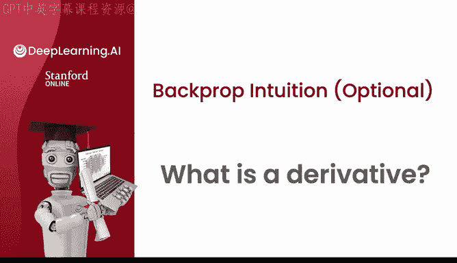
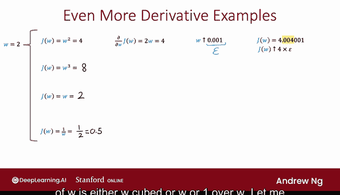
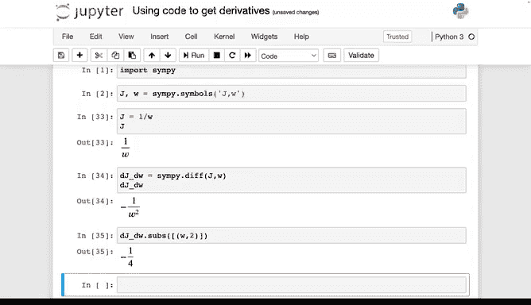
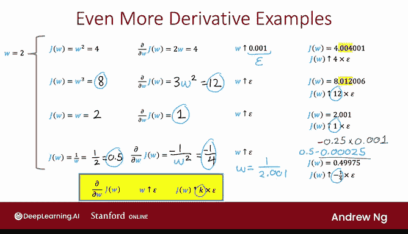
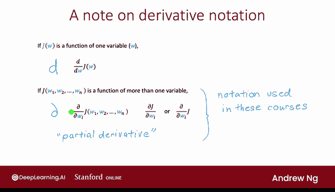

# 吴恩达《机器学习》｜machine-learning（中英字幕-deepseek翻译） - P72：30_02_01_什么是导数（可选）.zh_en - GPT中英字幕课程资源 - BV1MN4y1S7DE

You've seen how in Tensorflow， you can specify a neural network architecture to compute the output y as a function of the inputex and also specify a cost function。

 and Tensorflowlow will then automatically use back propag to compute derivatives and use gradient descent or addom to train the parameters of your neural network。

So the back propagation algorithm which computefuses derivatives of your cost function with respect to the parameters is a key algorithm in neural network learning。

 but how does it actually work in this and in the next few optional videos we'll try to take a look at how back propagation compute derivatives these videos are completely optional and they do go just a little bit into calculus if you are already familiar with calculus I hope you enjoy these videos but if not totally we'll build up from the very basics of calculus to try to make sure you have all the intuition you need to understand how appropagation works Let's take a look。

I'm going to use a simplified cost function。 J of W equals。W squared。

 so the cost function is a function of the parameters W and say B。

 and for the simplified cost function。Let's just pretend J of w equals W squared。

 and I'm going to ignore B for this example。And let's say the value of the parameter W is equal to3。

So J ofW。Will be equal to9 W squared of3 squared。No。If we were to increase W by a tiny amount。Say。

 epsilon。Which I'm going to set to 0。001。How does the value of J ofW change？If we increase w by 0。

001， then w becomes 3 plus 0。001， so 3。001， and so J of w， which is w squared。

 which we define above is now this 3。001 squared which is 9。

06001 so what we see is that if w goes up by 0。001 I'm going to use this up arrow here to denote w goes up by 0。

001 where 0。001 is this small value epsilon， then J of w roughly。Goes up。By six times as much。

6 times0 point。001 This isn't quite exact。 It actually goes up not to 9。006， but 9。06001。

 but it turns out that if epsilon were infinitesimally small and by infinitesimally small， I mean。

 very， very， very， very small。 You know， epsilon is pretty small。

 but it's not infinitesimally small If epsilon was 0。0000 losses zeros followed by1。

 then this becomes more and more accurate In this example。

 what we see is that if w goes up by epsilon， then J goes up roughly by6。Times epsilon。

And in calculus， what we would say is that derivative derivative。Of J ofW。

 where respect to W is equal to 6。And all this means is。If W goes up by a tiny little amount。

 J of w goes up six times as much。What if epsilon were to take on a different value。

 what if epsilon were 0。002？So in this case， w would be 3 plus 0。Z，02。And W squared becomes V。

002 squareds， which is 9。012004。And in this case， what will conclude is that if w goes up by0。Oh，2。

Then J of w goes up by roughly 6 times0。02。 it goes up roughly to 9。0。1，2。

And this point012 is roughly 6 times 0。002 again it's a little bit off， this is extra， you know， 0。

000004 here because epsilon is not quite infinitesimally small。And once again， we see this。

6 to one ratio between。How much W goes up versus how much J of w goes up and that's why the derivative of J of w where respect to W is equal to6 and the small epsilon is the more accurate this becomes and by the way。

 feel free to pause the video and try this calculation of yourself with other values of epsilon。

 the key is that so long as epsilon is pretty small。

 the ratio by which J of w goes up versus the amount by which W goes up should be six to one So feel free to try it out yourself with other values of epsilon and check if this really holds true And so this leads us to an informal definition of a derivative。

 which is that if whenever w goes up by a tiny amount epsilon that causes J of w to go up by K times epsilon。

And in our example just now， k was equal to6， then we say that the derivative of J of w with respect to w is equal to K。

 which was equal to6 in the example just now。So you might remember when implementing gradient descent。

You will repeatedly use this rule to update the parameter WJ。

 where as usual alpha is the learning rate。And so what does gradient descent do？

Notice that if the derivative is small， then this update step will make a small update to the parameter WJ。

 whereas if this derivative term is lod， this will result in a big change to the parameter WJ。

And this makes sense because this is essentially saying that if the derivative is small。

 this means that changing w doesn't make a big difference to the value of J。

And so let's not bother to make a huge change to WJ。But if the derivative is large。

 that means that even a tiny change to WJ can make a big difference in how much you can change or decrease the cost function J of W。

 so in that case， let's make a bigger change to WJ because doing so will actually make a big difference to how much we could reduce the cost function J。

Let's take a look at a few more examples of。Deratives。

What we saw in the example just now was that if w equals 3 and J of w equals w squared equals 9。

Then if w goes up by epsilon by 。01， then J of W becomes J of。3。001 is now 9。06001。Or in other words。

J has gone up by about 0。006， which is 6。Times 0。001 or6 times epsilon。

 which is why the derivative j of w with respect to w is equal to 6。

Let's look at what the derivative will be for all the values of W tick W equals2。In this case。

 J of w is w squared is now equal to 4， and if w goes up by 0。01， then J ofw becomes J of 2。01。

 which is equal to this 4。0401。And so JfW has gone up from4 to this value over here。

 which is roughly four times epsilon。Bigger than four。

Which is why now the derivative is4 because W going up by epsilon has caused JfW to go up four times as much and again this extra point over one is because it's not quite accurate because epsilon isn't infinitesimally small。

Well let's look at another example， what if w were equal to negative3 J of w。

 which is w squared is still equal to9 because negative 3 squared is 9。

And if w were to go up by epsilon again， then you now have w equals negative 2。999。

 so that's negative 2。999， and the square of negative 2。999 is equal to this 8。

994001 because w is negative 3 plus 0。001 and notice here J of w has gone down by about 0。

006 which is 6 times epsilon。And so what we have in this example is that J starts off as9。

 but it has now gone down， notices down arrow here instead of a arrow by six times epsilon or equivalently it has gone up by negative6 times epsilon and that's why de derivative in this case is equal to。

Negative 6， because。W going up by Epsilon causes J ofW to go up by negative six times epsilon when epsilon is small。

Another way to visualize this is to plot the function J of w。

 so if the horizontal axis is W and this is J of w， then when w is equal to 3。J of w is equal to9。

 when it's negative 3 is also equal to9 and when it is 2。

J ofW is equal to4 Let me make an observation that may be relevant if you've taken a calculus class before。

 but if you haven't what I say in the next 60 seconds may not make sense but don't worry about it。

 you won't need to understand it to fully follow the rest of these videos。

If you've taken the class calculus at some point， you may recognize that the derivatives corresponds to the slope of a line that just touches the function J of w at this point。

 say where w equals3。And so the slope of this line at this point and the slope is this height over this width turns out to be equal to 6 when w equals 3。

 the slope of this line turns out to be4。 when w equals 2 and the slope of this line turns out to be negative 6。

 When w equals negative 3。 And it turns out in calculus。

 the slope of these lines correspond to the derivative of the function。

 But if you haven't taken a calculus class before and haven't seen this slope concept before。

 don't worry about it。 Now， does one loss observation one make before moving on， which is that。

You see in all three of these examples， J of w is the same function， J of w is equal to W squared。

But the derivative of J of w depends on w when w is 3， the derivative 6， when w is 2。

 the derivative is4， and when w is negative 3， the derivative is negative 6 It turns out that if you're familiar with calculus and again totally fine if you're not。

 calculus can allow us to calculate the derivative of JfW with to W as two times w in a little bit。

 I'll show you how you could use Python to compute these derivatives yourself using a nifty Python package called Simpi。

But because calculus tells us that derivative derivative of w squared， J of w is2 w。

That's why the derivative when W is3 is2 times 3。Or minuss 2 is two times2。

Or when it's negative 3 is two times negative3 because this value of W。

Times  two turns out to give you the derivative let's go through just a few more examples before we wrap up。

For these examples， I'm going to set W equals2。So you saw on the last slide if J ofW is w squared。

 then the derivative I said would be 2 times w， which was4。And so if w goes up by 0。01。

 this being epsilon， J ofW becomes this so roughly J ofW goes up by four times epsilon。

Let's look at a few other functions What if J of w is equal to w cubed so in this case w cubed2 cubed would be equal to8 or what if J of w is just equal to w so here w equal to2 or what if J of w was1 over w in this case1 over w1 over2 would be 1 half or 0。

5 what is the derivative of J of w with respect to w when the cost function J of w is either w cubed or w or1 over w？

Let me show you how you can compute these derivatives yourself using a library and package called Simpi。

So， let me first import S。And。What I'm going to do is tell Sai that I'm going to use J andW as symbols。

For computing derivatives。So for our first example。We had the cost function J was equal to W squared。

 notice how Simpi actually renders it in this nifty font here as well Now if we were to use Simp to take the derivative of J respect W。

 we can do as follows。You see that simply tells you this derivativeive is 2 w。

Let me actually choose available DJ， DW to and set that to be equal to this and just type it in here。

 So print it out。So that's 2 w。 and if you want to plug in the value of tell into this expression to evaluate it。

 you can do。The derivative dot subs W2， this means plug the value of W。

To be equal to two into this expression and evaluate it， and that gives you the value of four。

 which is why when w close to 2。We saw that the derivative of J was equal to4。

 Let's look at some other examples。What if J was W cubed？Then。

The derivative becomes three times w squared， so it turns out from calculus and this is what Sia is calculating for us。

If J is w cubed， then the derivative of J respect to W is 3 W squared and depending on what。

W is the value of derivative derivativeative changes as well。And we can plug in。IfW equals 2。

 you get 12 in this case。Or what if。It was j equals W in this case。

 the derivative is just equal to one。Or the final example we had was what if j equals 1 over w In this case。

 the derivativeerive turns out to be negative1 over。W squared。And so this is negative 14。

 So what I'm going to do is take the derivatives we have worked out， remember if for w squared。

 it was 2 w。For W cubed， it was 3 W squared。For w is just one and for1 over w。

It is negative1 over W squared and let's copy this back to our other slide。😊。

So what simply or really cals showdowns is if。J ofW is w Q， the derivative is V W squared。

 which is equal to 12 when w equals 2， when JfW equals w， the derivative is just equal to1。

 and when JFW is 1 over w is negative1 of w squared， which is。Negative one quarter when de equals 2。

Thus double checks of these expressions that we got from Simpai are correct。

So let's try increasing W by Epsilon。In this case， J ofW and again。

 feel free to pause the video and check this map on your own calculator if you want。But in this case。

 J of w2。001 cubed becomes this， and so J has gone up from 8 to 8。

012 roughly and so it's gone up by roughly 12 times epsilon and thus the derivative is indeed 12。

Or if。JfW equals w， then if w increased by epsilon， then J ofW， which is just w is now 2。

001 and so it's gone up by 0。001， which is exactly the value of epsilon。

 So JFW is gone up by one times epsilon。 So the derivative is indeed equal to1。Noteice that here。

 this is actually exactly epsilon， even though epsilon isn't infinitesimonally small。

Or a last example。If JW equals1 over w， if W goes up by epsilon， then W is1 over 2。 over 1。

 then it turns out JW is approximately 4。9975 with some extra digits of truncated。

But this turns out to be 0。5 minus 0。00025。 So JfW has started off at 0。5。And it's gone down by 0。

00025。 And this 0。00025， it is。0。25 times。Epsilon and its gone down by this amount or is gone up by negative 0。

25 times epsilon because negative 0。25 times epsilon is equal to this term over here。

So we see that if w goes up by epsilon， J of w goes up by negative14 or negative 0。25 times epsilon。

 which is why the derivative in this case is negative one quarter So I hope that with these examples you have a sense of what the derivative。

Were respect to W of J of W。Means it just ask if。W goes up by Epsilon。

How much does JFW go up by some constant K？Times epsilon and this constant K is the derivative。

And the value of k will depend both on what is the function J of w as well as what is the value of W Before you wrap up this video。

 I want to briefly touch on the notation used to write derivatives that you may see in other text。

 which is that if J ofW is a function of a single variable。

Say W， then mathematicians will sometimes write the derivative as DDW of J ofW。 And notice to Sira。

 this notation is using the lower case。Leer D。Whereas in contrast， if J is a function of。

More than one variable。Then mathematicians will sometimes use thisquiggly alternative D to denote the derivative。

Of J with respect to one of the parameters WI to my mind。

 this notation distinguishing between this regular ledity and this stylized calculus。

Derivtive symbol D， it makes little sense to me to make the distinction and this notation to my mind overcomplicates calculus and derivative notation。

But for historical reasons， calculus text will use these two different notations。

 depending on whether J is a function of a single variable or a function of multiple variables。

 but I think for practical purposes， this notational convention。

 it tends to just overcomplicate things I think in a way that I don't think is actually necessary。

And so for this class， I'm just going to use this notation。Everywhere。

 even when there's just a single variable。And in fact， for most of our applications， the function J。

 it is a function of more than one variable and so this other notation。

 which is sometimes called the partial derivative notation this is actually the correct notation almost all the time because J usually has more than one variable。

 but I hope they're using this notation throughout these lectures that simplifies the presentation and makes derivatives a little bit easier to understand and in fact this notation is the one you've been seeing in the videos leading up to know and for conciseness。

 instead of writing out this full expression here， sometimes you also see the shorten as derivative or partial derivative of J who respect WI or。

Wri it like this and these are just simplified abbreviated forms of this expression over here。

So I hope that gives you a sense of what our derivatives is just if W goes up by a little bit by epsilon。

 how much does J ofW change as a consequence？Next， let's take a look at how you can compute derivatives in a neural network To do so we need to take a look at something called a computation draft。

 Let's go take a look at that in the next video。