# 吴恩达《机器学习》｜machine-learning（中英字幕-deepseek翻译） - P74：32_02_03_更大的神经网络示例（可选）.zh_en - GPT中英字幕课程资源 - BV1MN4y1S7DE

In this final video on intuition for backdrop， let's take a look at how the computation graph works on a larger neural network example。

Here's the network we will use with a single hidden layer。

With a single hidden unit that outputs a1 that feeds into the output layer that outputs the final prediction A2 to make the math more tractable。

 I'm going to continue to use just a single training example with inputs x equals 1， y equals 5。

 and these would be the parameters of the network。

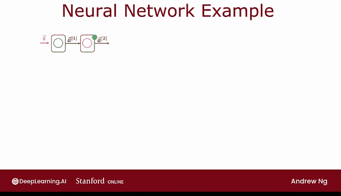

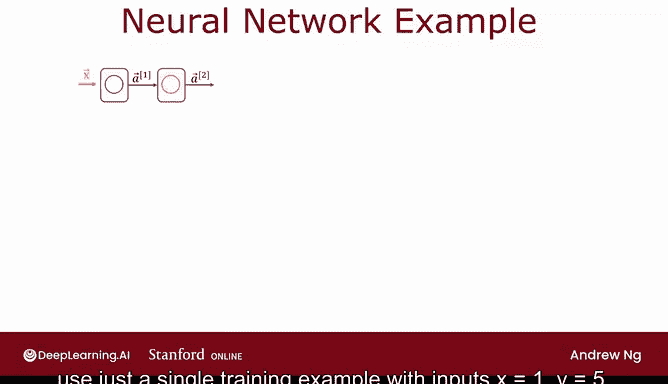

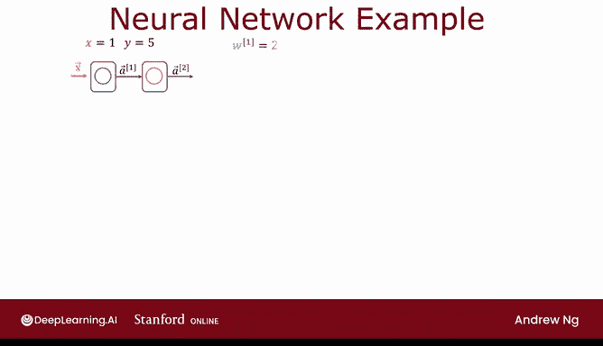

And throughout， we're going to use the regular activation function。 So G of Z equals max of0 comma Z。

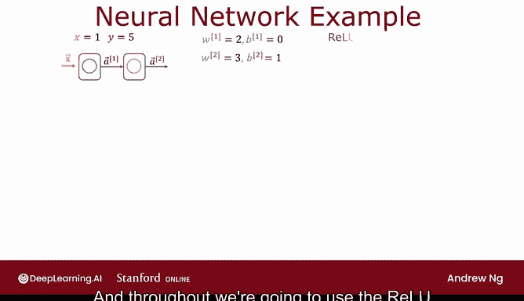

So for problem in neural network looks like this， as usual， a1 equals G of w1 times x plus B1。

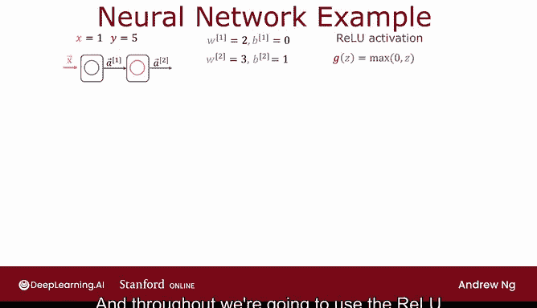

And so it turns out w1 x plus B will be positive， so we're in the max0 z equals z parts of this activation function。

 so that's just equal to this， which is2 times 1， that's w1 is 2 times x1 plus0， that's B1。

 which is equal to 2。

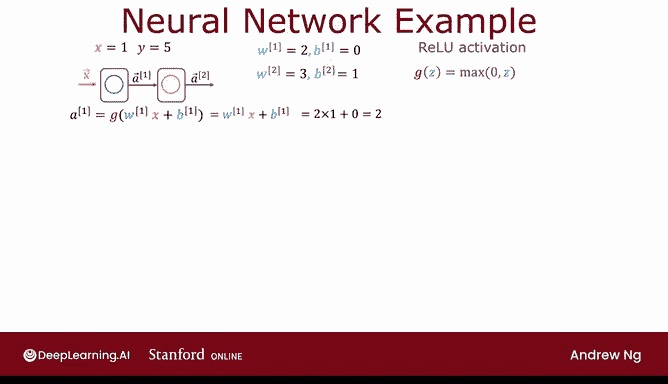

And then similarly a2 equals this G of w2 a1 plus B2， which is w2 times a1 plus B again。

 because we're in the positive part of the re activation function， which is3 times 2 plus1。

 which is equal to 7， Finally we'll use the squared error cost function。

 so J of wB is1 half a2 minus y squared， which is1 half7 minus5 squared， which is。

One half of two squared， which is just equal to2。 So let's take this calculation that we just did and write it down in the form of a computation graph to carry out the computation step by step。

 First thing we'll need to do is take w1 and multiply that by x。

 So I'm going to have w1 that feeds in to a computation node to compute w1 times x。

 And I'm going to call this a temporary variable T1。

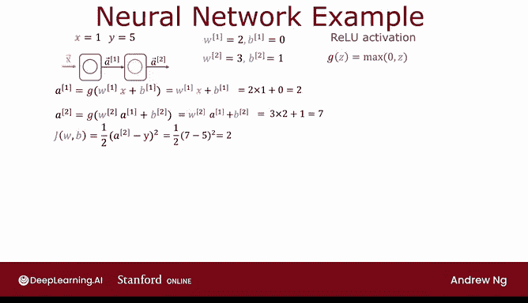

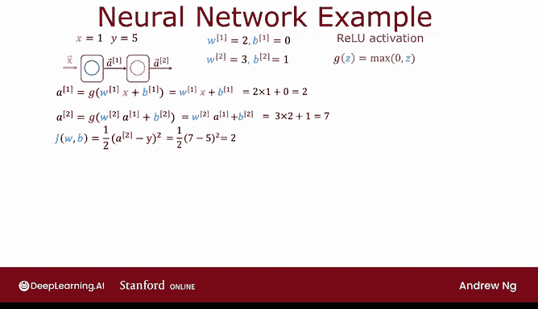

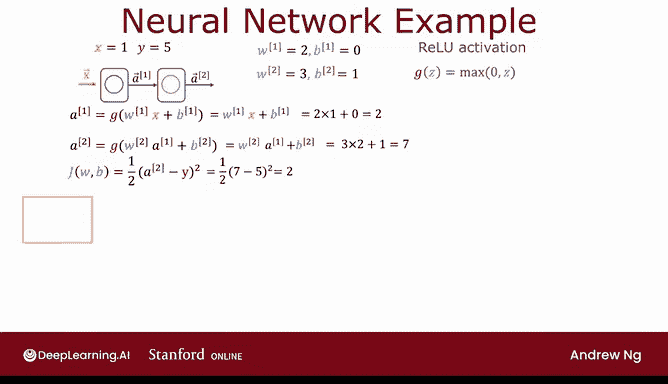

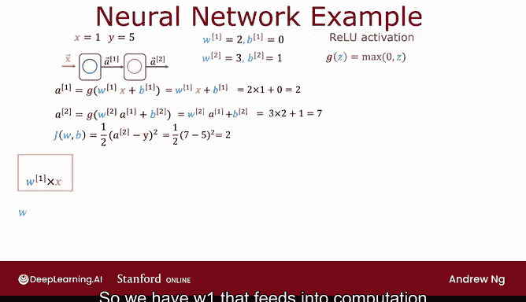

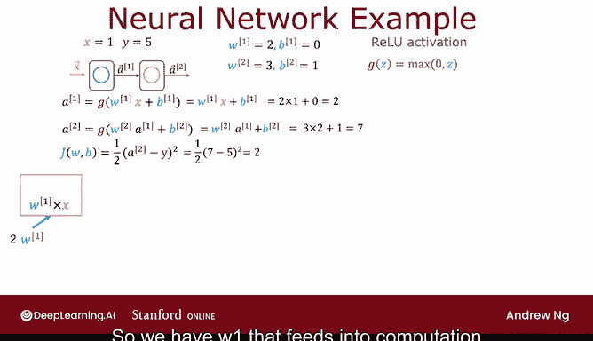

Next， we compute z1， which is this term here， which is T1 plus B1。

 so we also have this input B1 over here and finally a1 equals G of Z1。

 we apply to activation function and so we end up with again this value here2。

 and then next we have to compute。

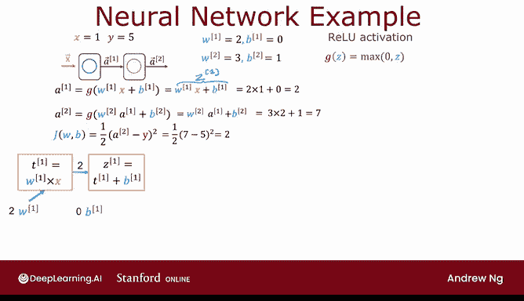

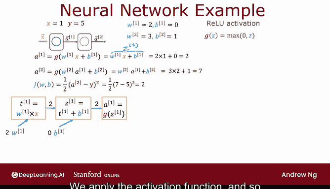

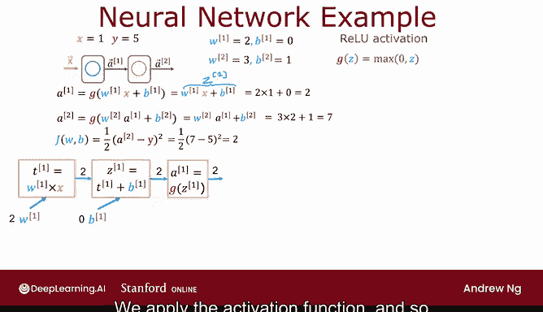

T2 which is W2 times a1， and so with W2， that gives us this value， which is6。

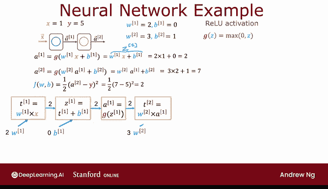

Then Z2， which is this quantity， we add B to it， and that gives us 7。

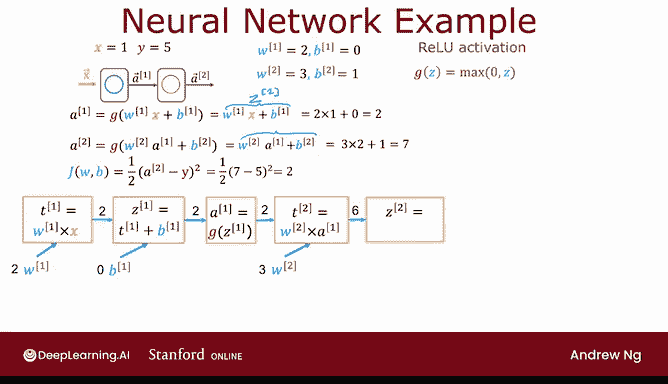

And finally， apply the activation function G， we still end up with 7。 And lastly。

 J is1 half a2 minus y squared。 and that gives us。

Two， which was this cost function here。So this is how you take the step by step computations for larger neural network and write it in a computation graph。

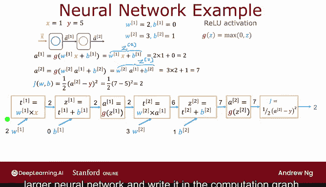

You've already seen in the last video the mechanics of how to carry out backpro。

 I'm not going to go through the step by step calculations here。

 but if you were to carry out backpro， the first thing you do is ask what is the derivative of the cost function J respect to a2 and it turns out if you calculate that it turns out to be2 so we'll fill that in here and the next step would be ask what's the derivative of the cost J respect to Z2 and using this derivative that we compute previously you can figure out that this turns out to be2 because if Z goes up by epsilon。

 you can show that for the current setting of all the parameters a2 will go up by epsilon and therefore J will go up by two times epsilon so this derivative is equal to2。

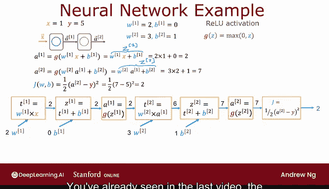

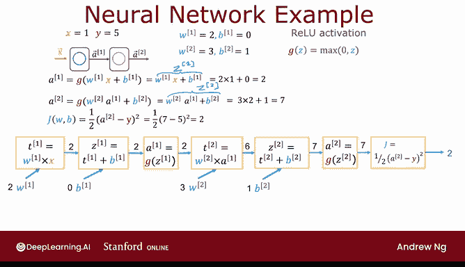

And so on。Step by step， we can then find out that derivative of J respect to B2 is also equal to2。

The derivative of respect to T2 is equal to 2。And so on and so forth。

 until eventually you've computed the derivative of J with respect to all the parameters， W1， B1， W2。

 and B2。And so that's backdrop And again， I didn't go through the mechanical steps of every single step of back。

 but it's basically the process that you saw in the previous video。

 Let me just double check one of these examples。 So we saw here that the derivative of J respect to W1 is equal to6。

 So what this is predicting is that if W1 goes up by epsilon J should go up by roughly six times epsilon。

Les。Seep through the math and see if that really is true。

 These are the calculations that we did again。 And so if W， which was2， were to be 2。

001 goes up by epsilon。

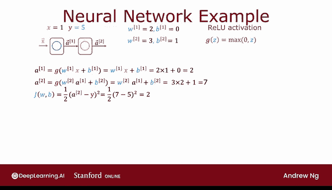

Then a1 becomes， let's see， instead of two， this is 2。001 as well。

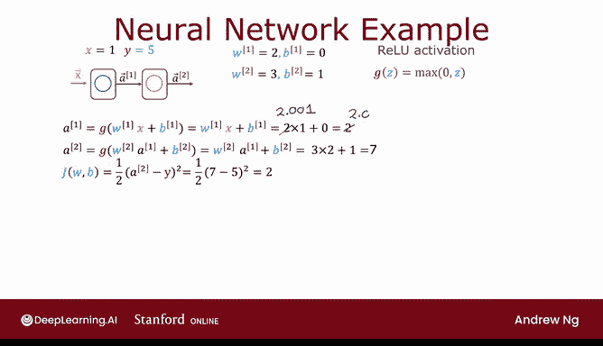

So a1， instead of2 is now 2。001， so3 times 2。01 plus 1 this gives us 7。003 and if a2 is 7。003。

 then this will 7。03 minus5。

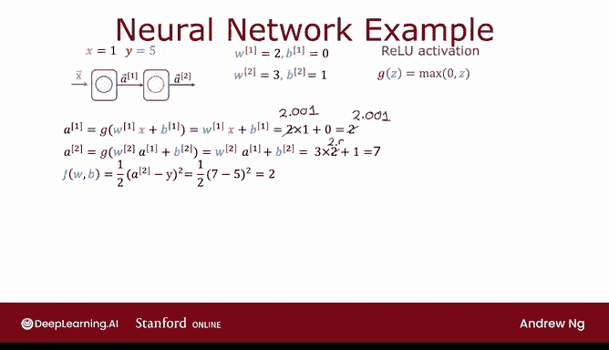

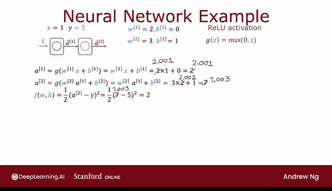

Squared， and so this becomes 2。00。

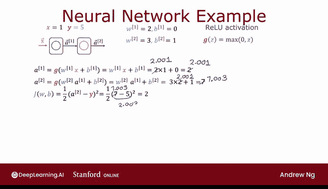

3 squared over2。Which turns out to be equal to 2。006005。

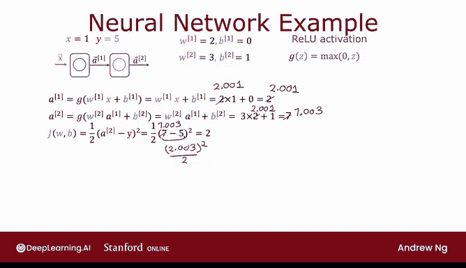

So ignoring some of the extra digits。

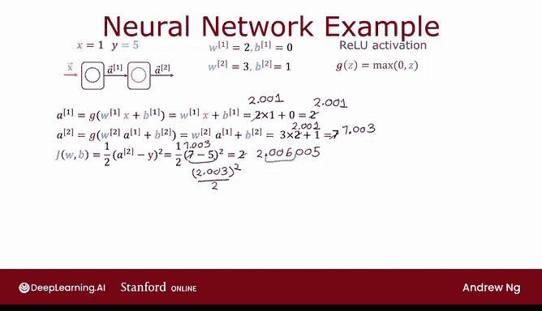

You see from this little calculation that if w1 goes up by 0。01 J of w has gone up from 2 to 2。

06 roughly so six times as much and so the derivative of J with respect to W1 is indeed equal to6 and so the back procedure gives you a very efficient way to compute all of these derivatives which you can then feed into the gradient in descent algorithm or the addom optimization algorithm to then train the parameters of your neural network and again the reason we use back for this is is a very efficient way to compute all the derivatives of j respect to W1 J respect to B1 J respect to W2 and j respect to B2 I did just illustrate how we could bump up W1 by a little bit and see how much J changes。

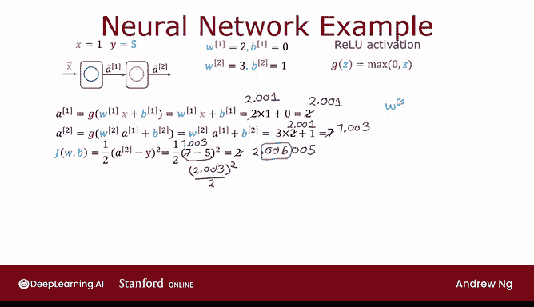

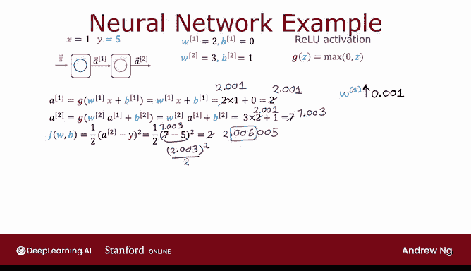

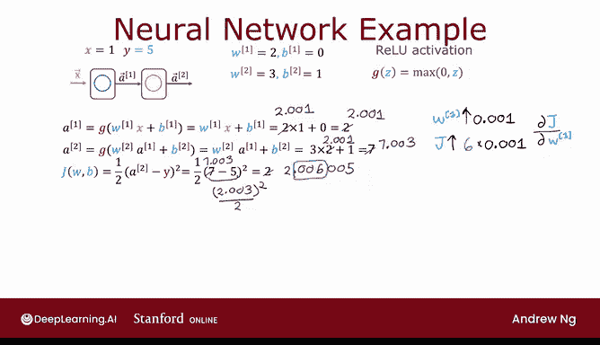

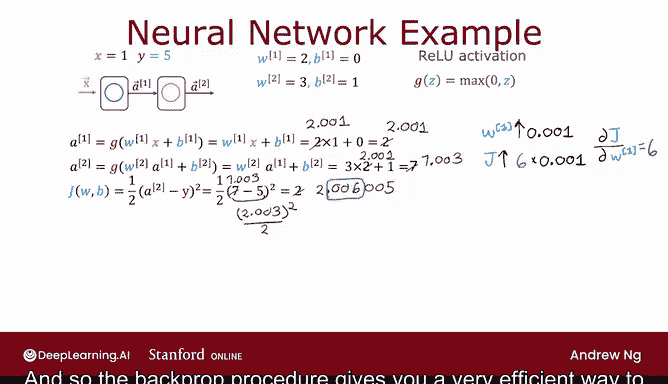

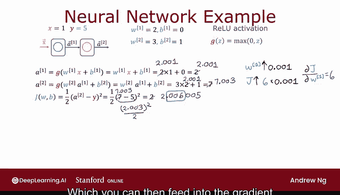

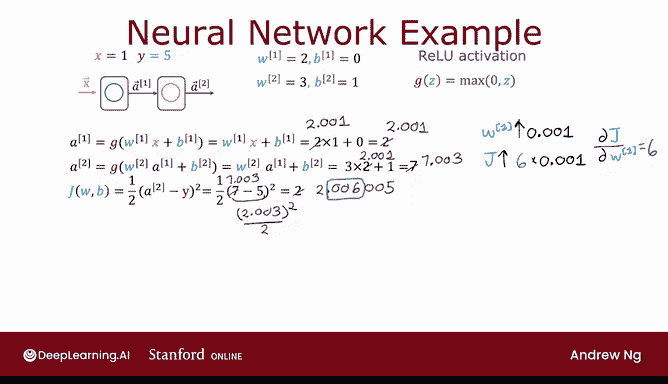

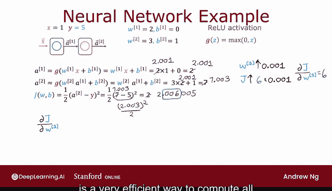

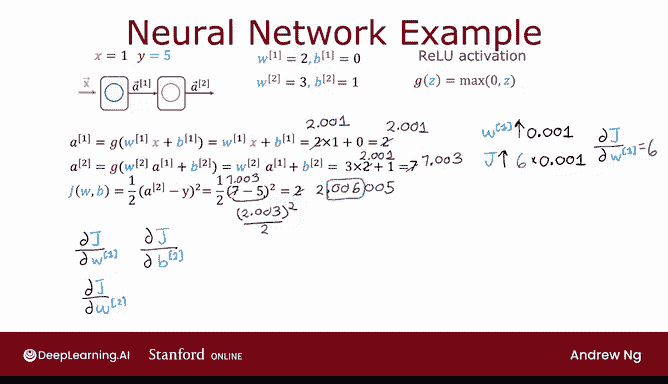

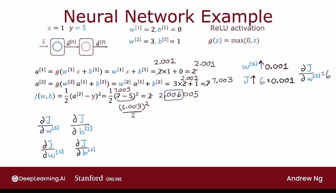

That was a left to right calculation and if we had to do this procedure for each parameter one parameter at a time。

 if we had to increase the view by 0。01 to see how that changes J。

 increase B1 by little bit to see how that changes J and increase every parameter one at a time by little bit to see how that changes J。

 then this becomes a very inefficient calculation and if you had n node in a computation graph and p parameters。

 this procedure would end up taking n times p steps， which is very inefficient。

 whereas we got all four of these derivatives and plus P rather than n times p steps。

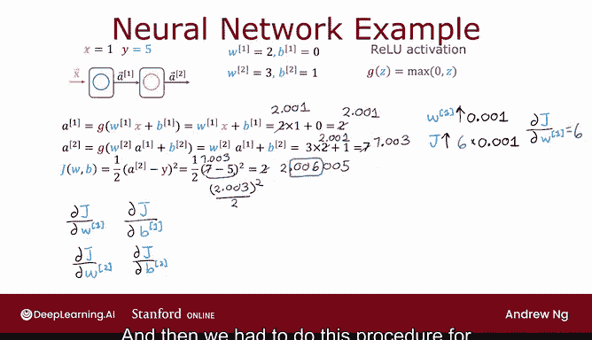

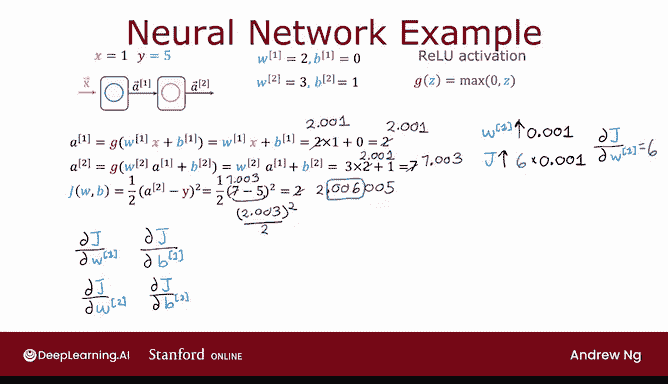

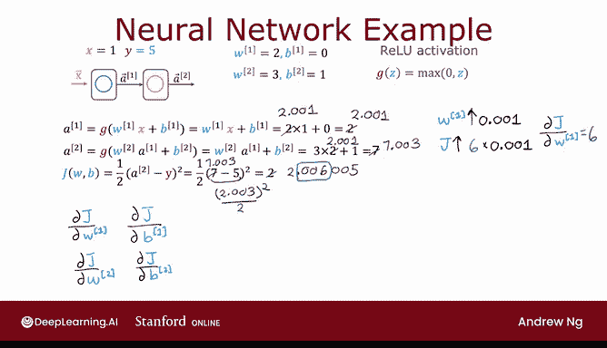

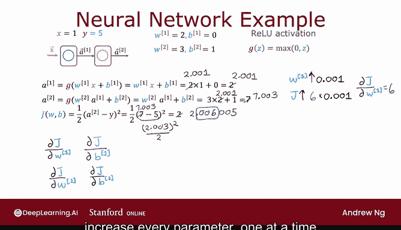

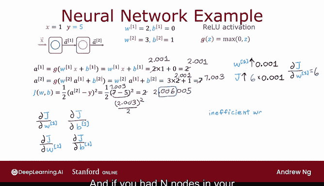

And this makes a huge difference in practical neural networks where the number of nodes in the number of parameters can be really large。

So that's the end of the videos for this week， thanks for sticking with me through the end of these optional videos and I hope that you now have an intuition for when you use a programming framework like TensorFlow to train a neural network what's actually happening under the hood and how is using the computation graph to efficiently compute divers for you。

😊，Many years ago， before the rise of frameworks like Tensorflow and Pytorch。

 researchers used to have to manually use calculus to compute the derivatives of the neural networks that they wanted to train and so in modern programming frameworks you can specify forpro and have a take care back for you many years ago researchers used to write down the neural network by hand。

 manually use calculus to compute the derivatives and then implement a bunch of equations that they had laboriously derived on paper to implement back thanks to the computation graph and these techniques for automatically。

Carrying out derivative calculations is sometimes called Autoative for automatic differentiation。

 this process of researchers manually using calculus to take derivatives is no longer really done。

 or at least I've not had to do this for many years now myself because of Autoative。

So many years ago to use neural networks， the bar for the amount of calculus you had to know actually used to be higher。

 but because of automatic differentiation algorithms， usually based on the computation graph。

 you can now implement a neural network and get derivatives computed for you easier than the so maybe with the maturing of neural networks。

 the amount of calculus you need to know in order to get these algorithms work has actually gone down and that's been encouraging for a lot of people。

And so that's it for the videos for this week， I hope you enjoy the labs and I look forward to seeing you next week。

