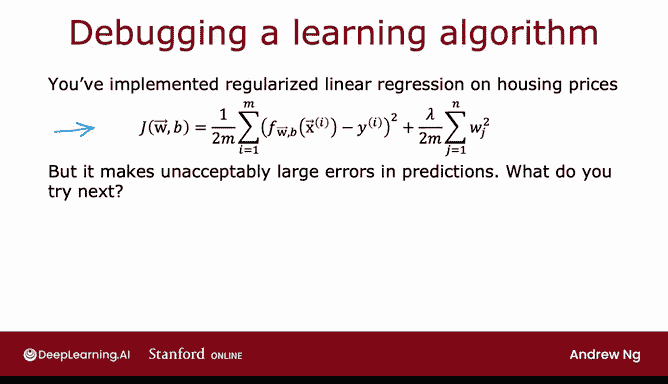
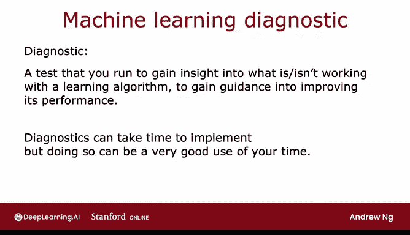

# 吴恩达《机器学习》｜machine-learning（中英字幕-deepseek翻译） - P75：33_03_01_决定下一步尝试什么.zh_en - GPT中英字幕课程资源 - BV1MN4y1S7DE

Hi and welcome back。 By now， you've seen a lot of different learning algorithms。

 including linear regression， logistic regression， even deep learning or neural networks。

 and next week you see decision trees as well， so you now have a lot of powerful tools of machine learning but how do you use these tools effectively I've seen teams sometimes take six months to build a machine learning system that I think a more skill team could have taken or done in just a couple weeks and the efficiency of how quickly you can get a machine learning system to work well will depend a large part on how you can repeatedly make good decisions about what to do next in the course of a machine learning project So in this week I hope to share with you a number of tips on how to make decisions about what to do next in the machine learning project that I hope will end up saving you a lot of time So let's take a look at some advice on how to build machine learning systems。

Let's start with an example。Say you've implemented regularized linear regression to critical housing prices so you have the usual cost function for your learning algorithm。

 squared error plus this regularization term， but if you train the model and find that it makes unacceptively large errors in its predictions。

 what do you try next when you're building a machine learning algorithm。

 there usually a lot of different things you could try， for example。

 you could decide to get more training examples since it seems like having more data should help right？

Or maybe you think maybe have too many features you could try a small set of features or maybe you want to get additional features such as find the additional properties of the houses to toss into your data and maybe that will help it to do better or you might take the existing features x1 x2 and so on and try adding polynomial features like x1 squared。

 x2 squared， x1 x2 and so on or you might wonder if the value of lambda is chosen well and you might saym maybe it's too big on to decrease it or you may say。

 oh maybe it's too small， I want to try increasing it。So on any given machine learning application。

 it will often turn out that some of these things could be fruitful and some of these things not fruitful and a key to being effective at how you build a machine learning algorithm will be if you can find a way to make good choices about where to invest your time For example。

 I have seen teams spend literally many， many months collecting more training examples thinking that more training datas got aho but it turns out sometimes it helps a lot and sometimes it doesn't So in this week you learn about how to carry out a set of diagnostics and by diagnostic I mean a test you can run to gain insight into what is or isn't working with a learning algorithm to gain guidance into improving its performance and some of these diagnostics will tell you things like is it worth weeks or even months collecting more training data because if it is then you can then go ahead and make the investment to get more data。

Which will hopefully lead to improved performance， or if it isn't then running that diagnostic could have saved you months of time。

And one thing you see this week as well is that diagnostics can take time to implement。

 but running them can be a very good use of your time。

So this week we'll spend a lot of time talking about different diagnostics you can use to give you guidance on how to improve your learning algorithm's performance。

 but first let's take a look at how to evaluate the performance of your learning algorithm。

 let's go do that in the next video。