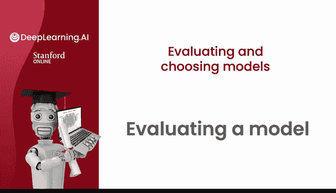
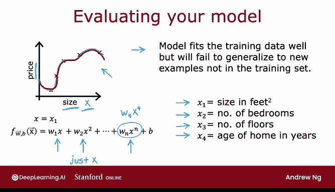
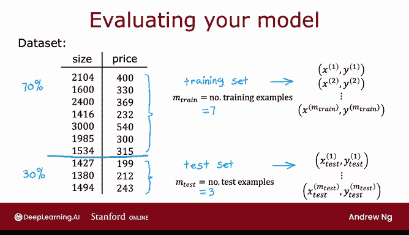
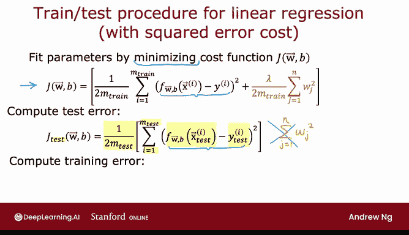
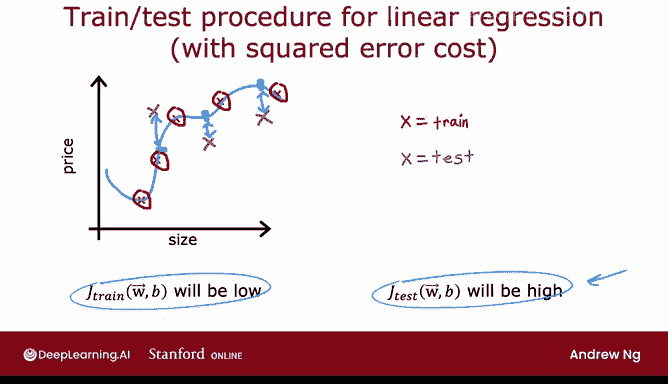
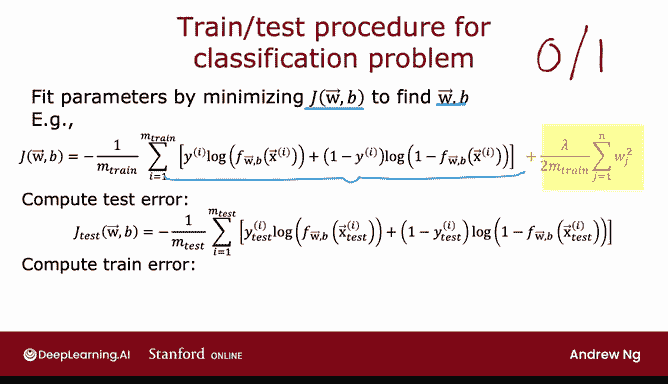
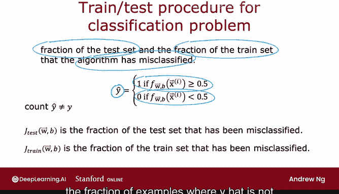

# 吴恩达《机器学习》｜machine-learning（中英字幕-deepseek翻译） - P76：34_03_02_模型评估.zh_en - GPT中英字幕课程资源 - BV1MN4y1S7DE

Let's see you've trained the machine learning model， how to evaluate that model's performance。

 you find that having a systematic way to evaluate performance will also help paint a clearer path for how to then improve its performance。

 so let's take a look at how to evaluate a model let's take the example of learning to predict housing prices as a function of the size。

Less say you've trained a model to predict housing prices as a function of the size x。Sa the model。

That is a fourth auto polynomial， so it features x x squared x cubed and x to the4。

Because we fit a fourth order polynomial to a training set with five data points。

 this fits the training data really well。But we don't like this model very much because even though the model fits the training data well。

 we think it will fail to generalize to new examples that aren't in the training set。

So when you are predicting prices just a single feature the size of the house。

 you could plot the model like this and we could see that the curve is very wickly so we know thispar isn't a good model。

 but if you were fitting this model with even more features， say we had x1 the size of the house。

 number of bedrooms， the number fours of the house also the age of the home in years。

 then it becomes much harder to plot F because。

F is now a function of x1 through x4。 And how do you plot a four dimensional function。

So in order to tell if your model is doing well， especially for applications where you have more than one or two features。

 which makes it difficult to plot F of x， we need some more systematic way to evaluate how well your model is doing。

 here's a technique that you can use。If you have a training set and this is a small training set with just 10 examples listed here。

 rather than taking all your data to train the parameters W and B of the model。

 you can instead split the training set into two subsets I'm going to draw a line here and let's put 70% of the data into the first part。

And I'm going to call that the training set and the second part of the data。

 let's say 30% of the data I'm going to put into a test set。

And what we're going to do is train the model's parameters on the training set。

 on this first 70% will sell the data， and then we'll test this performance on this test set。

In notation， I'm going to use X1。Yhy 1。Same as before to denote the training examples through XM。YM。

Except that now to make explicit so in this little example we would have seven training examples and to introduce one new piece of notation。

 I'm going to use M Subscript training M training is a number of training examples which in this small data is seven so the subscript training just emphasizes if we're looking at the training set portion of the data。

And for the test set， I'm going to use the notation x1 sub test， comma。

 y1 Sub test to denote the first test example， and this goes all the way to XM test。Subscript test。

 Y M test， Subscript test。And M test is the number of test examples， which in this case is three。

And it's not uncommon to split your dataset set according to maybe a 70， 30 split or 80。

 20 split with most of your data going into the training set and then a smaller fraction going into the test set。

So in order to train a model and evaluate it。This is what it would look like if you're using linear regression with a square error cost。

Start off by fitting the parameters by minimizing the cost function J of W B。

 So this is a usual cost function minimize over W B of this square error cost plus。

Regularization term longer over 2M times sum of the WJ squared。

And then to tell how well the model is doing， you would compute J test of WB。

 which is equal to the average error on the test set。

 and that's just equal to one over two times M test。That's the number of test examples。

 and then of sum over the examples from I equals1 to the number of test examples of the square error on each of the test examples。

 like so， so it's a prediction on the if test example input minus the actual price of the house on the ifF test example squared。

And notice that the test error formula J test， it does not include that regularization term。

And this will give you a sense of how well your learning algorithm is doing。

One other quantity that's often useful to compute as well is the training error。

 which is a measure of how well your learning algorithm is doing on the training set。

So let me define J train of WB to be equal to the average over the training set。

1 over 2 m or 1 over 2 m sub train of some over your training set of this squared error term。

 and once again this does not include the regularization term。

 unlike the cost function that you are minimizing to fit the parameters。

So in a model like what we saw earlier in this video。

J train of WB will be low because the average error on your training examples will be0 or very close to zero。

 so J train will be very close to zero， but if you had a few additional examples in your test set that the algorithm had not trained on。

 then those test examples。Might look like these。And there's a large gap between what the algorithm is predicting as the estimated housing price and the actual value of those housing prices and so Jt will be high So seeing that Jt is high on this model gives you a way to realize that even though it does great on the training set is actually not so good at generalizing to new examples to new data points that were not in the training set So that was regression with square error costs Now let's take a look at how you'd apply this procedure to a classification problem。

 for example， if you were classifying between handwritten digits that are either zero or one。

So same as before you fit the parameters by minimizing the cost function to find the parameters WB。

 for example， if you were training logistic regression。

 then this would be the cost function J of WB where。

This is the usual logistic loss function and then plus also the regularization term。

And to compute the test error。J Tess is then。The average over your test examples does that 30% of your data that wasn't in the training set of the logistic loss on your test set。

And the training area you could also compute using this formula is the average logistic loss on your training data that the algorithm was using to minimize the cost function J of WB。

Well， what I describe here， it will work。Okay for figuring out if your learning algorithm is doing well by seeing how well it's doing in terms of test error。

When applying machine learning to classification problems there's actually one other definition of J test and Jtrain that is maybe even more commonly used。

 which is instead of using the logistic loss to compute the test error and the training error to instead measure what's the fraction of the test set and the fraction of the training set that the algorithm has misclassified。

 so specifically on the test set。You can have the algorithm make a prediction1 or0 on every test example。

 so recall y hat， we would predict as one if F of x is greater integral equal 0。

5 and 0 if it's less than 0。5。And you can then count up in the test set the fraction of examples where Y hat is not equal to the actual ground truth label Y in the test set。

So concretely， if you were classifying。Handwritten digits 01 by new classification tasks。

 then J test would be the fraction of that test set where0 was classified as one or1 class as0。

 And similarly， Jtrainin is a fraction of the training set that has been misclassified。

 taking a data set and splitting it into a training set and a separate test set gives you a way to systematicmatically evaluate how well your learning algorithm is doing by computing both J test and Jtrainin。

 you can now measure how was's doing on the test set and on the training set。

This procedure is one step to what you' be able to automatically choose one model to use for a given machine learning application For example。

 if you're trying to predict housing prices， should you fit a straight line to your data or fit a second order polynomial or third order a fourth order polynomial it turns out that with one third refinement to the idea you saw in this video you be able to have an algorithm。

 help you to automatically make that type of decision well let's take a look at how to do that in the next video。

