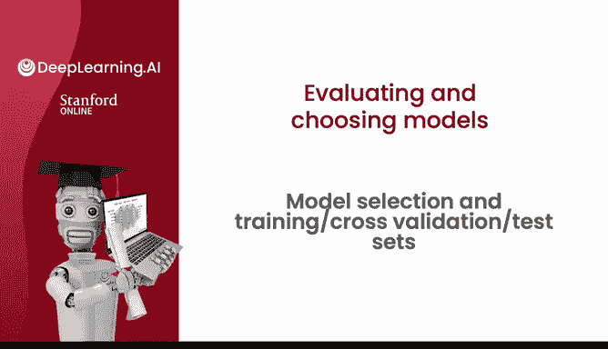
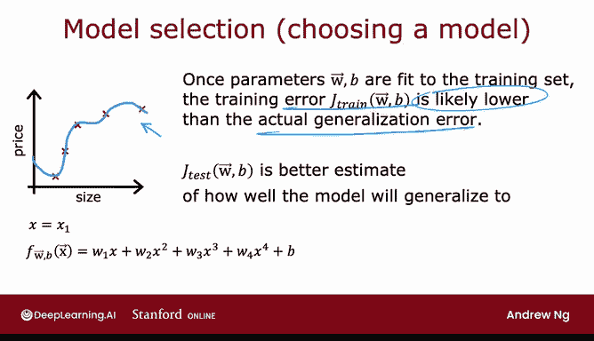
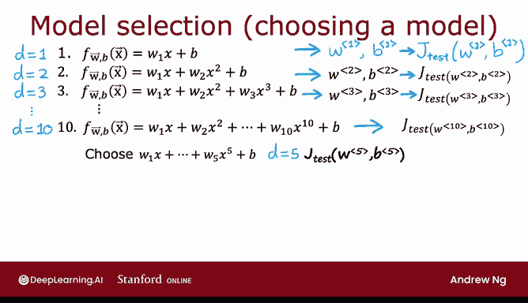
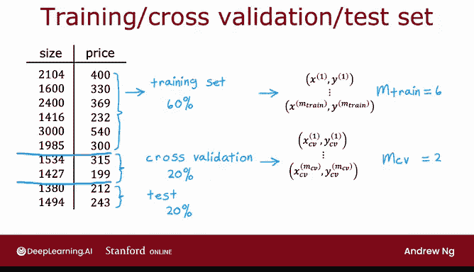
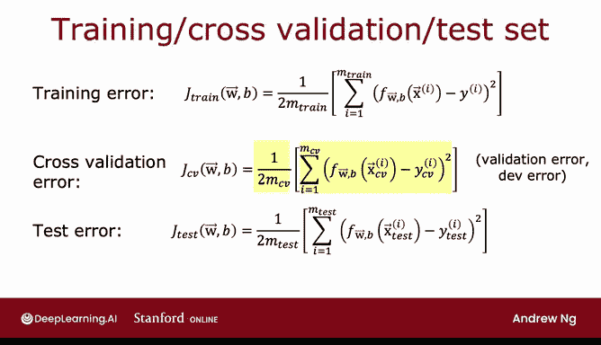
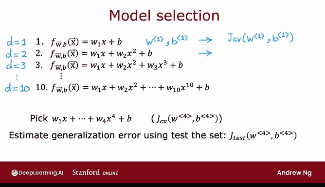
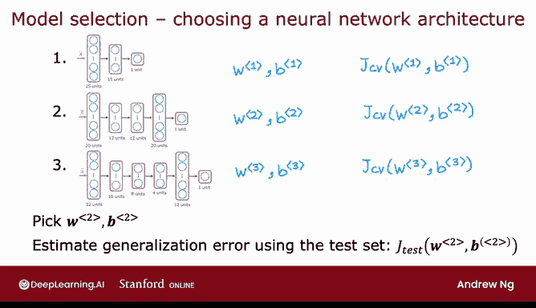

# 吴恩达《机器学习》｜machine-learning（中英字幕-deepseek翻译） - P77：35_03_03_模型选择与训练：交叉验证与测试集.zh_en - GPT中英字幕课程资源 - BV1MN4y1S7DE

In the last video you saw how to use a test set to evaluate the performance of a model Let's make one further refinement to that idea in this video which allow you to use the technique to automatically choose a good model for your machine learning algorithm One thing we've seen is that once the models parameters W andB have been fit to the training set the training error may not be a good indicator of how well the algorithm will do or how well it will generalize to new examples that were not in the training set。

And in particular， for this example， the training error will be pretty much zero and that's likely much lower than the actual generalization error and by that I mean the average error on new examples that were not in a training set and what you saw in the last video is that JT the performance of the album on examples is not trained on that that will be a better indicator of how well the model will likely do on new data and by that I mean other data thats not in the training set Let's take a look at how this affects how we might use a test set to choose a model for a given machine learning application。

So if a' fitting a function to predict housing prices or some of the regression problem。

 one model you might consider is to fit a linear model like this。

 and this is a first auto polynomial and I'm going to use d equals1 on this slide to denote。

Fitting a one or first or public narrow meal。If you were to fit a model like this to your training set。

 you get some parameters W and B， and you can then compute J tests。

To estimate how well this will generalize the new data and on this slide I'm going to use W1 B1 supertri there to denote that these are the parameters you get if you were to fit a first order polynomial or a degree1 d equals1 polynomial。

Now you might also consider fitting a second order polynomial or quadratic model。

 so this is the model and if you were to fit this to your training set。

 you would get some parameters W2 B2 and you can then similarly evaluate those parameters on your test set and get J test W2 B2 and this would give you a sense of how well the second order polynomial does and you can go on to try d equals3。

 that's a third order or a degree3 polynomial that looks like this and fit parameters and similarly get J test and you might keep doing this until say you try up to a tenth0 order polynomial and you end up with J test of W10 B10。

That gives you a sense of how well the tenth0th order polynomial is doing。

So one procedure you could try， this turns out not to be the best procedure。

 but one thing you could try is look at all of these J tests and see which one gives you the lowest value and say you find that J test for the fifth of polynomial for W5。

B5 turns out to be the lowest。If that's the case， then you might decide that the fifth audit polynomial equals 5 does best and choose that model for your application。

 and if you want to estimate how well this model performs， one thing you could do。

 but this turns out to be a slightly flawed procedure is to report the test set error， J test W5 B5。

The reason this prec is flawed is。J test of W5B5 is likely to be an optimistic estimate of the generalization error。

 in other words， it is likely to be lower than the actual generalization error。

And the reason is in the procedure we talked about on this slide。

 we basically fit one extra parameter。Which is indeed the degree of polynomial。

 and we chose this parameter using the test set。So on the previous slide。

 we saw that if you were to fit WB to the training data， then the training data。

ul be an overly optimistic estimate of generalization error， and it turns out too。

 that if you were to choose the parameter D using the test set。

 then the test set J test is now an overly optimistic that is lower than actual estimate of the generalization error。

So the procedure on this bookless slide is flawed and I don't recommend using this instead if you want to automatically choose a model。

 such as decide what degree polynomial to use。Here's how you modify the training and testing procedure in order to carry out model selection。

 whereby model selection， I mean choosing amongst different models such as these 10 different models that you might contemplate using for your machine learning application。

The way we'll modify the procedure is instead of splitting your data into just two subsets。

 the training set and the test set， we're going to split your data into three different subsets。

 which we're going to call the training set， the crossvalidation set， and then also the test set。

So using our example from before of these 10 training examples。

We might split it into putting 60% of the data into the training set。

And so the notation we use for the training set portion will be the same as before。

 except that now M train。The number training examples will be6。

 and we might put 20% of the data into the crossvalidation set and the notation I're going to use is XcV of1 comma Y CV of1 for the first crossvalidation example so CV stands with crossvalidation all the way down to XV of MCV and YCV of MCcV where here MCV equals2 in this example is the number of crossvalidation examples and then finally we have the test set same as before so x1 through XM tests。

And y1 through Y M test， where M test here is equal to2。

This is the number of test examples we'll see on the next slide how to use the cross validation set so the way we'll modify the procedure is you've already seen the training set and the test set and we're going to introduce a new subset of the data called the cross validation set。

The name cross validation refers to that this is an extra data that we're going to use to check or trustcheck the validity or really the accuracy of different models。

 I don't think it's a great name， but that is what people machine learning have gotten to call this extra data。

You may also hear people call this the validation set for short。

 just fewer syllables than cross validationid， or in some applications people also call this the development set means basically the same thing or for short。

 sometimes you hear people call as the de set but all of these terms mean the same thing as cross validationidation set I personally use the term de set the most often because it's the shortest fastest way to say it。

 but cross validation is probably used a little bit more often by machine learning practitioners。

So armed with these three subsets of the data training set crossvalidation set and test set。

 you can then compute the training error， the crossvalidation error and the test error using these three formulas whereas usual none of these terms include the regularization term that is included in the training objective and this new term in the middle the crossvalidation error is just the average over your MCV crossvalation examples of the average say squared error and this term in addition to being called crossvalation error is also commonly called the validation error for short or even the development set error or the dev error armed with these three measures of learning algorithm performance。

 this is how you can then go about carrying out model selection you can with the 10 models same as earlier on this slide with d equals1 d equals2 all the。

W up to a 10th degree or the 10 order polynomial。You can then fit the parameters， W1， B1。

But instead of evaluating this on your test set， you would instead evaluate these parameters on your cross validation set and compute JCV of W1 B1 and similarly for the second model。

You get JCV of W2 B2 and all the way down to JCV of W10， B10。Then in order to choose a model。

 you would look at which model has the lowest trust validationidation error and concretely let's say that JCV of W4B4 is lowest。

 then what that means is you would pick this four4 polynomial as the model you will use for this application。

Finally， if you want to report out an estimate of the generalization error of how well this model will do on new data。

 you would do so using that third subid w data， the test set， and you report out JT of W4B4。

And you notice that throughout this entire procedure you had fit these parameters using the training set。

 you then chose the parameter D or chose the degree of polynomial using the crossvalidation set。

 and so up until this point you've not fit any parameters， either W or B or D to the test set。

 and that's why J test in this example will be a fair estimate of the generalization error of this model that has parameters W4B4。

So this gives a better procedure for model selection and it lets you automatically make a decision like what order polynomial you choose for your linear regression model This model selection procedure also works for choosing among other types of models。

 for example， choosing a neural network architecture。

If you are fitting a model for handwritten in digit recognition。

 you might consider three models like these， maybe even a larger set of models than just three。

 but here are a few different neural networks of small， somewhat larger and then even larger。

To help you decide how many layers your neural network have and how many hidden units per layer should you have。

 you can then train all three of these models and end up with parameters。W1。B1 for the first model。

 W2， E2 for the second model and W3 B3 for the third model。

And you can then evaluate the neural network's performance using JCV using your trust validation set。

 and since this is a classification problem， JCV， the most common choice would be to compute this as a fraction of trust validation examples that the algorithm has misclassified and you would compute this using all three models。

And then pick the model with the lowest trust validation error。So if in this example。

 this has the lowest cross validation error， you would then pick the second neural network and use parameters。

Trained on this model and finally， if you want to report out an estimate of the generalization error。

 you then use the test set to estimate how well the neural network that you just chose will do So it's considered best practice in machine learning that if you have to make decisions about your model such as fitting parameters or choosing the model architecture such as neural network architecture or degree of polynomial if you're fitting linear regression to make all those decisions only using your training set and your crossvalidation set and to not look at the test set at all while you're still making decisions regarding your learning algorithm and it's only after you've come up with one model that's your final model to only then evaluated on the test set and because you haven't made any decisions using the test set that ensures that your test set is a fair and not overly optimistic estimate of how well your model were generalized。

To new data So that's model selection and this is actually a very widely used procedure I use this all the time to automatically choose what model to use for a given machine learning application。

Now earlier this week I mentioned running diagnostics to decide how to improve the performance of a learning algorithm now that you have a way to evaluate learning algorithms and even automatically choose a model。

 let's dive more deeply into examples of some diagnostics the most powerful diagnostic that I know of and that I use for a lot of machine learning applications is one called bias and variance let's take a look at what that means in the next video。

