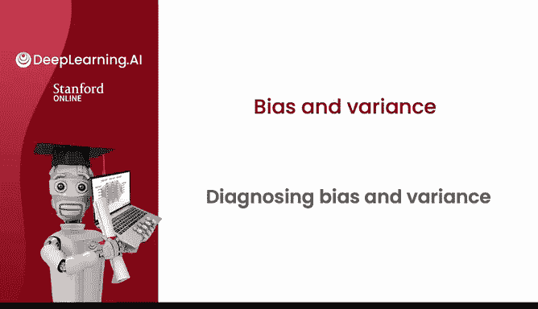
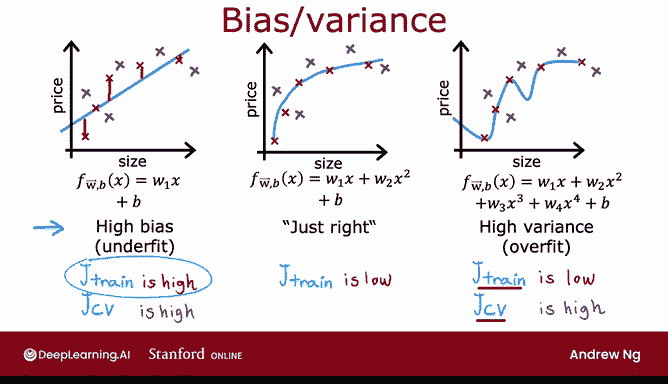
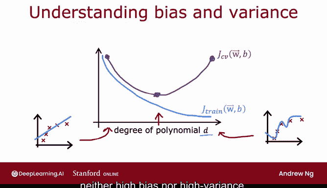
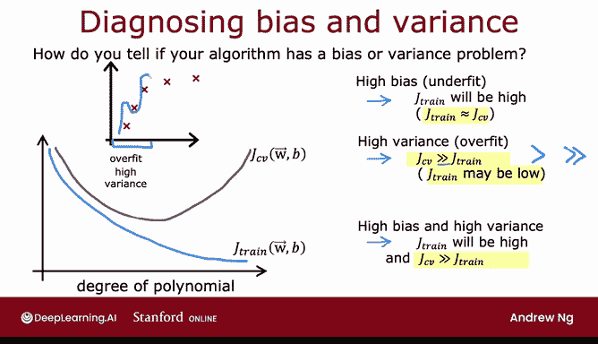

# 吴恩达《机器学习》｜machine-learning（中英字幕-deepseek翻译） - P78：36_03_01_诊断偏差与方差.zh_en - GPT中英字幕课程资源 - BV1MN4y1S7DE

The typical workflow of developing a machine learning system is that you have an idea and you train a model and you almost always find that it doesn't work as well as you wish yet when I'm training machine learning model it pretty much never works that well the first time and so key to the process of building a machine learning system is how to decide what to do NI in order to improve this performance I found across many different applications that looking at the buyers and variants of a learning algorithm gives you very good guidance on what to try N let's take a look at what this means。

You might remember this example from the first course on linear regression。Where given this data。

 if you were to further the straight line to it， it doesn't do that well and we said that thisar room has high biasers or that it underfits the dataset。

Or if you were to fit a forefather polynomial， then it has hi variances or it overfis and in the middle。

 if you fit a quadratic polynomial， then it looks pretty good and it that was just right。

Because this is a problem with just a single feature X。

 we could plot the function F and look at it like this， but if you had more features。

 you can't plot F and visualize whether it's doing well as easily。

So instead of trying to look at plots like this， a more systematic way to diagnose or to find out if your algorithm has high bias or high variances will be to look at the performance of your algorithm on the training set and on the cross validationidation set。

In particular， let's look sample on the left。If you were to compute。Jy train。

 how well does the algorithm do on the training set？Not that well。

 so I'd say Jay trained here would be high because there actually are pretty large errors between the examples and the actual predictions of the model。

And how about JCV， so JCV would be if we had a few new examples。

Maybe examples like that that the Abram had not previously seen。And here。

 the Am also doesn't do that well on examples that had not previously seen。

 so JCV would also be high。And one characteristic of an algorithm with high bias。

 something that is underfitting is that is not even doing that well on the training set and so when J train is high。

 that gives you a strong indicator that this algorithm has high bias Let's now look at the example on the right。

If you were to compute Jtrainin， how well was this doing on the training set well it's actually doing great on the training set Ph training data really well。

 so Jtrain here would be low， but if you were to evaluate this model on other houses not in the training set。

Then you find that JCV， the cross validation error。Will be quite high。

And so a characteristic signature or a characteristic Q that your algorithm has high variance will be of JCV is much higher than Jtrainin。

In other words， it does much better on data it has seen than on data it has not seen。

 and this turns out to be a strong indicator that your algorithm has high variances。And again。

 the point of what we're doing is that by computing Jtrainin and JCV and seeing if Jtrainin is high。

 or if JCV is much higher than JTin， this gives you a sense even if you can't plot to function F of whether your algorithm has high bias or high variances。

And finally， the case in the middle。If you look at Jay trainin。

It's pretty low since it's doing quite well on the training set。

 and if you were to look at a few new examples like those。From say your cross validation set。

 you find that JCV is also pretty low and so J train not being too high indicates this doesn't have a high bias problem and JCV not being much worse than J train just indicates that it doesn't have a high variance problem either。

Which is why this model， the quadratic model， seems to be a pretty good one for this application。

So to summarize when ds one for a linear polynomial。Jtrain was high and JCV was high。

When d equals4 Jtrain was low but JCV is high and when d equals2 both werere pretty low let's now take a different view on bias in variances and in particular on the next slide I'd like to show you how J train and JCV theory as a function of the degree of the polynomial you're fitting So let me draw a figure where the horizontal axis to this figure will be the degree of polynomial that we're fitting to the data over on the left will correspond to a small value of d like d equals 1 which corresponds to fitting straight line and over to the right will correspond to say d equals4 or even higher values of d werere fitting this high order polynomial。

So if you were to plot。Ja train。A WB as a function degree of polynomial。

What you find is that as you fit a higher and higher degree polynomial。

Here I'm assuming we're not using regularization， but as you fit a higher and higher water polynomial。

 the training error will tend to go down because when you have a very simple linear function。

 it doesn't fit the training data that well when you fit a quadratic function or a third auto polynomial or a fourth water polynomial。

It fits the training data better and better。 So as the degree polynomial increases。

 J train will typically go down。 Next， let's look at。J CV。

Which is how well does it do on data that it did not get to fit to What we saw was when=s one。

 when the degree of polynomial was very low， JCV was pretty high because it underfi so it didn't do well on the cross validationid set。

And here on the right as well， when the deri polynomoma is very large， say4。

 it doesn't do well in a cross validation set either， and so is also high。But if D was in between。

 say a second or polynomial， then it actually did much better。

And so if you were to vary the degree of polynomial， you'd actually get a curve that looks like this。

 which comes down and then goes back up。Where。If the degree of polynomoma is too low。

 it underfits and so doesn't do well on the cross validation set。If it is too high。

 it overths and also doesn't do well on the cross validation set。

 and theres only if it' somewhere in the middle that is just right。

 which is why the second order polynomial on our example。

 ends up with a lower cross validation error and neither high bias nor high variance means。

So to summarize， how do you diagnose bias and variants in your learning algorithm？

If your learning Ar has high bias or it has undefiit data。

 the key indicator will be if Jtrain is high， and so that corresponds to this leftmost portion of the curve。

 which is where J train is high and usually you have J train and JCV will be close to each other。

And how do you diagnose if you have hi variances Well the key indicator of a hi variances will be if JCV is much greater than Jtrainin。

 this double greater than sign in math refers to much greater than so this is greater and this means much greater and this rightmost portion of the plot is where JCV is much greater than Jtrain and usually Jtrain will be pretty low。

But the key indicator is whether JCV is much greater than JTin and that's what happened when we had fit a very high auto polynomial to this small data set and even though we've just seen biasers in the areas。

 it turns out in some cases it's possible to simultaneously have high biasers and have high variances。

You won't see this happen that much for linear regression。

 but it turns out that if youre training a neural network。

 there are some applications where unfortunately you have high biasers and high variants。

And one way to recognize that situation will be if J train is high。

 so you're not doing that well on the training set。

 but even worse the cross the validation error is again even much larger than the training set。

The notion of high biass and high variances， it doesn't really happen for linear models applied to 1D。

But to give intuition about what it looks like， it would be as if for part of the input。

 you had a very complicated model that overfits， so it overfits the part of the input but then for some reason for other parts of the input。

 it doesn't even fit the training data well and so it underfits for part of the input in this example which looks artificial because it's a single future input we fit the training set really well and we overfi in part of the input and we don't even fit the training data well and we underfit in part of the input and that's how in some applications you can unfortunately end up with both high biasers and high variances。

And the indicator for that will be if the algorithm does poorly on the training set and it even does much worse than on the training set for most learning applications you probably have primarily a high bias or a high variance problem rather than both at the same time。

 but it is possible sometimes both at the same time。So I know that there's a lot to process。

 there are a lot of concepts on the slides， but the key takeaways are high biasers means it's not even doing well in the trading set。

And hi variance means。It does much worse on the trust validation set than the training set When I'm training a machine learning algorithm。

 I will almost always try to figure out to what extent the algorithm has a high bias or underfitting versus a high variance or overfitting problem and this will give good guidance as we'll see later this week on how you can improve the performance of your algorithm。

But first， let's take a look at how regularization affects the bias and variances of a learning algorithm。

 because that will help you better understand when you should use regularization。

 let's take a look at that in the next video。