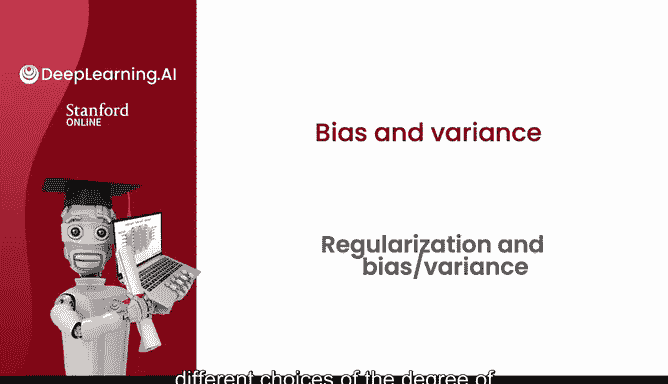
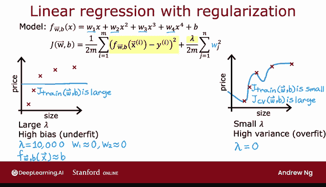
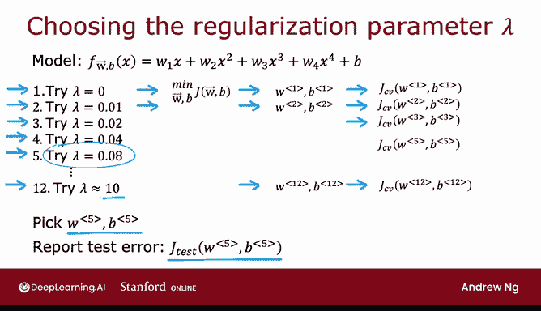
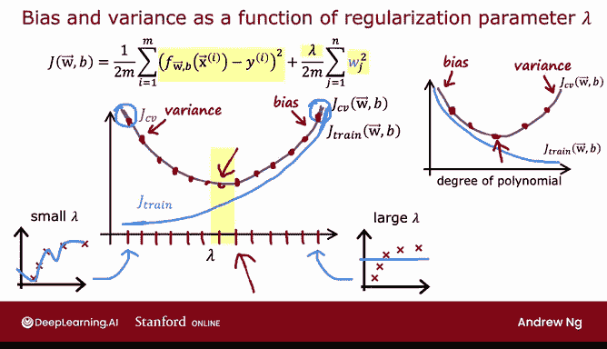

# 吴恩达《机器学习》｜machine-learning（中英字幕-deepseek翻译） - P79：37_03_02_正则化与偏差-方差.zh_en - GPT中英字幕课程资源 - BV1MN4y1S7DE

You saw in the last video how different choices of the degree of polynomial D affects the bias and variances of your learning algorithm and therefore as overall performance In this video let's take a look at how regularization specifically the choice of the regularization parameter lambda affects the bias and variances and therefore the overall performance of the algorithm This it turns out will be hopeful for when you want to choose a good value of lambda of the regularization parameter for your algorithm let's take a look In this example I'm going to use a four of all the polynomial but we're going to fit this model using regularization where here the value of lambda is the regularization parameter that controls how much you trade off keeping the parameters W small versus fitting the training data well。

Let's start with the example of setting Lada to be a very large value， say Lada is equal to 10，000。

If you were to do so， you would end up fitting a model that looks roughly like this。

Because if lambda were very， very large， then the algorithm is highly motivated to keep these parameters W very small。

 and so you end up with W1 W2， really all of these parameters would be very close to zero。

And so the model ends up being F of x is just approximately B a constant value。

 which is why you end up with a model like this。And this model clearly has high bias and it underfits。

The training data because it doesn't even do well on the training set and J train is large。

Let's take a look at the other extreme。Let's say you set lambda to be a very small value。

 So with a small value of lambda。In fact， let's go to the extreme of setting lambda equals zero。

With that choice of la， there is no regularization and so we're just fitting the fullvol polynomial with no regularization and you end up with that。

Curve that you saw previously that overfits the data and so what we saw previously was when you have model elect this。

 Jtrainin is small， but JCV is much larger than Jtrainin or JCV is large and so this indicates with high variances and it overfis this data。

And it would be if you have some intermediate value of la， not really largely 10，000。

 but not so small as0， that hopefully you get a model that looks like this that is just right and fits the data well with small Jtrain and small JCV。

So if you are trying to decide what is a good value of launder to use for the regularization parameter。

 cross validation gives you a way to do so as well。

Let's take a look at how we could do so and just as a reminder。

 the problem we're addressing is if you're fitting a fourthwater polynomial。

 so that's the model and you're using regularization， how can you choose a good value of Lada？

This would be procedure similar to what you have seen for choosing the degree of polynomial D using cross validation。

Specifically， let's say we try to fit a model using lambda equals0。 and so we would minimize。

The cost function using lambda equals0 and end up with some parameters w1， B1。

 and you can then compute the cross validation error， JCV of W1 B1。

And now let's try a different value of Lada， let'sly try lambda equals 0。01。 Then again。

 minimizing the cost function gives you a second set of parameters W2 B2。

And you can also see how well that does on the cross validationation set and so on and let's keep trying other values of Lada and in this example I'm going to try doubling it to lambda equals002 and so that will give you JCV of W3 B3 and so on and let's double again and double the again after doubling a number of times you end up with lambda approximately equal to 10 and that will give you parameters W12 B12。

And JCV W12 V12 and by trying out to large range of possible values for La， fitting parameters。

 using those different regular parameters and then evaluating the performance on the cross validation set。

 you can then try to pick what is the best value for the regularization parameter。Concretely。

 if in this example， you find that JCV of W5。B5 has the lowest value of all of these different cross validation errors you might then decide to pick this value for Laer。

And so use W 5， B5 as the chosen parameters。And finally， if you want to report out。

An estimate of the generalization error， you would then report out the test set error。

 J test of W5 B5。

To further hold an intuition about what this algorithm is doing。

 let's take a look at how training error and cross validation error vary as a function of the parameter Lada。

 So in this figure I've change the x axis again， notice that the X axis is here。

Is annotated with the value of the regular parameter lambda。And。

If we look at the extreme of lambda equals 0。Here on the left。

 that corresponds to not using any organizationization and so that's where we wound up with this very weeklyly curve if long that was small or it was even zero。

And in that case， we have a high variance model， and so Jtrain is going to be small and JCV is going to be large because it does great on the training data。

 but does much worse on the cross validation data。This extreme on the right with very large values of lambda。

 say lambda equals 10，000 ends up with fitting a model that looks like that， so this has high bias。

 it underfiit data and it turns out Jtrain will be high and JCV will be high as well。And in fact。

 if you were to look at how J train varies as a function of Lada。

 you find that Jtrainin will go up like this because in the optimization cost function。

 the larger Lada is， the more the algorithm is trying to keep W squared small。

 that is the more weight iss giving to this regular term。

 and thus the less attention is paying to actually doing well on the training set。

 where around this term on the left is Jtrain， so the more trying to keep the parameter small。

 the less good a job it does on minimizing the training error。So that's why as longda increases。

 the training error J train will tend to increase like so。Now， how about the cross validation error。

 turns out the cross validation error。Will look like this。

Because we've seen that if laer is too small or too large。

 then it doesn't do well on the cross validation set， it either overfits here on the left or。

Underfis here on the right。And therell be some intermediate value of laer that causes the algorithm to perform this。

And what cross validation is doing is trying out a lot of different values of Lada。

 this is what we saw in the last slide try out Lada equals 0， Lada equals 0。01 Lada equals 0。02。

 try a lot of different values of Lada and evaluate the cross validation error at a lot of these different points。

And then hopefully pick a value that has low cross validation error。

 and this will hopefully correspond to a good model for your application。

If you compare this diagram to the one that we had in the previous video where the horizontal axis was the degree of polynomial。

 these two diagrams look a little bit， not mathematically and not in uniformal way。

 but they look a little bit like mirror images of each other and that's because when you're fitting a degree of polynomial。

The left part of this curve corresponded to underfitting and high bias。

 the right part corresponded to overfitting and high variances， whereas in this one。

 high variances was on the left and high bias was on the right。

 but that's why these two images are a little bit like mirror images of each other。

 but in both cases cross validation， evaluating different values can help you choose a good value of T or a good value of Lada。

So that's how the choice of regularization parameter Lada affects the bias and variance and overall performance of your algorithm。

 and you've also seen how you can use cross validationation to make a good choice for the regularization parameter Lada。

Now so far we've talked about how having a high training setter。

 high Jtrainin is indicative of high buyers and how having a high crossvalidation error， JCV。

 specifically if it's much higher than Jtrainin， how that's indicative of variance problem but what do these words high or much higher actually mean。

 let's take a look at that in the next video where we'll look at how you can look at the numbers Jtrainin and JCV and judge if it's high or low。

 and it turns out that one further refinement of these ideas that is establishing a baseline level of performance we're learning algorithm will make it much easier for you to look at these numbers。

 Jtrain JCV and judge if they're high or low， let's take a look at what all this means in the next video。

