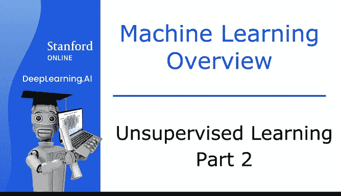
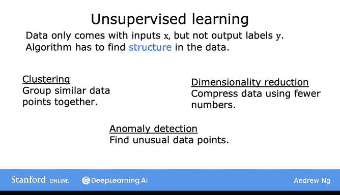
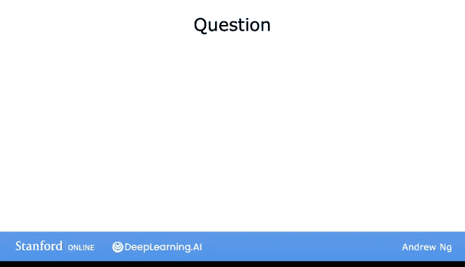

# 吴恩达《机器学习》｜machine-learning（中英字幕-deepseek翻译） - P7：07_01_05_无监督学习第二部分.zh_en - GPT中英字幕课程资源 - BV1MN4y1S7DE

In the last video you saw what is unsupervised learning and one type of unsupervised learning called clustering let's give a slightly more formal definition of unsupervised learning and take a quick look at some other types of unsupervised learning other than clustering。

 whereas in supervised learning the data comes with both input X and output labels Y in unsupervised learning。

 the data comes only with input X， but not output labels Y。

 and the algorithm has defined some structure or some pattern or something interesting in the data。

We've seen just one example of unsupervised learning called a clustering algorithm。

 which group similar data points together。In this specialization， you learn about clustering。

 as well as two other types of unsupervised learning， one is called anomaly detection。

 which is used to detect unusual events， this turns out to be really important for fraud detection in the financial system。

 where unusual events， unusual transactions could be a signs of fraud and for many other applications。

And you also learn about dimensionality reduction This lets you take a big data and almost magically compress it to a much smaller data set while losing as little information as possible in case anomami detection and dimensionality reduction don't seem to make too much sense to you yet don't worry about it will get to this later into specialization Now I'd like to ask you another question to help you check your understanding。

And no pressure， if you don't get it right on the first try， its totally fine。

Please select any of the following that you think are examples of unsupervised learning。

 two are unsupervised examples and two are supervised learning examples， so please take a look。

Maybe you remember the spam filtering problem， if you have label data， you know。

 label as spam or non spam email， you can treat this as a supervised learning problem。

The second example， the news story example， that's exactly the Google New and tanF example that you saw in the last video。

 and so you can approach that using a clustering algorithm to group news articles together so that would use unsupervised learning。

The market segmentation example that I talked about a little bit earlier。

 you can do that as an unsupervised learning problem as well because you can give your algorithm some data and ask it to discover market segments automatically。

And the final example on diagnosing diabetes， well。

 actually that's a lot like a breast cancer example from the supervised learning videos。

Only instead of benign or malignant tumors， we instead have diabetes or not diabetes。

 and so you can approach this as a supervised learning problem。

 just like we did for the breast tumor classification problem。Even though in this S last video。

 we've talked mainly about clustering in later videos into this specialization will dive much more deeply into anomaly detection and dimensionality reduction as well。

So that's unsupervised learning Before we wrap up the section I want to share with you something that I find really exciting and useful。

 which is the use of Jupiter notebooks in machine learning let's take a look at that in the next video。

