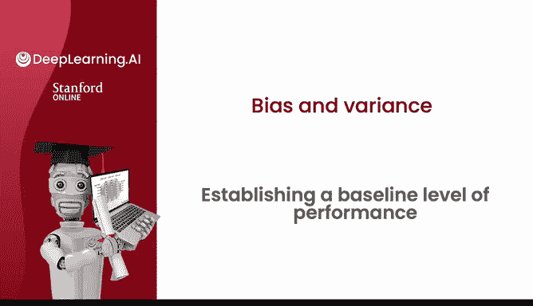
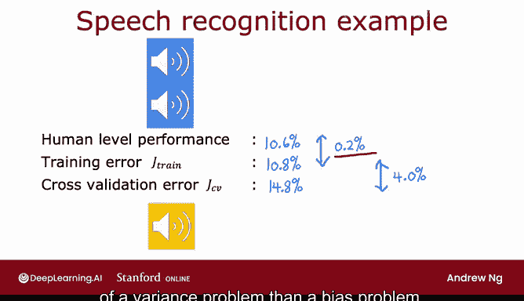
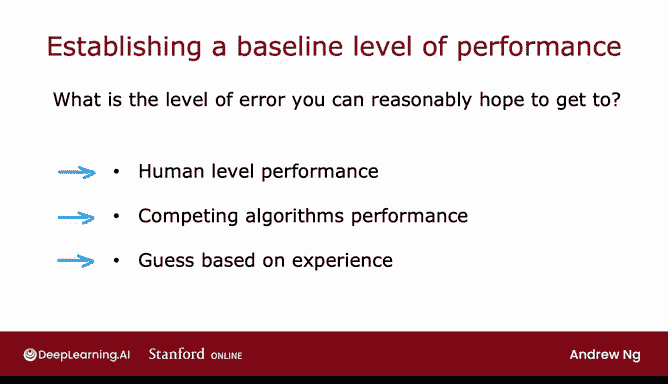
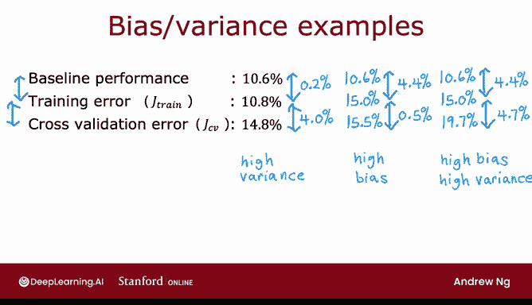

# 吴恩达《机器学习》｜machine-learning（中英字幕-deepseek翻译） - P80：38_03_03_建立性能基线水平.zh_en - GPT中英字幕课程资源 - BV1MN4y1S7DE

Let's look at some concrete numbers for what JTin and JCV might be and see how you can judge if a learning algorithm has high biasers or high variances and for the examples in this video I'm going to use as a running example。

 the application of speech recognition which is something I've worked on multiple times over the years Let's take a look a lot of users doing web search on a mobile phone will use speech recognition rather than type on the tiny keyboards on a phones because speaking to a phone is often faster than typing。

And so typical audio that a web search engine would get would be like this what is today's weather or like this coffee shops near me and is the job of the speech recognition algorithm to output the transcripts。

 whether's today's weather or coffee shops near me。Now。

 if you were to train a speech recognition system and measure the training error and the training error means what's the percentage of audio clips in your training set that the algorithm does not transnscribe correctly in its entirety？

Let's say the training error for this data set is 10。8%， meaning that it trascribes it perfectly for。

89。2% of your training set， but make some mistake in 10。8% of your training set。

And if you were to also measure your speech recognition algorithmm's performance on a separate cross validation set。

Let's say it gets 14。8% error。So if you were to look at these numbers。

 it looks like the training error is really high， it got 10% wrong。

 and then the cross validation error is higher but。Getting 10% of even your training set wrong。

 that seems pretty high and it seems like that 10% error would lead you to conclude it has to have high bias because it's not doing well on your training set。

 but it turns out that when analyzing speech recognition is useful to also measure one other thing。

 which is what is the human level of performance in other words。

 how well can even humans transscribe speech accurately from these audio clips and concretely let's say that you measure how well。

Fluent speakers can trans audio clips and you find that human level performance achieves 10。6% error。

 why is human level error so high？It turns out that for web search。

 there are a lot of audio clips that sound like this， I'm going to navigate too on where。

And there's a lot of noisy audio where really no one can accurately transcribe what was said because of the noise in the audio。

And if even a human makes 10。6% error， then it seems difficult to expect a learning algorithm to do much better and so in order to judge if the training error is high it turns out to be more useful to see if the training error is much higher than the human level of performance and in this example it does just 0。

2% worse than humans given that humans are actually really good at recognizing speech。

 I think if I can build a speech recognition system that achieves 10。

6% error matching human performance I'd be pretty happy so it's just doing a little bit worse than humans。

 but in contrast the gap or the difference between JCV and Jtrainin is much larger。

 there's actually a 4% gap there。So whereas previouslysley， we have said maybe 10。

8% error means this is high bias。When we benchmark to human level of performance。

 we see that the average is actually doing quite well on the training set。

But the bigger problem is the cross validation error is much higher than the training error。

 which is why I would conclude that this algorithm actually has more of a variance problem than a bias problem。

 So it turns out when judging if the training error is high is's often useful to。

Establish a baseline level of performance and by baseline level of performance I mean。

 what is the level of error you can reasonably hope your learning algorithm to eventually get to。

And one common way to establish a baseline level of performance is to measure how well humans can do on this task。

 because humans are really good at understanding speech data or processing images or understanding text。

 human level performance is often a good benchmark when you are using unstructured data such as audio images or text。

Another way to estimate a baseline level of performance is if there's some competing algorithm。

 maybe a previous implementation that someone else had implemented or even a competitive's algorithm to establish a baseline level of performance。

 if you can measure that， or sometimes you might guess based on prior experience。

And if you have access to this baseline level of performance。

 that is what is the level of error you can reasonably hope to get to or what is the design level of performance that you want your algorithm to get to then when judging if an algorithm has high biasvariance you would look at the baseline level performance and the training error and the cross validationation error and the two key quantities to measure are then。

What is the difference between training error and the baseline level that you hope to get to？

So this is 0。2 and if this is large， then you would say you have a high bias problem and you would then also look at this gap between your training error and your cross validation error and if this is high。

 then you would conclude you have a high variance problem and that's why in this example we conclude it we have a high variance problem。

Whereas let's look at the second example。If the baseline level of performance。

 that the human level of performance and training error and cross validation error look like Lewis。

Then this first gap is。4。4% and so there's actually a big gap。

 the training error is much higher than what humans can do and what we hope to get to。

 whereas the crossvalidation error is just a little bit bigger than the training error and so if your training error and cross validationid error look like this I would say this aantus。

High bias and so by looking at these numbers， training error and cross validation error。

 you can get a sense intuitively or informally of the degree to which your algorithm has a high bias or high variance problem。

And so just to summarize， this gap between these first two numbers gives you a sense of whether you have a high bias problem and the gap between these two numbers gives you a sense of whether you have a high variance problem and sometimes the baseline level of performance could be0% if your goal is to achieve perfect performance。

 then the baseline level performance could be0%。But for some applications like the speech recognition application where some audios just noisy than the baseline of a performance could be much higher than zero and the method described on this slide will give you a better read in terms of whether your algorithms suffers from bias or variants and by the way。

 it is possible for your algorithm to have high bias and high variances so concretely if you get numbers like these。

Then the gap between the baseline and the training error is large， that would be a 4。4%。

And the gap between training and cross validation error is also large， this is 4。

7% if it looks like this， you would conclude that your algorithm has high bias and high variances。

Although hopefully this won't happen that often for your learning applications， so to summarize。

 we've seen that looking at whether your training error is large is a way to tell if your algorithm has high biasers。

But on applications where the data is sometimes just noisy and is infeasible or unrealistic to ever expect to get to zero error。

 then it's useful to establish this baseline level of performance so that rather than just asking。

 is my training error large， you can ask is my training error large relative to what I hope I can get to eventually。

 such as is my training error large relative to what humans can do on a task。

 and that gives you a more accurate read on how far away you are in terms of a training error from where you hope to get to？

And then similarly， looking at whether your trust allegvation error is much larger than your training error gives you a sense of whether or not your algorithm may have a high variance problem as well。

And in practice this is how I often will look at these numbers to judge if my learning algorithm has a high bias or high varianceance problem Now to further hone our intuition about how a learning algorithm is doing。

 there's one other thing that I found useful to think about， which is the learning curve。

 let's take a look at what that means in the next video。

