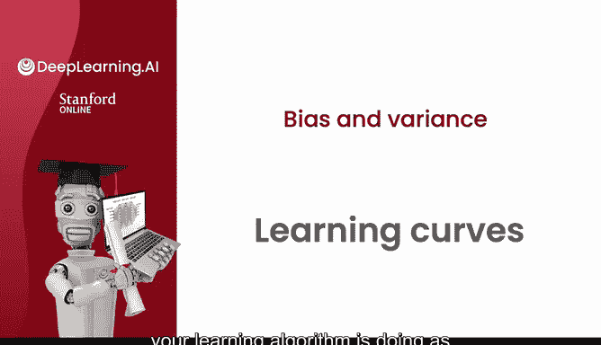
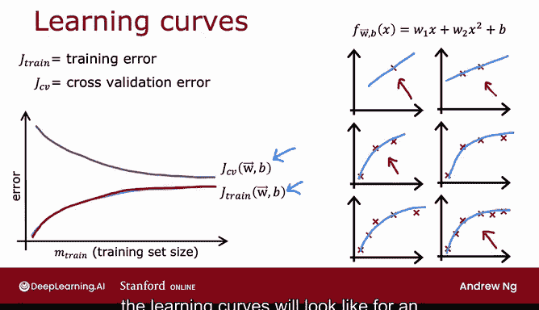
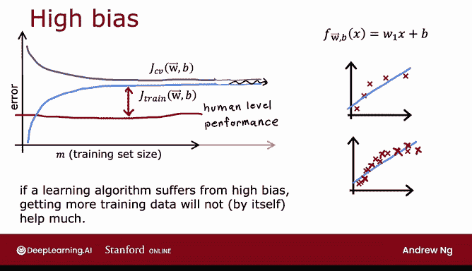
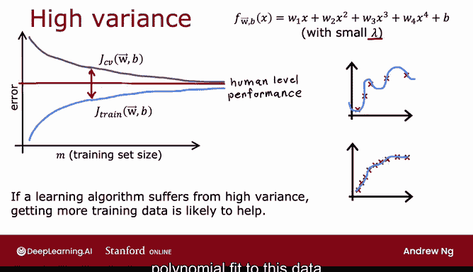

# 吴恩达《机器学习》｜machine-learning（中英字幕-deepseek翻译） - P81：39_03_04_学习曲线.zh_en - GPT中英字幕课程资源 - BV1MN4y1S7DE

Learning curves are a way to help understand how your learning algorithm is doing as a function of the amount of experience it has。

 whereby experience I mean for example， the number of training examples it has， let's take a look。

 let me plot learning curve for a model that fits a second auto polynomial or quatic function like so and I'm going to plot both JCV。

 the crossval error as was Jtrain the training error。

So on this figure， the horizontal axis is going to be M。Train。

 that is the training set size or the number of examples that the algorithm room can learn from。

 and on the ver I'm going to plot the error and by error I mean either JCV or Jtrain。

So let's start by plotting the cross validation error， it will look something like this。

So that's what JCV of WB will look like。And it's maybe no surprise that as am trained。

 the training set size gets bigger， then you learn a better model and so the cross validation error goes down。

Now let's plot J train of WB of what the training error looks like as the training set size gets bigger。

It turns out that the training error will actually look like this。

That as the training set gets bigger the training sets error actually increases let's take a look at why this is the case we'll start with an example of when you have just a single training example。

 well if you were to fit a quadratic model to this。

 you can fit you know easy a straight lineer curve and your training error would be zero。

How about if you have two training examples like this。

 well you can again fit straight line and achieve zero training error in fact if you have three training examples。

 the quache like function can still fit this very well and get pretty much zero training error。

But now if your training set gets a little bit bigger， so you have four training examples。

 then it gets a little bit harder to fit all four examples perfectly and you may get it curve that looks like this。

 fit it pretty well but a little bit often a few places here there and so when you have entries the training set size to four the training error has actually gone up a little bit。

How about when you have five training examples， well again。

 you can fit it pretty well but it gets even a little bit harder to fit all of them perfectly and when you have an even larger training set it just gets harder and harder to fit every single one of your training examples perfectly。

So to recap， when you have a very small number of training examples， like one or two or even three。

 it's relatively easy to get zero or very small training error。

 but when you have a larger training set， it' harder for a quaial function to fit all the training examples perfectly。

 which is why as the training set gets bigger。The training ever increases because it's harder to fit all of the training examples perfectly。

Notice one other thing about these curves， which is that crossvalidation error will be typically higher than the training error because you fit the parameters to the training set and so you expect to do at least a little bit better or when m is small maybe even a lot better on the training set than on the crossvalidation set let's now take a look at what the learning curves will look like for an error with high bias versus one with high theians let's start at the high bias or the underfiing case recall that an example of high bias will be if you're fitting a linear function to curve that looks like this if you were to plot the training error。

 then the training error will go up like so as you'd expect。

And in fact， this curve of training error may start to flatten out or we call it plateau。

 meaning flatten out。After a while， and that's because as you get more and more training examples。

 when you're fitting the simple linear function， your model doesn't actually change that much more。

Spitting a straight line and even as you get more and more and more examples。

 there's just not that much more to change， which is why the average training error flattens out after a while。

And similarly， your cross validationidation error will come down and also flatten out after a while。

 which is why JCV again is higher than Jtrainin but JCV will tend to look like that。

 and it's because beyond a certain point， even as you get more and more and more examples。

 not much is going to change about the straight line you're fitting is just too simple。

 a model to be fitting to dismch data， which is why both of these curves。

 JCV and Jtrainin tend to flatten after a while。And。

If you had a measure of that baseline level of performance， such as human level performance。

 then it'll tend to be a value that is lower than your Jtrain and your JCV。

 so human level performance may look like this， and there's a big gap between the baseline level of performance and Jtrain which was our indicator for this algorithm having high bias。

That is， one could hope to be doing much better if only we could fit a more complex function than just a straight line。

Now one interesting thing about this plot is you can ask。

 what do you think will happen if you could have a much bigger training set？

What would it look like if we could increase M even further than the right of this plot and go further to the right as follows Well you can imagine if you were to extend both these curves in the right they both sort of flatten out and both of them will probably just continue to be flat like that and no matter how far you extend to the right of this plot。

 these two curves they will never you know somehow find a way to dip down to this human level of performance or just keep on being kind of flat like this。

Pretty much forever， no matter how large the training set gets。

So that gives this conclusion maybe a little bit surprising that if a learning algorithm has high bias。

 getting more training data will not by itself， hope that much and I know that we're used to thinking that having more data is good。

 but if your album has high bias， then if the only thing you do is throw more training data at it。

That by itself would not ever let you bring down the error rate that much and it's because of this really no matter how many more examples you add to this figure the straight line you're fitting just isn't going to get that much better and that's why before investing a lot of effort into collecting more training data。

 it's worth checking if your're learning algorithm has high bias because if it does。

 then you probably need to do some other things other than just throw more training data at it。

Let's now take a look at what the learning curve looks like for learning algorithm with high variances you might remember that if you were to fit the fullvol polynomial。

With small lambda， say or even lambda equals zero， then you get a curve that looks like this。

And even though it fits the trading data very well， it doesn't generalize。

Let's now look at what a learning curve might look like in this high variance scenario。

J train will be going up。As the training set size increases so you get a curve that looks like this and JCV will be much higher so your crossvalidation error is much higher than your training error and the fact is a huge gap here is what can tell you that this high variance is doing much better on the training set than it' doing on your cross validationation set if you were to plot a baseline level of performance such as human level performance you may find that it turns out to be here that J training can sometimes be even lower than the human level of performance or maybe human level performance is a little bit lower than this but when you're overfitting the training set you may be able to fit the training set so well to have an unrealistically low error such as zero error in this example over here which is actually better than you how well humans would actually be able to predict housing prices or whatever the application you're working on but again to signal for。

High variance is whether JCV is much higher than Jtrain and when you have high variance。

 then increasing the training set size could help a lot and in particular。

 if we could extrapolate these curves in the right increase M train。

 then the training error would continue to go up。But then the trust validation error hopefully will come down and approach JTin and so in this scenario。

 it might be possible just by increasing the training set size to lower the trust validation error and to get your algorithm to perform better and better and this is unlike the high bias case where if the only thing you do is get more training data that won't actually help you learn your algorithm's performance as much。

So to summarize if if a learning algorithm suffers from high variances。

 then getting more training data is indeed likely to help。

 because extraplating to the right of this curve， you see that you can expect JCV to keep on coming down and in this example。

 just by getting more training data allows the algorithm to go from this relatively high cross validation error to get much closer to human level performance。

You can see that if you were to add a lot more training examples and continue to fill the fourthvol polynomial。

 then you can just you know get a better fourthvol polynomial fit to this data than does very weeklyly curve up on top So if you're building a machine learning application you could plot the learning curve if you want that is you can take different subsets of your training sets and even if you have。

 say 100 training examples， you could train a model on just 100 training examples and look at the training error and a cross validation error。

 then train a model on 200 examples holding out 800 examples and just not using them for now and plot J training a JCV and so on repeat and plot out what the learning curve looked like and if you were to visualize it that way。

 then that could be another way for you to see if your learning curve looks more like a high bias or high variances one。

One downside of plotting learning curves like this is something I've done。

 but one downside is it is computationally quite expensive to train so many different models using different size subsets of your training set。

 so in practice it isn't done that often， but nonetheless I find that having this mental visual picture in my head of what the training set looks like sometimes that helps me to think through what I think my learning algorithm is doing and whether it has high bias or high variance。

So I know we've gone through a lot about buys and variances。

 let's go back to our early example of if you have trained a model for housing price prediction。

 how does buys and variance help you decide what to do next let's go back to that early example which I hope will now make a lot more sense to you Let's do that in the next video。

