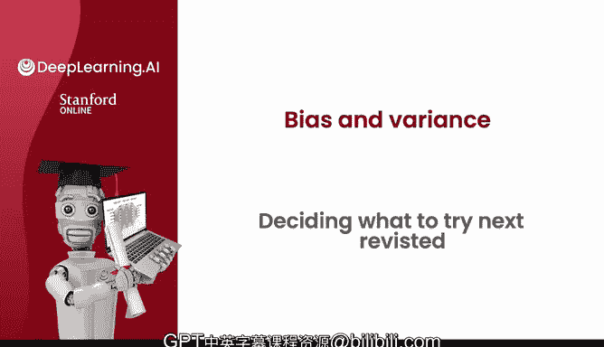

# 吴恩达《机器学习》｜machine-learning（中英字幕-deepseek翻译） - P82：40_03_05_重新审视决定下一步尝试什么.zh_en - GPT中英字幕课程资源 - BV1MN4y1S7DE

You've seen how by looking at JTin and JCV that is the training error in the crossvalidation error or maybe even plotting a learning curve。

 you can try to get a sense of whether your learning algorithm has high bias or high variances This is a procedure I routinely do when I'm training a learning algorithm or often look at the training error in the crossval error to try to decide if my algorithm has high bias or high variances it turns out this will help you make better decisions about what to try next in order to improve the performance of your learning algorithm let's look at an example。

This is actually the example that you had seen earlier if you've implemented regularized linear regression on predicting housing prices。

But your algorithm makes on the set three large errors in these predictions what do you try and links and these were the six ideas that we had when we had looked over this slide earlier。

 get more training examples， try set features， additional features and so on。

 it turns out that each of these six items either helps fix a high variance or a high bias problem and in particular if your learning algorithm has high bias。

 three of these techniques will be useful， if your learning algorithm has high variances then a different three of these techniques will be useful。

Let's see if can figure out which is which？First， one is get more training examples。

We saw in the last video that if your algorithm has high bias。

 then if the only thing we do is get more training data。That by itself probably won't help that much。

 but in contrast， if your album had hi variances， say it was overfitting to a very small training set。

Then getting more training examples will help a lot。

So this first option of killing more training examples helpss to fix a high variance problem。

How about the other five do you think you can figure out which of the remaining five fixed high bias or high variance problems I'm going to go through the rest of them in this video a minute。

 but if you want feel free to pause the video and see if you can think through these five other things by yourself so feel free to pause the video and。

Just kidding， that was me pausing， not your video pausing， but seriously if you want。

 go ahead and pause the video and think through it that you want or not。

 and we'll go over these with you in a minute。How about trying a smaller set of features Sometimes if your learning algorithm has too many features。

 then it gives the algorithm too much flexibility to fit very complicated models this is a little bit like if you had X X squared。

 X cubed， X the fourth， X the fifth and so on。And if only you were to eliminate a few of these。

 then your model won't be so complex and it won't have such high variances。

 So if you suspect that your algorithm has a lot of features that are not actually relevant or helpful to predicting a housing price or if you suspect that you have even somewhat redundant features。

 then eliminating or reducing the number of features will help reduce the flexibility of your algorithm to overfit the data And so this is a tactic that will help you to fix high variances。

 conversely getting additional features， that's just adding additional features is kind of the opposite of going to a smaller set of features。

 this will help you to fix a high bias problem。As a concrete example。

 if you were trying to predict the price of a house just based on the size。

 but it turns out that the price of a house also really depends on the number of bedrooms and on the number of floors and on the age of a house then the algorithm will never do that well unless you add in those additional features so that's a high bias problem because you just can't do that well on the training set when you know only the size is's only when you tell the algorithm。

 how many bedrooms are there， how many floors are there what the age of the house that it finally has enough information you even do better on the training set。

And so adding additional features is a way to fix a high bias problem。

Adding polynomial features is a little bit light。Adding additional features so if your linear function straightline can't fit the training set that well。

 then adding additional polynomial features could help you do better on the training set and helping you do better on the training set is a way to fix a high biased problem and then decreasing Lada means to use a lower value for the regular parameter and that means we're going to pay less attention to this term and pay more attention to this term to try to do better on the training set and again that helps you to fix a high bias problem and finally increasing Lada。

 well that's the opposite of this but that says you're overfitting the data and so increasing Lada will make sense if it's overfitting the training set just putting too much attention to fitting the training set but at the expense of generalizing to new examples。

And so increasing Lada would force the algorithm to fit a smoother function。

 maybe a less wigly function， and use this to fix a high variance problem。

So I realized that this was a lot of stuff on the slide。

But the takeaways I hope you have are if you find that your algorithm has high variances。

 then the two main ways to fix that are either get more training data。Or simplify your model。

 And by simplify model， I mean either。Get a smaller set of features or increase the regular parameter or la。

 so your album has less flexibility to fit very complex， very wly curves。Conversely。

 if your algorithm has high bias， then that means it's not doing well even on the training set。

 so if that's the case， the main fixes are to make your model more powerful or to give it more flexibility to fit more complex or more weeklyigly functions and so some ways to do that are to give it additional features or add these polynoial features or to decrease the regularization parameter Lada。

Anyway， in case you're wondering if you should fix high bias by reducing the training set size that doesn't actually help if reduce the training set size。

 you will fit the training set better， but that tends to worsen your cross validationid error in the performance of your learning algorithm so don't randomly throw away training examples just to try to fix a high bias problem one of my PhD students from Stanford。

 many years after he already graduate from Stanford once said to me that while he was studying at Stanford。

 he learned about bias and variances and felt like he got it he understood it but that subsequently after many years of work experience in a few different companies。

 he realized that bias and variances is one of those concepts that takes a short time to learn but takes a lifetime to master those were his exact words and I think bias andvaris it is one of those very powerful ideas when I'm training learning algorithm I almost always try to figure out if it is。

varianceBut the way you go about addressing it systematically is something that I think you will keep on getting better at through repeated practice。

But you're find， I think that understanding these ideas will help you be much more effective at how you decide what to try next when developing a learning algorithm。

Now I know that we did go through a lot in this video and if you feel like boy there's just a lot of stuff here is okay don't worry about it later this week in the practice labs and practice quizzes will have also additional opportunities to go over these ideas so that you can get additional practice with thinking about bias and variants of different learning algorithms so if it seems like a lot right now is okay you get to practice these ideas later this week and hopefully deepen your understanding of them at that time。

Before moving on， buys and variants also are very useful when thinking about how to train a neural network。

 so in the next video let's take a look at these concepts applied to neural network training let's go on to the next video。

