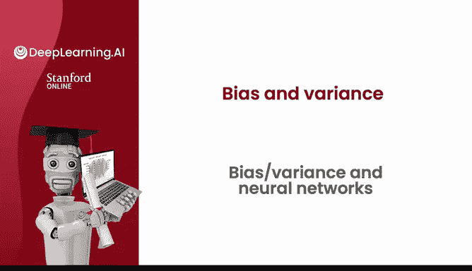
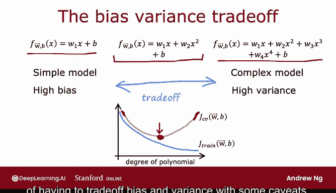
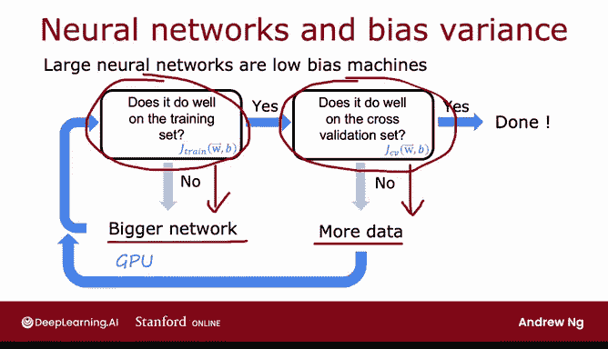
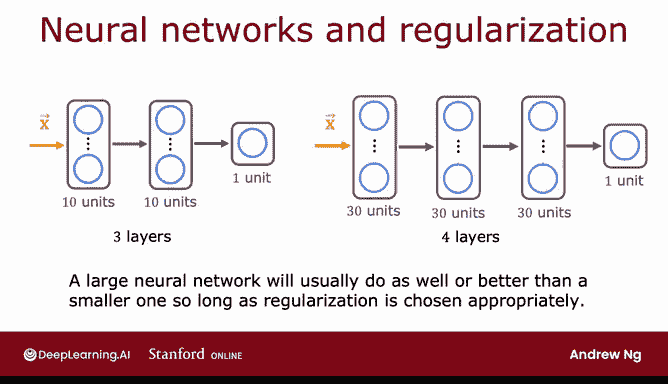

# 吴恩达《机器学习》｜machine-learning（中英字幕-deepseek翻译） - P83：41_03_06_偏差-方差与神经网络.zh_en - GPT中英字幕课程资源 - BV1MN4y1S7DE

We've seen that high bias or high variances are both bad in the sense that they hurt the performance of your algorithm one of the reasons that neural networks have been so successful is because neural networks together with the idea of big data of hopefully having large dataset sets is giving us a new way of new ways to address both high bias and high variances。

 let's take a look， you saw that if you're fitting different older polynomials to a data。

Then if you were to fit a linear model。Like this on the left。

 you have a pretty simple model that can have high bias whereas you were to fit a complex model。

 then you might suffer from high variants， and there's this tradeoff between bias and variantans and in our example it was choosing a second auto polynomial that helps you make a tradeoff and pick a model with lowest possible trust validationation error。

And so before the days of neural networks， machine learning engineers talked a lot about this biased variance trade off in which you had to balance the complexity that is。

The degree of polynomial or the regular parameters a la to make biasers and variances both not be too high and if you hear machine learning engineers talk about the bias variance tradeoff。

 this is what they're referring to where if you have too simple a model。

 you have high bias to complex a model high variances and you have to find a tradeoff between these two bad things to find probably the best possible outcome but it turns out that neural networks offer us a away all of this dilemma of having a tradeoff bias and variances with some caveats。

And it turns out that large neural networks when trained on small to moderate size dataset sets are low bias machines and what I mean by that is if you make your neural network large enough。

 you can almost always fit your training set well so long as your training set is not enormous and what this means is it gives us a new recipe to try to reduce bias or reduce variance as needed without needing to really trade off between the two of them。

 so let me share with you a simple recipe that isn't always applicable。

 but if it is's a bias can be very powerful for getting an accurate model using a neural network。

Which is。First， train your algorithm on your training set and then ask。

 does it do well on the training set so measure J train？And see if it is high。And by high， I mean。

 for example， relative to human level performance or some baseline level of performance。

And if it is not doing well， then you have a high bias problem， high training set error。

 and one way to reduce bias is to just use a bigger neural network， and by bigger neural network。

 I mean either more hidden layers or more hidden units per layer。

 and you can then keep on going through this loop and make your neural network bigger and bigger until it does well on the training set。

 meaning it achieves the level of error on your training set that is roughly comparable to target level of error you hope to get to。

 which could be human level performance。After it does fall on the trading set。

 so the answer to that question is yes。U then ask does it do well on the trust validationidation set。

 in other words， does it have high variance？And if the answer is no。

 then you can conclude that the algorithm has high variances because it does want the training set。

 does not do one on the cross validation set， so that big gap in JCV and J train indicates you probably have a high varianceance problem。

And if you have a high variance problem， then one way to try to fix it is to get more data。

 to get more data and go back and retrain the model and just double checkck that it does well on the trading set。

 if not have a bigger network or it does see if it does want a trust validationation set and if not get more data。

 and if you can keep on going round and round and round this loop until eventually it does well on the trust validationidation set。

 then you're probably done because now you have a model that does well on the trust validationation set and hopefully will also generalize to new examples as well。

Now， of course there are limitations the application of this recipe。

 training a bigger neural network does reduce bias。

 but at some point it does get computationally expensive。

 that's why the rise of neural networks has been really assisted by the rise of very fast computers。

 including especially GPUs or graphics processor units。

Hardware traditionally used to speed out computer graphics。

 but that turns out has been very useful for speeding of neural networks as well。

 but even with hardware accelerators beyond a certain point。

 the neural networks are so large and takes so long to train it becomes infeasible。And then。

 of course， the other limitation is。More data sometimes you can only get so much data and beyond a certain point it's hard to get much more data。

 but I think this recipe explains a lot of the rise of deep learning in the last several years。

 which is for applications where you do have access to a lot of data then being able to train large neural networks allows you to eventually get pretty good performance on a lot of applications One thing that was implicit in this slide that may not have been obvious is that as you're developing a learning algorithm sometimes you find that you have high bias in which case you do things like increase in neural network。

 but then after you increase the neural network， you may find that you have high variance。

 in which case you might do other things like collect more data and during the hours or days or weeks you're developing a machine learning algorithm at different points you may have high bias or high variances and it can change。

But it's depending on whether your algorithm has high bias or high variances at that time。

 that that can help give guidance for what you should be trying next。

When you're training a neural network， one thing that people have asked me before is， hey， Andrew。

 what my neural network is too big？Will that create a high variance problem？

It turns out that a launch neural network with well chosen regularization will usually do as well better than a smaller one。

And so for example， if you have a small neural network like this。

And you were to switch to a much larger neural network like this。

 you would think that the risk of overfitting goes up significantly。

But it turns out that if you were to regularize this larger neural network appropriately。

 then this larger neural network usually will do at least as well or better than the smaller one。

 so long as the regularization is chosen appropriately。

So another way of saying this is that it almost never hurts to go to a larger neural network so long as you regularize appropriately with one caveat。

 which is that when you train a larger neural network。

 it does become more computationally expensive so the main way it hurts is it' will slow down your training and your inference process and very briefly to regularize a neural network。

 this is what you do。If the cost function for your neural network is the average loss。

 And so the loss here could be。Squared error or logistic loss。

 then the regular term for a neural network looks like pretty much what you expect is Lada over 2M times the sum of w squared where this is a sum over always w in the neural network。

And similar to regularization for linear regression and legislative regression。

 we usually don't regularize the parameters being in a neural network。

 although in practice it makes very little difference whether you do so or not。

And the way you would implement regularization in TensorFlow is recall that this was the code for implementing an unregularized handwritten digit classification model。

 we create three layers like so。With number of hidden units activation and then create a sequential model with the three layers。

 if you want to add regularization， then you would just add this extra term kernel regularizer equals L2 and then 0。

01 where that's the value of lambda In Ten offlow actually lets you choose different values of lambda for different layers。

 although for simplicity， you can choose the same value of Lada for all the weights in all of the different layers as follows。

 and then this will allow you to implement regularization in your neural network。So to summarize。

 two takeaways I hope you have from this video are one。

 it hardly ever hurts to have a larger neural network so long as you regularize appropriately。

One cave being that having a larger neural network can slow down your algorithms。

 so maybe that's the one way it hurts， but it shouldn't hurt your algorithm's performance for the most part and in fact。

 it could even help it significantly and second，So long as your training set isn't too large。

 then a neural network， especially a large neural network， is often a low biased machine。

 It just fits very complicated functions very well。

 which is why when I'm training neural networks I find that I'm often fighting various problems rather than bias problems at least the neural network is large enough So the rise of deep learning has really changed the way that machine learning practitioners think about bias and variants Having said that even when you're training a neural network。

 measuring bias invaris and using that to guide what you do next is often a very hopeful thing to do。

So that's it for bias and theoryians， let's go on to the next video where we'll take all the ideas we've learned and see how they fit in to the development process of machine learning systems and I hope that will tie a lot of these pieces together to give you practical advice for how to quickly move forward into development of your machine learning systems。

