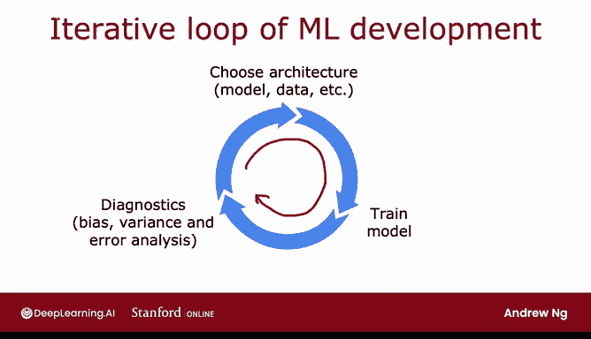
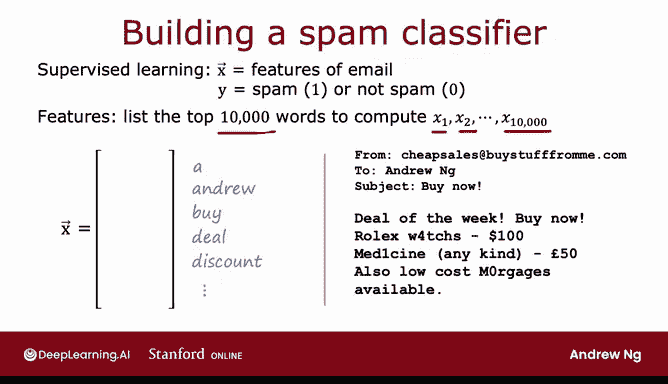
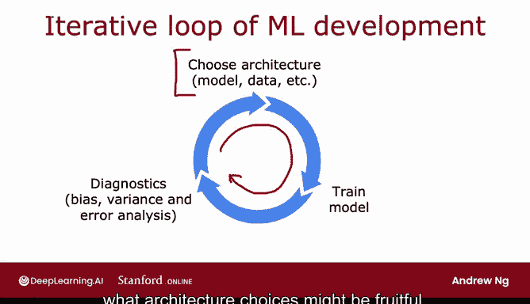

# 吴恩达《机器学习》｜machine-learning（中英字幕-deepseek翻译） - P84：42_03_01_机器学习开发的迭代循环.zh_en - GPT中英字幕课程资源 - BV1MN4y1S7DE

In the next few videos I'd like to share a you what it's like to go through the process of developing a machine learning system so that when you are doing so yourself。

 hopefully you'll be in a position to make great decisions at many stages of the machine learning development process let's take a look first at the iterative loop of machine learning development。

This is what developing a machine learning model will often feel like first you decide on what is the overall architecture of your system and that means choosing your machine learning model as was deciding what data to use may be picking the hyperpar and so on。

Then given those decisions， you would implement and train a model。And as I've mentioned before。

 when you train a model for the first time， it will almost never work as well as you want to。

The next step that I recommend then is to implement or to look at a few diagnostics。

 such as looking at the bias and variants of your algorithm。

 as was something we'll see in the next video called error analysis。

 and based on the insights from the diagnostics， you can then make decisions like do you want to make your neural network bigger or change the Lada regularization parameter or maybe add more data or add more features or subtract features。

 and then you go around this loop again with your new choice of architecture and it' will often take multiple iterations through this loop until you get to the performance that you want？

Let's look at an example of building an email spam classifier I think many of us passionately hate email spam and this is a problem that I worked on years ago and also was involved in starting an anti spam conference once years ago The example on the left is what a highly spammy email might look like the of the week by now rolelex watches and spams will sometimes deliberately。

Mispell words like these watches， medicine and mortgages in order to try to trip up a spam recognizer and in contrast。

 this email on the right is an actual email I once got from my younger brother Alfred about getting together for Christmas。

 So how do you build a classifier to recognize spam versus non spam emails？

One way to do so would be to train a supervised learning algorithm。

Where the input features X will be the features of an email， and the output label Y will be。

1 or zero， depending on whethers spam or not spam。So one way this application is an example of text classification because you're taking a text document that is an email and trying to classify it as either spam or not spam one way to construct the features of the email would be to say take the top 10。

000 words in the English language or in some other dictionary and use them to define features x1 x2 through X 10。

000。So for example， given this email on the right， if the list of words we have is a Andrew。Bye。丢。

Discount。And so on。Then given the email on the right。

 we would set these features to be say 001 depending on whether or not that word appears。

 so the word a does not appear， the word Andrew does appear the word by does appear deal does discount does not and so on and so you can construct 10。

000 features of this email and there are many ways to construct the feature vector。

 another way would be to let。

These numbers not just be1 or0， but actually count the number of times given where it appears in the email。

So if buy appears twice， maybe you want to set this to two。

 but set the end to just one or0 actually works decently well。Given these features。

 you can then train a classification algorithm， such as a logistic regression model or a neural network to predict Y given these features X。

After you've trained your initial model， if it doesn't work as well as you wish。

You will quite likely have multiple ideas for improving the learning algorithm's performance。

For example， it always tempting to collect more data In fact I have friends that have worked on very large-scale honeypot projects and these are projects that create a large number of fake email addresses and tries deliberately to get these fake email addresses into the hands of spams so that when they send spam email to these fake emails where we know these are spam new messages and so this is a way to get a lot of spam data or you might decide to work on developing more sophisticated features based on the email routing email routing refers to the sequence of compute service。

Sometimes around the world that the email has gone through on this way to reach you and emails actually have what's called email Heather information。

 that is information that keeps track of how the email has traveled across different servers across different networks to find its way to you and sometimes the path that an email has traveled can help tell you if it was sent by a spam or not。

Or you might work on coming up with more sophisticated features from the email body that is the text of the email。

So in the features I talked about last time， discounting and discount might be treated as different words。

 and but maybe they should be treated as the same word。

Or you might decide to come up with algorithms to detect misspellings or deliberate misspellings like watches。

 medicine and mortgage， and this too could help you decide if an email is spammy。

So given all of these and possibly even more ideas。

 how can you decide which of these ideas are more promising to work on because choosing the more promising path forward can speed up your project easily 10 times compared to if you were to somehow choose some of the less promising directions For example。

 we've already seen that if your album has high bias rather than high variances then spending months and months on a honeypot project may not be the most truthful direction。

But if your algorithm has hi variances， then collecting more data could help a lot。

 So during the inter loop of machine learning development。

You may have many ideas for how to modify the model or the data and itll be coming up with different diagnostics that could give you a lot of guidance on what choices for the model or data or other parts of the architecture could be most promising to try。

In the last several videos we've already talked about buys and variants in the next video。

 I'd like to start just drivinging to you the error analysis process。

 which is a second key set of ideas for gaining insight about what architecture choices might be fruitful。

So that's the iterative loop of machine learning development and using the example of building a spam classifier。

 let's take a look at what error analysis looks like， let's do that in the next video。

