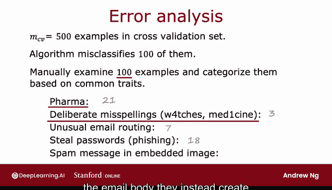
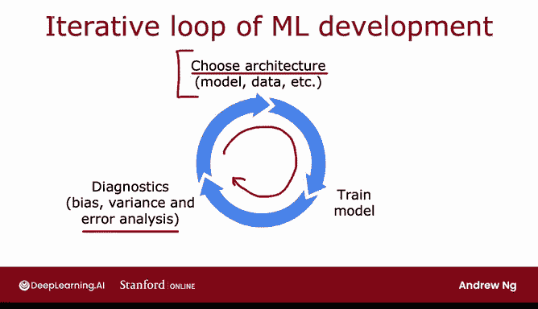

# 吴恩达《机器学习》｜machine-learning（中英字幕-deepseek翻译） - P85：43_03_02_误差分析.zh_en - GPT中英字幕课程资源 - BV1MN4y1S7DE

In terms of the most important ways to help you run diagnostics to choose what to try next to improve your learning algorithm performance。

 I would say bias invariance is probably the most important idea and error analysis would probably be second on my list so let's take a look at what this means concretely let's say you have MCV equals 500 crossvalidation examples and your algorithm misclassifies 100 of these 500 crossvalating examples。

The error analysis process just refers to manually looking through these0 examples and trying to gain insights into where the algorithm is going wrong。

 specifically what I will often do is find a set of examples that the algorithm has misclassified。

Examples from the cross validation set and try to group them into common themes or common properties or common traits。

So for example， if you notice that quite a lot of the misclassified spam emails are pharmaceutical sales trying to sell medicines or drugs。

 then I will actually go through these examples and count up by hand。

 how many emails in misclassified are pharmaceutical spam and say there are 21 emails the pharmaceutical spam。

Or。If you suspect that。Deliberate misspellings may be tripping out the spam classifier。

 then I would also go through and just count out how many of these examples that it misclassified had a deliberate misspelling。

 let's say I find three out of 100。我。Looking through the email routing info。

 I find7 has unusual email routing and。18 are emails trying to steal passwords or phishing emails。

Sam is sometimes also instead of writing the spam message in the email body。

 they instead create an image and then write the spammy message inside an image that appears in the email this makes a little bit harder for a learning algorithm to figure out what's going on and so maybe some of those emails are these embedded image spam if you end up with。

Discount， then that tells you that。Pharmaceutical spam and emails China to steal passwords or phishing emails seem to be huge problems。

 whereas deliberate misspellings， while it is a problem。 it is a smaller one。 in particular。

 what this analysis tells you is that even if you were to really sophisticatedd algorithms to find deliberate misspellings。

 It would only solve three out of 100 of your misclassify the examples。

 So the net impact seems like it may not be that large。 doesn't mean it's not worth doing。

 but when you're prioritizing what to do。 you might therefore decide not to prioritize this as highly。

 and by the way， I'm telling the story because I once actually spent a lot of time building algorithms to find deliberate misspellings and ST emails only much later to realize that the net impact was actually quite small。

 So this is one example where I wish I had done a more careful error analysis before spendinging a lot of time myself。

I to find these celebty misspellings。Just a couple notes on this process。

 these categories can be overlapping or in other words， they're not mutually exclusive。 So。

 for example， there can be a pharmaceutical spam email that also has unusual routing or。

A password that has deliberate misspellings and is also trying to carry out the phishing attack。

 so one email can be counted in multiple categories。And in this example。

 I had said that the algorithm misclassifies 100 examples and we'll look at all 100 examples manually。

 if you have a larger trust validation set， say if you had 5。

000 trust validation examples and if the algorithm misclassify， say 1000 of them。

 then you may not have the time depending on the team size and your。

How much time you have to work on this project you may not have the time to manually look at all 1000 examples that the algorithm misclassifies。

 in that case I will often sample randomly a subset of usually around a hundred maybe a couple hundred examples because that's the amount that you can look through in a reasonable amount of time。

And hopefully looking through maybe around 100 examples will give you enough statistics about what are the most common types of errors and therefore where maybe be most fruitful to focus your attention。

And so after this analysis， if you find that a lot of areas are pharmaceutical spam emails。

 then then this might give you some ideas or inspiration for things to do mix， for example。

You may decide to collect more data。But not more data of everything。

 but just try to find more data of pharmaceutical spa emails so that the learning algorithm can do a better job recognizing these pharmaceutical spas。

 or you may decide to come up with some new features that are related to say specific names of drugs or specific names of pharmaceutical products that the spaMs are trying to sell in order to help your learning algorithm become better at recognizing the type of pharma spam。

Then again this might inspire you to make specific changes to the algorithm relating to detecting phishing emails。

 for example， you might look at the URLs in the email and write special code to come with extra features to see if us linking to suspicious URLs or again you might decide to get more data of phishing emails specifically in order to help your learning algorithm do a better job in recognizing them so the point of this error analysis is by manually examining a set of examples that your algorithm is misclassifying or mislabelling often this will create inspiration for what might be useful to tryN and sometimes it can also tell you that certain types of errors are sufficiently rare that they aren't worth as much of your time to try to fix。

And so returning to this list， a bias varianceance analysis should tell you if collecting more data is helpful or not based on our error analysis in the example we through。

 it looks like more sophisticated email features could help but only a bit where more sophisticated features to detect farmert or phishing emails could help a lot。

 and this detecting misspellings would not help nearly as much So in general。

 I found both the biasvariance diagnostic as well carrying out this form of error analysis to be really helpful to screening or to deciding which changes to the model are more promising to try out mix Now one limitation of error analysis is that it's much easier to do for problems that humans are good at So you can look at the email and say you think a stamp email Why did the algorithm get wrong error analysis can be a bit harder for tasks that even humans aren't good at。

 For example， if you're trying to predict what。Some will click on on the website well I can't predict what someone will click on so error analysis there actually tends to be more difficult。

 but when you apply error analysis to problems that you can。

 it can be extremely helpful for focusing your attention on the more promising things to try and that in turn can easily save you months of otherwise fruitless work。

In the next video， I'd like to dive deeper into the problem of adding data when you train a learning algorithm。

 sometimes you decide there's high variance and you want to get more data for it and theres some techniques that can make how you add data much more efficient so let's take a look at that so that hopefully you'd be armed with some good ways to get more data for your learning application。

