# 吴恩达《机器学习》｜machine-learning（中英字幕-deepseek翻译） - P86：44_03_03_增加数据.zh_en - GPT中英字幕课程资源 - BV1MN4y1S7DE

In this video， I'd like to share with you some tips for adding data or connecting more data or sometimes even creating more data for your machine learning application Just a heads up that this in the next few videos will seem a little bit like a grab bag of different techniques and I apologize if it seems a little bit grab baggy and that's because machine learning applications are different machine learning is apply to so many different problems and for some humans are great at creating labels and for some you can get more data and for some you can't and that's why different applications actually sometimes call for slightly different techniques but I hope in this in the next few videos to share a you some of the techniques that are found to be most useful for different applications although not every one of them will apply for every single application but I hope many of them will be useful for many of the applications that you be working on as well but let's take a look at some tips for how to add data for your application when training machine learning。

rooms and it feels like always we wish we had even more data almost all the time and so sometimes it's tempting to let's just get more data of everything。

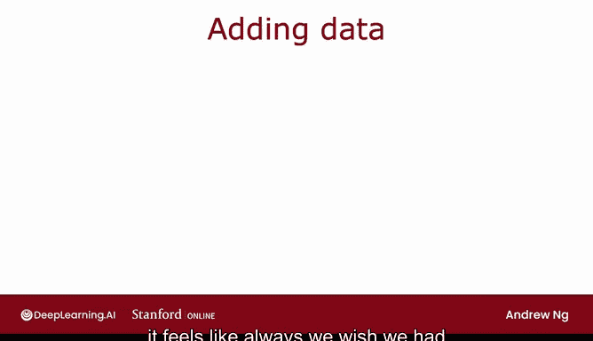

But trying to get more data of all types can be slow and expensive instead。

 an alternative way of adding data might be to focus on adding more data of the types where error analysis has indicated it might hope。

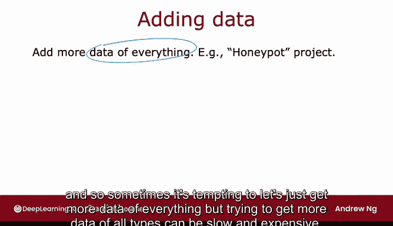

In the previous slide， we saw if error analysis revealed that farmers them。Was a large problem。

 then you may decide to have a more targeted effort not to get more data of everything under the sun。

 but to instead focus on getting more examples of farmer spam and with a more modest cost。

 this could let you at just the emails you need to help your learning algorithm gets smarter on recognizing farmer spam。

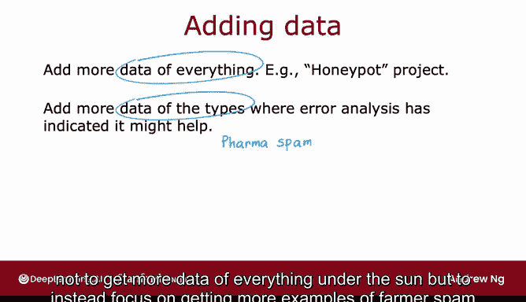

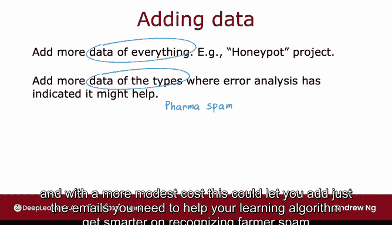

And so one example of how you might do this is if you have a lot of unlabelled email data。

 say email sitting around that no one has bother to label yeah their spam or non spam。

You may be to ask your laborers to quickly skim through the unlabeled data and find more examples specifically of phma related spam。

And this could boost your learning average performance much more than just trying to add more data of all sorts of emails。

But the more general pattern I hope you take away from this is if you have some ways to add more data of everything。

 that's okay， nothing wrong with that。But if error analysis has indicated that there's certain subsets of the data that the algorithm is doing particularly poorly on and that you want to improve performance on then getting more data of just the types where you wanted to do better be it more examples of pharmaceutical spam or more examples of phishing spam or something else that could be a more efficient way to add just a little bit of data that boost your algorithms performance by quite a lot beyond getting your hands on brand new training examples X Y。

 there's another technique that's why they use especially for images and audio data that can increase your training set size significantly this technique is called data augmentation and what we're going to do is take an existing training example to create a new training example For example。

 if you're trying to recognize the letters from A to Z for an OCR optical character recognition。

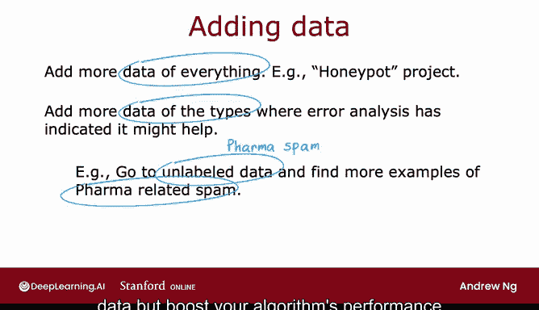

bleSo not just the digit 0 to 9， but also the letters from A to Z。Given an image like this。

 you might decide to create a new training example by rotating the image a bit or by enlarging the image a bit or by shrinking a little bit。

Or by changing the contrast of the image。 And these are examples of distortions to the image that don't change the fact that this is still the letter A。

And for some letters， but not others， you can also take the mirror image。

Of the letter and it still looks like the letter A， but this only applies to some letters。

 but these would be ways of taking a training example， X Y。

 and applying a distortion or transformation to the input X in order to come up with another example that has the same label and by doing this you're telling the algorithm that the letter A rotated a bit or enlar a bit or shrunk a little bit。

 it is still the letter A and creating additional examples like this helps the learning algorithm。

Do a better job learning how to recognize the letter in。

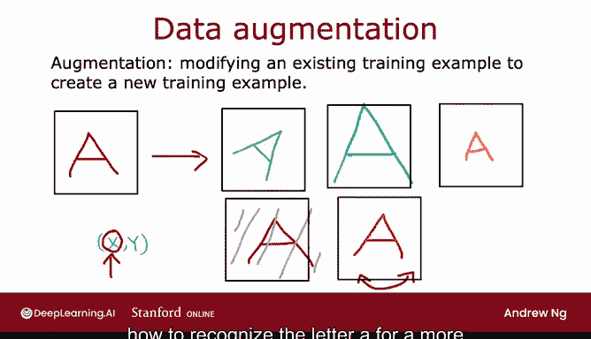

For a more advanced example of data augmentation， you can also take the letter A and place a grid on top of it and by introducing random warpings of this grid。

 you can take the letter A and introduce warpings of the letter A to create a much richer library of examples of the letter A and this process of distorting these examples then has turned one image or one example into here。

 training examples that you can feed to the learning algorithm to help it learn more robustly。

 what is the letter A， this idea of data augmentation also works for speech recognition。

Let's say for a voice search application you have an original audio clip that sounds like this What is today's weather one way you can apply data augment to speech data would be to take noisy background audio like this。

 for example， this is what the sound of a crowd sounds like。

And it turns out that if you take these two audio clips。

 the first one and the crowd noise and you add them together。

 then you end up with an audio clip that sounds like this。

What is today's weather and you just created an audio clip that sounds like someone saying。

 what's the weather today， but they're saying it around the noisy crowd in the background。Or in fact。

 if you were to take a different background noise， say someone in a car。

 this is what background noise of a car sounds like。

And you were to add the arsen audio clip to the car noise， then you get this。

What is today's weather and it sounds like the original audio clip。

 but as if the speaker was saying it from a car。And a more advanced data augment step would be if you make the original audio sound like you're recording on a bad cell phone connection like this。

And so we've seen how you can take one audio clip and turn it into three training examples here。

 one with trial background noise， one with car background noise and one as if it was recorded on a bad cellphone connection and the times I worked on speech recognition systems。

 this was actually a really critical technique for increasing artificially the size that the training data I had to build a more accurate speech recognizer one tip for data augmentation is that the changes or the distortions you make to the data should be representative of the types of noise or distortions in the test set。

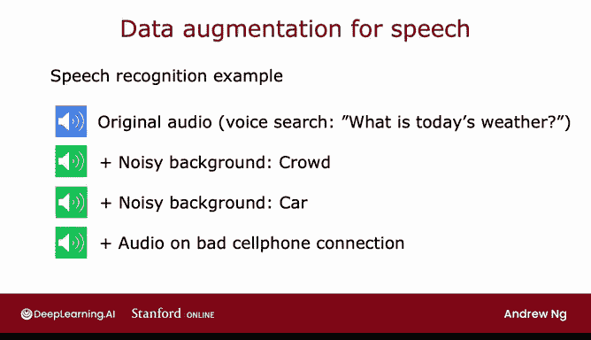

So for example， if you take the letter A and warp it like this。

 this still looks like examples of letters you might see out there that you would like to recognize。

 or for audio adding background noise or bad cell phone connection。

 if that's representative of what you expect to hear in the test set。

 then this would be helpful ways to carry out data augment on your audio data。

In contrast its usually not that helpful to add purely random meaningless noise to your data for example。

 here I've taken the letter A and I've added per pixel noise where if XI is the intensity or the brightness of pixel I。

 if I were to just add noise to each pixel then you end up with images that look like this。

 but if to the extent that this isn't that representative of what you see in a test set because you don't often get images like this in a test set。

 this actually might be less helpful。

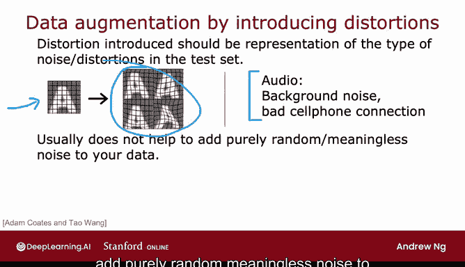

So one way to think about data augment is how can you modify or warp or distort or make more noisy your data。

 but in a way so that what you get is still quite similar to what you have in your test set。

Because that's what the learning algorithm will ultimately end up doing well on。Now。

 whereas data augmentation takes an existing training example and modifies it to create another training example。

 there's one other technique which is data synthesis in which you make up brand new examples from scratch。

 not by modifying an existing example， but by creating brand new examples。

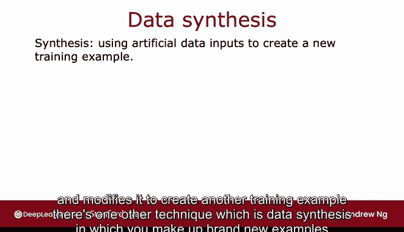

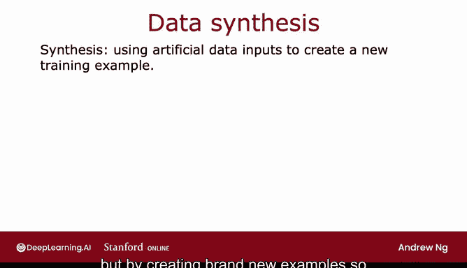

So take the example of photoocCR， photoOCR or photo opticalical character recognition refers to the problem of looking at an image like this and automatically having a computer read the text that appears in this image。

 so there's a lot of text in this image。How can you train an OCR algorithm to read text from an image like this？

Well， when you look closely at what the letters in this image looks like。

 they actually look like this， so this is real data from a photo OCR task。

And one key step with the photoocCR task is to be able look at the little image like this and recognize the letter at the middle。

 so this has T in the middle， this has the letter L in the middle。

 this has the letter C in the middle and so on。So one way to create artificial data for this task is if you go to your computer's text editor。

 you find that it has a lot of different fonts and what you can do is take these fonts。

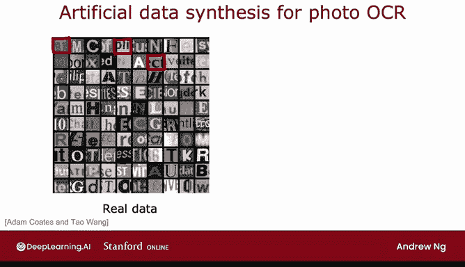

And basically type out random text in your text editor and screenshot it using different colors and different contrasts and very different fonts。

 and you get synthetic data like that on the right。

The images on the left were real data from real pictures taken out in the world。

 the images on the right are synthetically generated using font on the computer。

 and it actually looks pretty realistic。So with synthetic data generation like this。

 you can generate a very large number of images or examples for your filter OCR task。

It can be a lot of work to write the code to generate realistic looking synthetic data for a given application。

 but when you spend the time to do so， it can sometimes help you generate a very large amount of data for your application and give you a huge boost to your average performance。

Synthetic data generation has been used most probably for computer vision tasks。

And less for other applications， not that much for audiotas as well。

All the techniques you've seen in this video relate to finding ways to engineer the data used by your system。

In the way that machine learning has developed over the last several decades， many decades。

 most machine learning researchers' attention was on the conventional model centric approach。

 and here's what I mean。A machine learning system or an AI system includes both code to implement your algorithm or your model as well the data that you train the algorithm on。

And over the last few decades， most researchers doing machine learning research would download the data set and hold the data fix while they focus on improving the code of the album or the model。

Thanks to that paradigm of machine learning research， I find that today。

The algorithms we have access to， such as linear regression， logistic regression， neural networks。

 also decision trees which you see next week， there are algorithms that are already very good and will work well for many applications。

And so sometimes it can be more fruitful to spend more of your time taking a data centric approach in which you focus on。

engineering the data used by your algorithm， and this can be anything from collecting more data to collecting more data just on pharmaceutical spa。

 if that's what error analysis told you to do。To using data augmentation to generate more images or more audio or using data synthesis to just create more training examples。

 and sometimes that focus on the data can be an efficient way to help your learning algorithm improve its performance so I hope that this video gives you a set of tools to be efficient and effective in how you add more data to get your learning algorithm to work better。

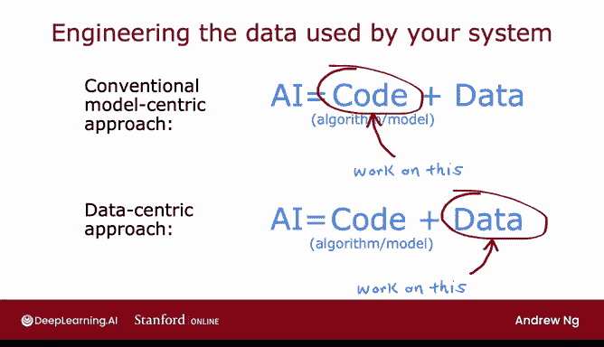

Now there are also some applications where you just don't have that data and it's really hard to get more data It turns out that there's a technique called transfer learning which could apply in that setting to give your learning algorithms performance a huge boost and the key idea is to take data from a totally different fairly related task but using a neural network there's sometimes ways to use that data from a very different task to get your algorithm to do better on your application。

Doesn't apply to everything， but when it does， it can be very powerful。

 let's take a look in the next video at how transfer learning works。

