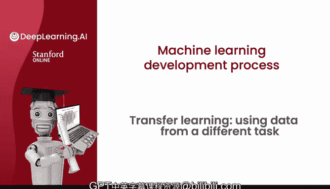
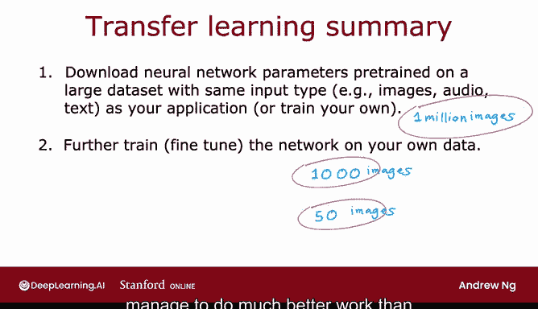

# 吴恩达《机器学习》｜machine-learning（中英字幕-deepseek翻译） - P87：45_03_04_迁移学习：使用不同任务的数据.zh_en - GPT中英字幕课程资源 - BV1MN4y1S7DE

For an application where you don't have that much data transfer learning is a wonderful technique that lets you use data from a different task to help on your application This is one of those techniques that I use very frequently let's take a look at how transfer learning works so here's how transfer learning works let's say you want to recognize the handwritten digits from0 through9 but you don't have that label data of these handwritten digits Here's what you can do say you find a very large data set of1 million images。

Of pictures of Cs， dogs， cars people， and so on， thousand classes。

 you can then start by training a neural network on this large data set of a million images with a thousand different classes and train the algorithm to take as input in image X and learn to recognize any of these 1。

000 different classes。In this process， you end up learning parameters for the first layer of the neural network。

 W1B1， for the second layer， W2B2， and so on W3B3， W4B4 and W5B5 for the upper layer。

To apply transfer learning， what you do is then make a copy of this neural network。

Where you would keep the parameters W1p1， W2p2， W3P3 and W4p4， but for the loss layer。

 you would eliminate the upper layer and replace it with a much smaller output layer with just 10 rather than 1000 output units。

And these 10 upper units will correspond to the clauses 01 through9 that you want your neural network to recognize。

Notice that the parameters is W5 b5， they can't be copied over because the dimension of this layer has changed。

 so you need to come up with new parameters。W5B5 that you need to train from scratch rather than just copy it from the previous neural network。

And in transfer learning， what you can do is use。The parameterss from。The first four layers。

 really all the layers except define upper layer as a starting point for the parameters and then run an optimization algorithm such as gradient descent or the atom optimization algorithm with the parameters initialized using the values from this neural network up upon top。

So in detail there are two options for how you can train this neural networks parameters Op one is you only train the upper layers parameters。

 so you would take the parameters W1 B1 W2B2 through W4P4。

As the value from on top and just hold them fix and don't even bother to change them and use an algorithm like srcastic gradient descent or the other optimizationization algorithm to only update W5B5 to lower the cost function。

 the usual cost function that you use for learning to recognize these digits zero to9 from a small training set of these digits0 to9 so there's option one。

Option two would be to train all the parameters in the network。

 including W1b1W2B2 all the way through W5B5， but the first four layers parameters would be initialized using the values that you had trained on top。

If you have a very， very small training set， then option one might work a little bit better。

 but if you have a training set that's a little bit larger then option two might work a little bit better。

This algorithm is called transfer learning because the intuition is by learning to recognize cats dogs。

 cow people and so on， it will hopefully have learned some plausible sets of parameters for the earlier layers for processing image inputs。

 and then by transferring these parameters to the new neural network。

 the new neural network starts off with the parameters in a much better place。

So that with just a little bit of further learning， hopefully it can end up at a pretty good model。

 These two steps of first training on a large data set， and then。

Tune in the parameters further on a smaller dataset。

 go by the name of supervised pretraining for this step on top。

 that's when you train a neural network on a very large data set of say a million images of not quite the related task。

And then the second step is called fine tune name。Where you take the parameters that you had initialized or cotton from supervised pre tradinging and then run gradient descent further to fine tune the weights to suit the specific application of handwritten digit recognition that you may have and so if you have a small data set。

 even tens or hundreds or thousands or just tens of thousands of images of the hamwritten digits。

Be able to learn from this million images of a not quite related task can actually help your learning everyone's performance a lot。

One nice thing about transfer learning as well is maybe you don't need to be the one to carry out supervised pretraining for a lot of neural networks。

 there will already be researchers that have already trained a neural network on the large image and will have posted a trained neural networks on the internet。

 freely licensed for anyone to download and use and what that means is rather than carrying out the first step yourself。

 you can just download the neural network that someone else may have spent weeks training and then replace the output layer with your own output layer and carry out either option one or option two to fine tune a neural network that someone else has already carried out supervised pretraining on and just do a little bit of fine tuning to quickly be able to get to neural network that performs well on your task downloading a pretrained model that someone else has trained and provided for free is one of those techniques where。

By building on each other's work in the machine learning community。

 we can all get much better results by the generosity of other researchers that have pre traineded and posted their neural networks online。

But why does transfer learning even work， how could you possibly take parameters obtained by recognizing cats。

 dogs， cars， and people and use that to help you recognize something as different as handwritten digits？

Here's some intuition behind it if you are training a neural network to detect。

 say different objects from images， then the first layer of a neural network may learn to detect edges in the image。

 we think of these as somewhat low level features in the image， which is a detect edges。

Each of these squares is a visualization of what a single neuron has learned to detect。

 has learned to group together pixels to find edges in an image。

The next layer of the neural network then learns to group together edges to detect corners。

And so each of these is a visualization of what one neuron may have learned to detect and is learned to detect little。

Simple shapes like con like shapes like this。And the next layer of the neural network may have learned to detect somewhat more complex baal generic shapes like basic curves or small little shapes like these。

And that's why by learning on detecting lots of different images。

 you're teaching the linear network to detect edges， corners and basic shapes。

 and that's why by training a neural network to detect things as diverse as cats and do and con and people。

 you are helping to learn to detect these pretty generic features of images and finding edges。

 corners， curves， basic shapes， is is useful for many other computer vision tasks such as recognizing。

Haandwritten digits。One restriction of pretraining though。

 is that is that the image type X has to be the same for the pretraining and the fine tuning steps。

 So if the final task you want to solve is a computer vision task。

 then the pretraining step also has be a neural network train on the same type of input namely an image of the desired dimensions。

 conversely if your goal is to build a speech recognition system to process audio。

 then a neural network pretrain on images probably won't do much good on audio instead you want a neural network pretrained on audio data that you then fine tune on your own audio data and the same for other types of applications you can pretrain a neural network on text data and if your application has the same feature input X of text data then you can fine tune that neural network on your own data to summarize these are the two steps for transfer learning Step1 is。

Download the neural network with parameters that have been pretrained on a large data set with the same input type as your application and that input type could be images。

 audio， text or something else。 Or if you don't want to download the neural network。

 maybe you can train your own。But in practice， if you're using images。

 say it's much more common to download someone else's pretraining your network， then。

Further train or fine tune the network on your own data。

 and I found that if you can get a neural network， pretrain on a large dataset set。

 say a million images， then sometimes you can use a much smaller data set， maybe 1 thousand images。

 maybe even smaller。To fine tune the neural network on your own data and get pretty good results and I've sometimes trained neural networks on S few as 50 images that work quite well using this technique when it has already been pre-trained on a much larger data this technique isn't panacea。

 you can't get every application they work just on 50 images。

 but it does help a lot when the data you have for your application isn't that large。And by the way。

 if you've heard of advanced techniques in the news like G3 or B or neural networks pretrained on Inets。

 those are actually examples of neural networks that someone else has pre-trained on a very large image dataset or text data they can then be fine- tuneed on other applications if you haven't heard the GT3 or B or Inet don't worry about it。

 but you have those have been successful applications of transfer learning in the machine learning literature One of the things I like about transfer learning is it been one of the ways that the machine learning community has shared ideas and code and even parameters with each other because thanks to the researchers that have pre-trained large neural networks and posted the parameters on the internet freely for anyone else to download and use this empowers anyone to take models they're pre-trained to fine- tuneed on potentially much smaller dataset in machine learning。

 all of us end up often building on the work。Each other and that open sharing of ideas of code of trained parameters is one of the ways that the machine learning community。

 all of us collectively manage to do much better work than any single person by themselves can and so I hope that you joining the machine learning community will someday maybe find a way to contribute back to this community as well so that's it for free training。

I hope you find this technique useful and in the next video I'd like to share with you some thoughts on the full cycle of a machine learning project。

 so when building a machine learning system what are all the steps that are worth thinking about。

 let's take a look at that in the next video。