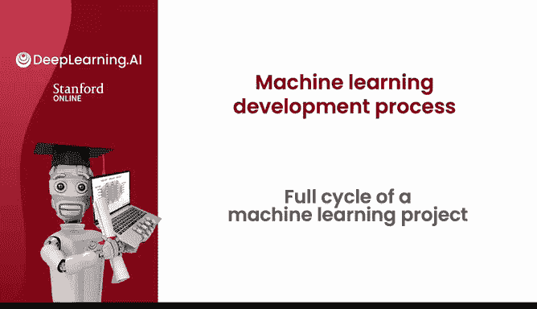
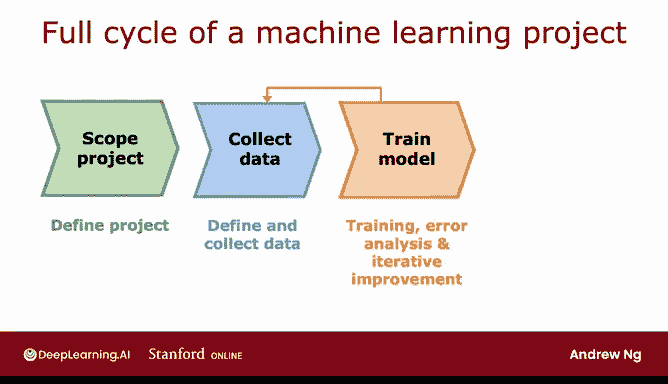
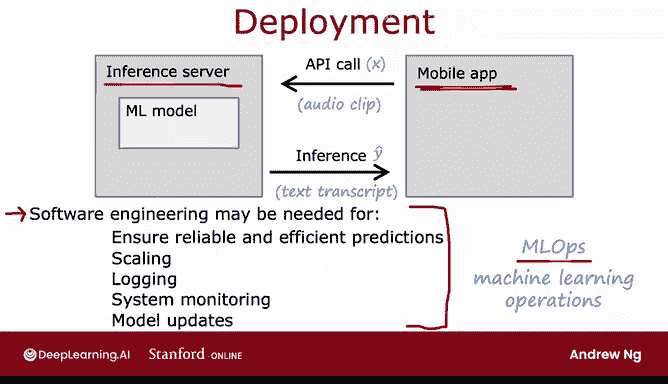

# 吴恩达《机器学习》｜machine-learning（中英字幕-deepseek翻译） - P88：46_03_05_机器学习项目的完整周期.zh_en - GPT中英字幕课程资源 - BV1MN4y1S7DE

So far we've talked a lot about how to train a model and also talked a bit about how to get data for your machine learning application。

 but when I'm building a machine learning system， I find that training a model is just part of the puzzle in this video I'd like to share you what I think of as the full cycle of a machine learning project then is when you're building a valuable machine learning system。

 what are the steps to think about and plan for Let's take a look Let me use speech recognition as an example to illustrate the full cycle of a machine learning project。

The first step with machine learning project is to scope the project， in other words。

 decide what is the project and what you want to work on。So for example。

 I once decided to work on speech recognition for Vo search that is to do web search using speaking to your mobile phone rather than typing into your mobile phone。

 so there's project scoping。After deciding what to work on， you have to collect data。

 so decide what data you need to train your machine learning system and go and do the work to get the audio and get the transcripts or the labels for your data set。

 so that's data collection。After you have your initial data collection。

 you can then start to train the model， and so here you would train the speech recognitionation system and carry out error analysis and itly improve your model。

And it's not at all uncommon common。After youve started training the model for a error analysis or for a biovariance analysis to tell you that you might want to go back to collect more data。

 maybe collect more data of everything or just collect more data of a specific type where your error analysis tells you you want to improve the performance of your learning algorithm for example。

 once when working on to speech， I realized that my model was doing political poorly when there was car noise in the background。

 so if it sounded like someone was speaking in a car my speech system performed poorly decided to get more data actually using data augmentation to get more speech data that sounded like it was a car in order to improve the performance of my learning algorithm。

So you go around this loop a few times， train the model， carry error analysis。

 go back to collect more data， maybe do this for a while。

 until eventually you think the model is good enough to then deploy in a production environment and what that means is you make it available for users to use。

And when you deploy a system， you to also make sure that you continue to monitor the performance of the system and to maintain the system in case the performance gets worse to bring this performance back up instead of just hosting your machine learning model on a server。

I'll say you a little bit more about why you need to maintain these machine learning systems on the next slide。

 but after this deployment， sometimes you realize that it's not working as well as you hoped and you go back to train the model to improve the game or even go back and get more data。

In fact， if users and if you have permission to use data from your production deployment。

 sometimes that data from your working speech system can give you access to even more data with which to keep on improving the performance of your system Now I think you have a sense of what scoping a project means and we'll talked a bunch about collecting data and training models in discourse but let me share you a little bit more detail about what deploying and production might look like。

After you've trained a high performing machine learning model， say a speech recognition model。

 a common way to deploy the model would be to take your machine learning model。

And implemented in a server， which I'm going to call an inference server whose job it is to call your machine learning model。

 your trained model in order to make predictions。Then if。Your team has implemented a mobile app。

 say a search application， then when a user talks to the mobile app。

 the mobile app can then make an API call to pass to your inference server。

 the audio clip that was recorded and the inference service job is supply the machine learning model to it。

 and then return to it， the prediction of your model。

 which in this case would be the text transcript of what was said。

So this will be a common way of implementing an application that calls via an API an inference server that has your model repeatedly make predictions based on the input X。

 so this be a common pattern where depending on the application that's implemented。

 you have an API call to give your learning algorithm the input X and your machine learning model would then output the prediction。

 say Y hat。To implement this， some software engineering may be needed to write all the code that does all of these things。

And depending on whether your application needs to serve just a few handful of users or millions of users。

 the amounts of software engineering needed can be quite different。

So I've built software that serve just a handful of users on my laptop and I've also built software that serves hundreds of millions of users requiring significant data center resources。

So depending Pan on scale application needed， software Engine may be needed to make sure that your inference server is able to make reliable and efficient predictions。

 hopefully at not too high a computational costs So Engine may be needed to manage scaling to a large number of users。

 you often want to log the data you're getting both the input X as words the predictions myha。

 assuming that user privacy and consent allows you to store this data。

And this data if you can have access to it， is also very useful for system monitoring for example。

 I once built a speech recognition system on a certain data set that I had but when there were new celebrities that suddenly became wellknow or elections cause new politicians to become elected then people would search for these new names that were not in a training set and that my system did poorly on and it was because we're monitoring the system it allowed us to figure out when the data was shifting and the algorithm was becoming less accurate and this allowed us to retrain the model and then to carry out a model update to replace the old model with a new one。

So the deployment process can require some amount of software engineering。For some applications。

 if you're just running it on the laptop or on the one or two services。

 maybe not that much operating is needed， but for and depending on the team you're working on。

 it's possible that you build the machine learning model。

 but there could be a different team responsible for deploying it。

But there is a growing field in machine learning called MLOs that stands for machine learning operations and this refers to the practice of how to systematically build and deploy and maintain machine learning systems to do all of these things to make sure that your machine learning model is reliable。

 scales well has good laws is monitored and that you have the opportunity。

 make updates to the model as appropriate to keep it running well For example。

 if youre deploying your system to millions of people。

 you may want to make sure you have a highly optimized implementation so that the compute cost of serving millions of people is not too expensive。

So in this and the last class， we spent a lot of time talking about how to train a machine learning model and that is absolutely the critical piece to making sure you have a high performance system。

 and if you ever have to deploy a system to millions of people。

 these are some additional steps that you probably have to address。

 think about an address at that point as well。

Before moving on from the topic of the machine learning development process。

 there's one more set of ideas that I want to share with you that relates to the ethics of building machine learning systems this is a crucial topic for many applications so let's take a look at this in the next video。

