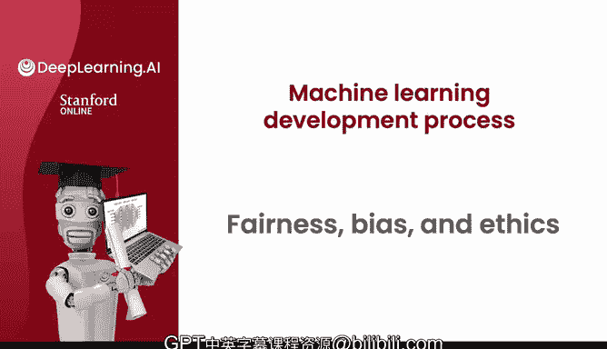
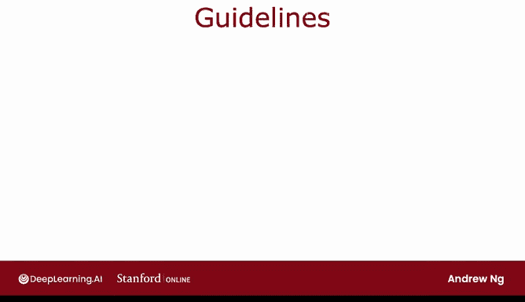
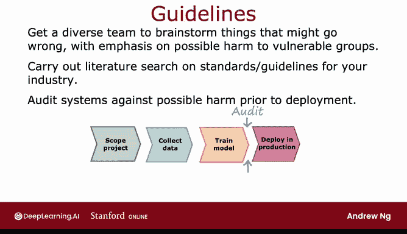

# 吴恩达《机器学习》｜machine-learning（中英字幕-deepseek翻译） - P89：47_03_06_公平性、偏见与伦理.zh_en - GPT中英字幕课程资源 - BV1MN4y1S7DE

Machine learning algorithms today are affecting billions of people you've heard me mention ethics in other videos before and I hope that if you're building a machine learning system that affects people that you give some thought to making sure that your system is reasonably fair。

 reasonably free from bias and that you're taking a ethical approach to your application let's take a look at some issues related to fairness。

 bias and ethics。

Unfortunately， in the history of machine learning， there happened been a few systems。

 some widely we publicized that turned out to exhibit a completely unacceptable level of biasers。

For example， there was a hiring to that was one shown to discriminate against women。

 a company that built a system， stopped using it， but one wishes is that the system had never been rolled out in the first place。

OrThere was also a well documented example of face recognition systems that matched dark skin individuals to criminal mugshots much more often than lighter skin individuals and clearly this is not acceptable and we should get better the community at just not building and deploying systems with a problem like this in the first place there have been systems that gave bank loan approvals in a way that was bias and discriminated against subgroups and we'd also really like learning algorithms to not have the toxic effect of reinforcing negative stereotypes for example。

 I have a daughter and if she searches online for certain professions and doesn't see anyone that looks like her I would hate for that to discourage her from taking on certain professions In addition to the issues of bias and fair treatment of individuals there have also been adverse use cases or negative use cases of machine。

sFor example， there was this widely cited and widely viewed video release with full disclosure full transparency by the complete buzzfe of a deep fake of former US President Barack Obama and you can actually find and watch the whole video online if you want。

But the company that created this video did so with full transparency and full disclosure。

 but clearly using this technology to generate fake videos without consent and without disclosure would be unethical。

We've also seen， unfortunately， social media sometimes spreading toxic or incendiary speech。

Because optimizing for user engagement has led to algorithms doing so。

There have been bots that were used to generate fake content for either commercial purposes。

 such as posting fake comments on products or for political purposes。

And there are uses of machine learning to build harmful products， commit fraud and so on。

 and in parts of the machine learning world， just as an email。

 there has been a battle between the spammers and the Anti- spam community I am seeing today in。

 for example， the financial industry， a battle between people trying to commit fraud and the people fighting fraud。

And unfortunately， machine learning is used by some of the frauds and some of the standardss so for good sakes。

 please don't build a machine learning system that has a negative impact on society and if you are asked to work on an application that you consider unethical。

 I urge you to walk away for what is worth that been multiple times that I have looked at the project that seemed to be financially sound you make money for some company but I have killed the project just unethical grounds because I think that even though the financial case was sound。

 I felt that it makes the work worse off and I just don't ever want to be involved in a project like that。

Ethics is a very complicated and very rich subject that humanity has studied for at least a few thousand years when AI became more widespread。

 I actually went and read up multiple books on philosophy and multiple books on ethics because I was hoping naively it turned out to come up with if only there's a checklist of five things we could do and so last we do these five things then we can be ethical。

 but I failed and I don't think anyone has ever managed to come up with a simple checklist of things to do to give that level of concrete guidance about how to be ethical So what I hope to share with you instead is not a checklist because I wasn't able come up with one with just some general guidance and some suggestions for how to make sure that work is less biased more fair and more ethical and I hope that some of these guidance which would be relatively general will help you with your work as well so here are some suggestions for making your work。

WorkMore fear， less bias and more ethical。When before deploying a system that could。Create harm。

 I will usually try to assemble a diverse team to brainstorm possible things that might go wrong with an emphasis on possible harm to vulnerable groups。

Ive found many times in my life that having a more diverse team and by diverseverse。

 I mean diversity on multiple dimensions ranging from gender to ethnicity to culture to many other traits。

I found that having more diverse teams actually causes the team collectively to be better at coming up with ideas about things that might go wrong。

 and it increases the odds that will recognize a problem and fix it before rolling out the system and having that cause harm to some particular group。

In addition to having a diversity in carry out brainstorming。

 I have also found it useful to carry out a literature search on any standards or guidelines for your industry or particular application area。

For example， in the financial industry， there are starting to be established standards for what it means to be a system。

 say one that decides who to approve loans to， what it means for a system like that to be reasonably fair and free from buyers and those standards that are still emerging in different sectors could inform your work depending on what you're working on。

After identifying possible problems， I found it useful to then audit the system。

Against these identified dimensions of possible harm prior to deployment you saw in the last video the full cycle of a machine learning project and one key step there's often a crucial line of defense against deploying something problematic is after you've trained a model。

 but before you deploy in production， if the team has brainstormed that it may be bias against certain subgroups such as certain genders or certain ethnicities。

 you can then order the system to measure the performance to see if it really is bias against certain genders or ethnicities or other subgroups and to make sure。

That any problems are identified and fixed prior to deployment Finally。

 I found it useful to develop a mitigation plan if applicable and one simple mitigation plan would be a roadback to the earlier system that we knew was reasonably fair and then even after the deployment to continue to monitor harm so that you can then trigger a mitigation plan and act quickly in case there is a problem that needs to be addressed。

 for example， all of the good self-driving car teams prior to rolling out self-driving cars on the road。

 had developed mitigation plan for what to do in case the car ever gets involved in an accident so that if the car was ever in an accident there was already a mitigation plan that it could execute immediately rather than have a car get into an accident and then only scramble after the fact to figure out what to do。

I've worked on many machine learning systems and let me tell you the issues of ethics。

 fairness and bias issues which should take seriously is not something to brush off is not something to take lightly Now。

 of course， theres some projects with more serious ethical implications than others， for example。

 if I'm building a neural network to decide how long to roast my coffee beans clearly the ethical implications of that seem significantly less than if say you are building a system to decide what loans bank loans to approve。

 which if it's bias can cause significant harm。But I hope that all of us collectively working in machine learning can keep on getting better。

 debate these issues， spot problems， fix them before they cause harm so that we collectiveively can avoid some of the mistakes that the machine learning world had made before。

 because the stuff matters and systems we built can affect a lot of people。

And so that's it on the process of developing a machine learning system and congratulations on getting to the end of this week's required videos I have just two more optional videos this week for you on addressing skewed datasets and that means datasets where the ratio of positive to negative examples is very far from 5050 and it turns out that some special techniques are needed to address machine learning applications like that。

 so I hope to see you in the next video optional video on how to handle skewed dataset sets。

