# 吴恩达《机器学习》｜machine-learning（中英字幕-deepseek翻译） - P8：08_01_06_Jupyter笔记本.zh_en - GPT中英字幕课程资源 - BV1MN4y1S7DE

So far the videos， you've seen supervised learning and unsupervised learning and also examples of both。

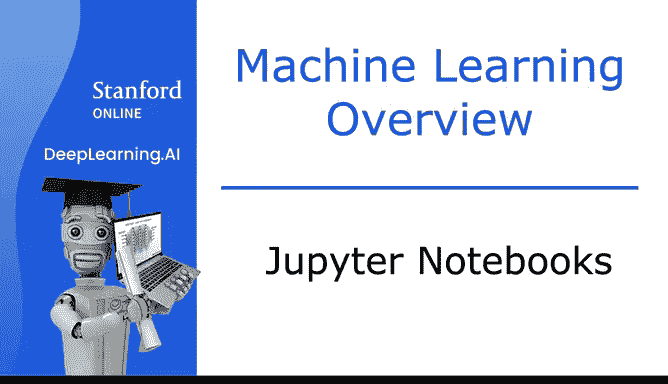

For you to more deeply understand these concepts， I'd like to invite you in this class to see run and maybe later write code yourself to implement these concepts。

 The most widely used tool by machine learning and data science practitioners today is the Jupyter notebook This is a default environment that a lot of us use to code up an experiment and try things out And so in this class right here in your web browser。

 you' be able to use a Jupyter notebook environment to test out some of these ideas for yourself as well。

This is not some made up simplified you know environment。 This is the exact same environment。

 the exact same too， the Jupyter notebook that developers are using in mini large companies right now。

One type of lab that you see throughout this class are optional labs。

 which are once you can open and run one line at a time with usually not needing to write any code yourself。

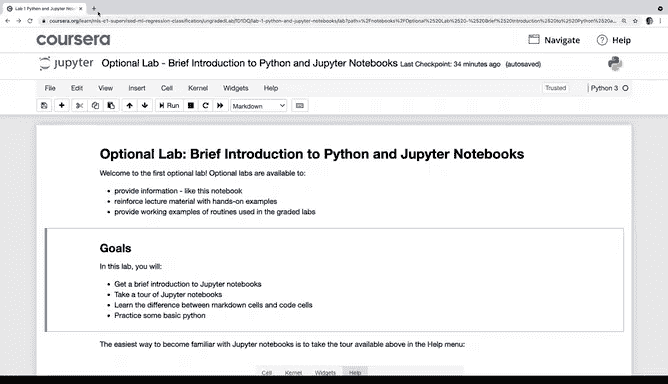

So optional labs are designed to be very easy and I can guarantee you will get full miles for every single one of them because there are no marks。

All you need to do is open it up and just run the code we've provided。

 and by reading through and running the code in the optional labs。

 you see how machine learning code runs。And。You should be able to complete them， you know。

 relatively quickly， just by running it one line at a time from top to bottom。

Optional labs are completely optional， so you don't have to do them at all if you don't want to。

 but I hope you will take a look because running through them will give you a deeper feel。

 give you a little bit more experience with what machine learning algorithms。

 what machine learning code actually looks like。Starting next week。

 there also will be some practice labs which would give you an opportunity to write some of that codes yourself。

But we'll get to that next week。 so don't worry about it for now。

 And I hope you just go through the next optional lab and get through the rest of the content for this week。

 So let's take a look at an example of a notebook。Here's what you see when you go to the first optional lab。

 feel free to scroll up and down and browse and mouse over the different menus and take a look at the different options here。

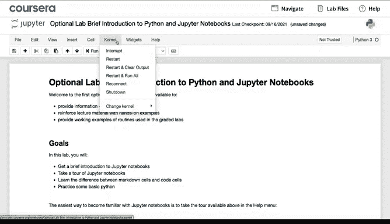

You might notice that there are two types of these blocks also called cells in the notebook。

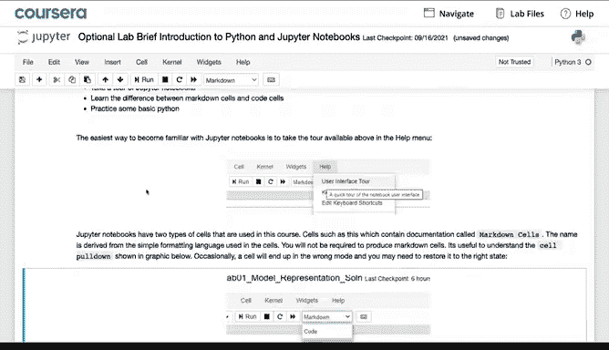

And there are two types of cells。One is what's called a mockdown cell。

 which means basically a bunch of text， so here you can actually edit the text if you don't like the text that we wrote。

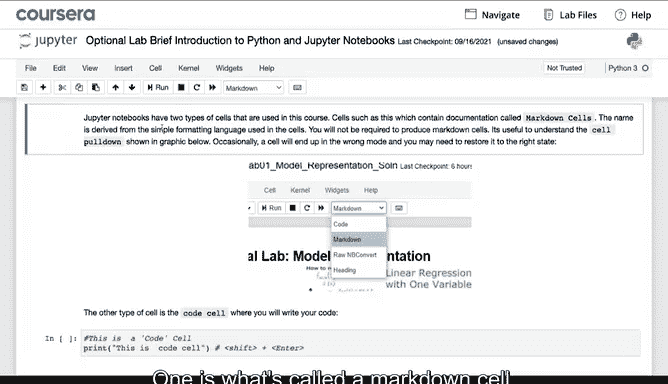

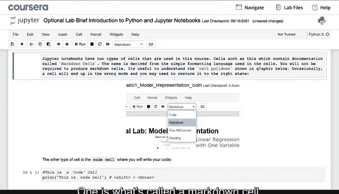

But this is text that describes the code。Then there's a second type of block or cell。

 which looks like this， which is a cold cell。

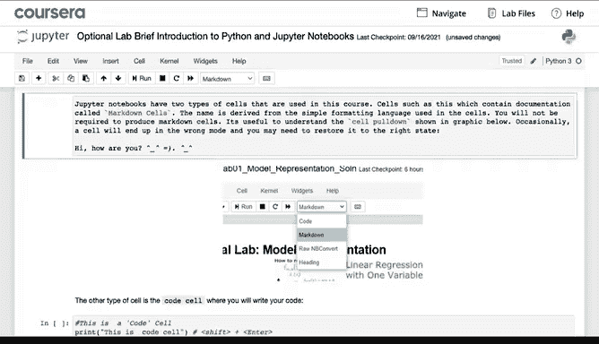

So here we've already provided the code and if you want to run this code cell。

 hitting shift enter will run the code in this code cell。

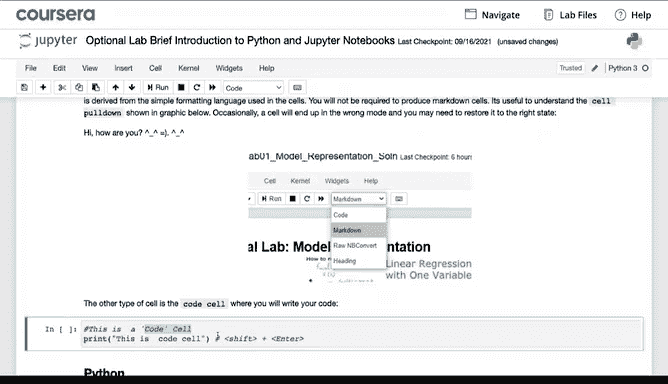

Oh and by the way， if you click on a markdown cell， so its showing all this formatting。

 go ahead and hit shift enter on your keyboard as well。

 and that will also convert it back to this nicely formatted text。

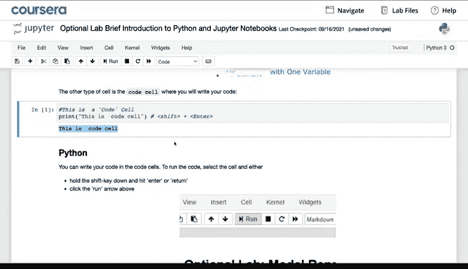

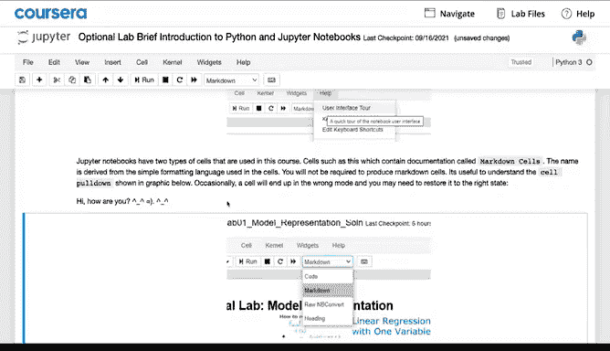

This optional lab shows some common Python code so you can go ahead and run this afterward in your own Jupyter notebook。

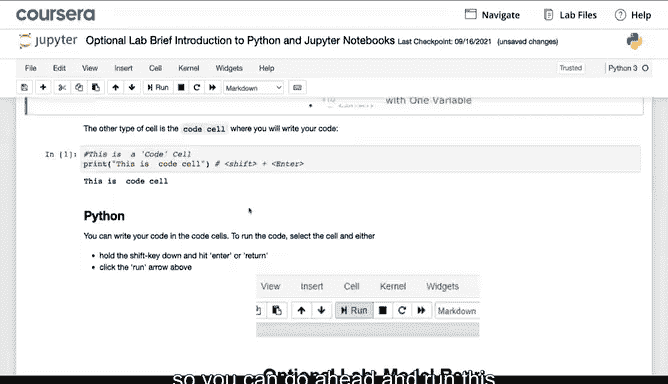

When you jump into this notebook yourself， what I'd like you to do is select the sales and hit shift enter。

 well read through the code， see if it makes sense， you know。

 try to make a prediction about what you think this code will do and then hit shift enter。

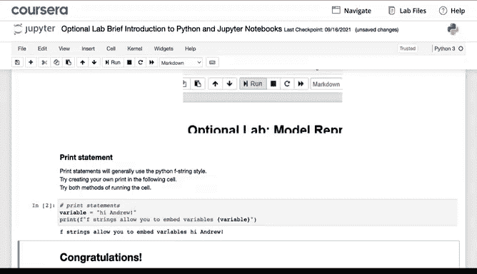

And then see what the code actually does and if you feel like it。

 feel free to go in and edit the code， you know， change the code and then run it and see what happens。

And if you haven't played in a Jupiter notebook environment before。

 I hope you become more familiar with Python in a Jupiter notebook。

 I spend a lot of hours playing around in Jupiter notebooks。 And so I hope you have fun with them。

 too。 And after that， I look forward to seeing you in the next video。

 Where we'll take the supervised learning problem and start to flesh out our first supervised learning algorithm。

 I hope that'll be fun， too and look forward to seeing you there。😊。

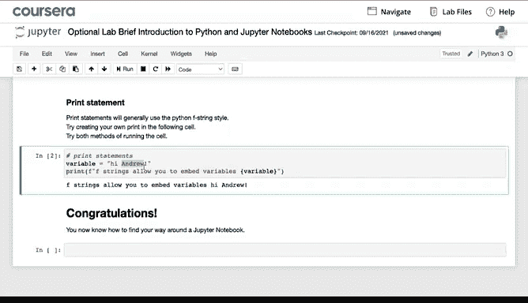