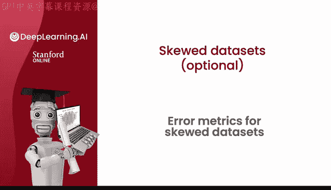
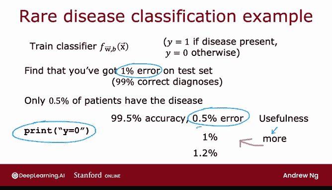
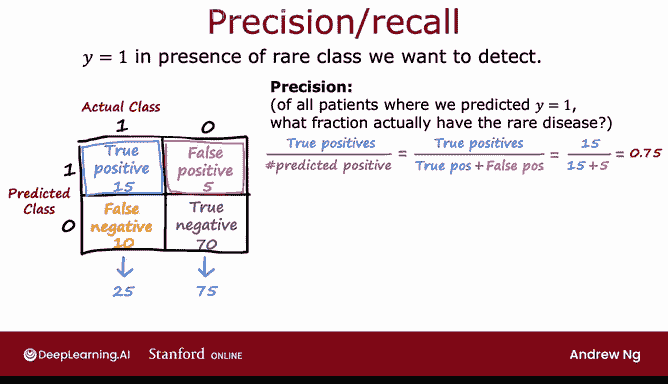

# 吴恩达《机器学习》｜machine-learning（中英字幕-deepseek翻译） - P90：48_03_01_偏斜数据集的误差指标.zh_en - GPT中英字幕课程资源 - BV1MN4y1S7DE

If you're working on a machine learning application where the ratio positive to negative examples is very skewed。

 very far from 50-50， then it turns out that the usual error metrics like accuracy don't work that well let's start with an example。

 let's say you're training a binary classifier to detect a rare disease and patients based on lab tests were based on other data from the patients So y is equal to one if the disease is present。

And y is equal to zero otherwise？And suppose you find that you've achieved 1% error on the test set。

 so you have a 99% correct diagnosis， this seems like a great outcome， right？

But it turns out that if this is a rare disease， so y is equal to one very rarely。

 then this may not be as impressive as it sounds。Specifically， if it is a rare disease and if only 0。

5% of the patients in your population have the disease。

Then if instead you wrote a program that just said print y equals zero。

 it predicts y equals zero all the time， this very simple even nonlearning algorithm because it just says y equals zero all the time。

 this will actually have 99。5% accuracy or 0。5% error。

So this really dumb algorithm outperforms your learning algorithm which had 1% error。

 much worse than 0。5% error。But I think a piece of software that just prints y equal zero is not a very useful diagnostic too。

What this really means is that you can't tell if getting 1% error is actually a good result or a bad result。

And in particular， if you have one algorithm that achieves 99。5% accuracy。

 different one that achieves 99。2% accuracy， different one that achieve。99。6 was an accuracy。

It's difficult to know which of these is actually the best algorithm。

Because if you have an algorithm that achieves 0。5% error and a different one that achieves 1% error and a different one that achieves 1。

2% error is difficult to know which of these is the best algorithm。

 because the one with the lowest error may be a not particularly useful prediction like this that always predicts y equals zero and never ever diagnose any patient as having this disease。

 and quite possibly an algorithm that has1% error but that at least diagnoses some patients as having the disease could be more useful than just printing y equals zero all the time。

When working on problems with skewed datas。We usually use a different error metric rather than just classification error to figure out how well your learning algorithm is doing。

In particular， a common pair of errormetric are precision and recall。

 which will define on the slide in this example， y equals one will be the rare class such as the rare disease that we may want to detect。

And in particular， to evaluate a learning average performance with one rare class would be useful to construct。

What's called a confusion matrix， which is a two by two matrix or a two by two table that looks like this。

On the axis on top， I'm going to write the actual class， which could be1 or0。

 and on the vertical axis I'm going to write the predicted class。

 which is what did Gi learningni A predict on a given example，1 or zero。

To evaluate your algorithm's performance on the cross validation sets or the test set， say。

 we would then count up how many examples was the actual class one and the predicted class one。

 maybe you have 00 cross validation examples and on 15 of them。

The learning algorithm had predicted one and the actual label was also one。

And over here you would count up the number of examples in say your cross validationation set where the actual clause was0 and your algorithmm predicted one。

 so maybe you have five examples there and here predicted clause  zero， actual clause 1。

 so you have 10 examples， and let's say 70 examples with predicted clause zero and actual clause zero。

In this example， the sw isn't as extreme as what I had on the previous slide。

 because in these 100 examples in your cross validation set， we have a total of。

25 examples where the actual clause was1 and 75 where the actual class was zero by adding up these numbers vertically。

 and you notice also that I'm using different colors to indicate these four cells in the table。

 unless you're going to give names to these four cells。

When the actual class is one and the predicted class is one。

 we're going to call that a true positive。Because you predict they're positive and it was true。

 theres a positive example。In this cell on the lower right。

 where the actual class is0 and predict class is0， we call that a true negative because you predicted negative and it was true。

 it really was a negative example。This cell on the upper right， is called a。False。Positive。

Because the average predicted positive， but it was false， is not actually positive。

 So this is called a false positive。 And this cell is called the number of false。Negatives。

 because the average predicted zero but it was false。

 it wasn't actually negative to actual label the actual clause was one。

Having divided the classifications into these four cells。

 two common metrics you computes are then the precision and recall， here's what they mean。

The precision of learning are from computes。Of all the patients where we predicted y is equal to1。

 what fraction actually has the rare disease？In other words。

 precision is defined as the number of true positives divided by the number classified as。Positive。

In other words， of all the examples you particularly as positive。

 what fraction do we actually get right？Another way to write this formula would be true positives。

Divided by。True positives plus。False。Positive。Because it is by summing this cell。

And this cell that you end up with the total number that was predicted as positive。In this example。

 the numerator true pauses would be 15 and divided by 15 plus5。

 and so that's 15 over 20 or 3 quarterss or 0。75 so we say that this algorithm has a precision of 75%。

Because of all the things it predicted as positive of all the patients that it thought has this rare disease。

 it was right， 75% of the time。The second metric that is useful to compute is recall and recall ask of all the patients that actually have the rare disease。

 what fraction do we correctly detect as having it？

So recall is defined as the number of true positives divided by the number of。Actual positives。

And alternatively， we can write that as。Number of true positives divided by the number of actual positives is well is dis cell plus this cell。

 so there's actually the number of true positives plus the number of false negatives。

Because this by summing up this upper left cell and this lower left cell that you get the number of actual positive examples。

 and so in our example， this would be 15 divided by 15 plus 10。which is 15 over 25 which is 0。

6 or 60%。 so this learning algorithm would have 0。75 precision and 0。

60 recall and you notice that this will help you detect if the learning algorithm is just printing y equals0 all the time。

 because if it predicts 0 all the time， then the numerator of both of these quantities will be 0。

It has no true positives and the recall metric in particular helps you detect if the learning algorithm is predicting zero all the time。

 because if yourre learning algorithm just prints，Y equals zero？

Then the number of true positives will be zero because it never predicts positive and so the recall will be equal to zero divided by the number of actual positives。

 which is equal to zero， and in general， a learning algorithm with either zero precision or zero recall is not a useful algorithm。

 but just as a side notes， if an algorithm actually predicts zero all the time。

 precision actually becomes undefined because it's actually zero over zero。

 but in practice if an algorithm doesn't predict even a single positive would just say that precision is also equal to zero。

 but computing precision and recall makes it easier for you to spot if a learning algorithm。

 but well find that computing both precision recall makes it easier to spot if an algorithm is both reasonably accurate in that when it says a patient has a disease。

 there's a good chance a patient has a disease， such as 。7。

5 chance in this example and also making sure that of all the patients that have the disease is hoping to diagnose a reasonable fraction of them。

 such as here is finding 60% of them。So when you have a rare class looking at precision recall and making sure that both numbers are decently high。

 that hopefully helps reassure you that your learning algorithm is actually useful。

And the term recall was。Moulttivated by this observation that if you have a group of patients or population of patients。

 then recall measures of all the patients that have the disease。

 how many would you have accurately diagnosed as having it？

So when you have S classes or a rare class that you want to detect。

 precision and recall helps you tell if your learning algorithm is making good predictions or useful predictions。

Now that we have these metrics for telling how well your learning algorithm is doing in the next video。

 let's take a look at how to trade off between precision and recall to try to optimize the performance of your learning algorithm。

