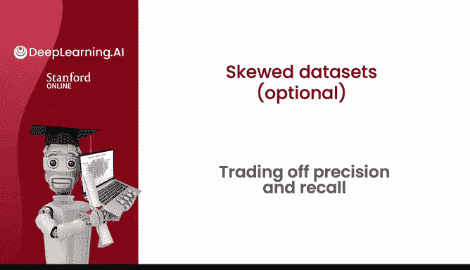
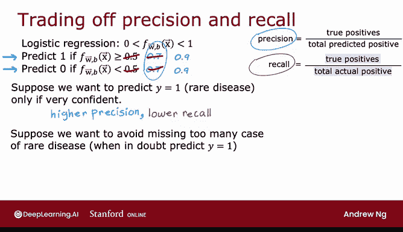
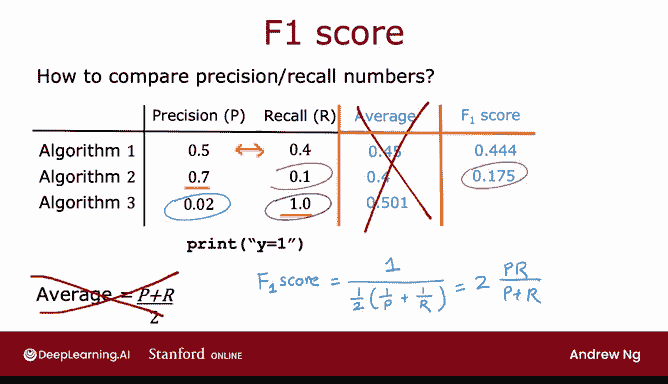

# 吴恩达《机器学习》｜machine-learning（中英字幕-deepseek翻译） - P91：49_03_02_精确率与召回率的权衡.zh_en - GPT中英字幕课程资源 - BV1MN4y1S7DE

In the ideal case， we like for learning our roomss to have high precision and high recall high precision would mean that if it diagnoses a patient have that rare disease。

 probably the patient does have it and is an accurate diagnosis and high recall means that if there's a patient with that rare disease。

 probably the our will correctly identify that they do have that disease。

But it turns out that in practice， there's often a trade off between precision and recall in this video we'll take a look at that trade off and how you can pick a good point along that trade off。

So here are the definitions from the last video on precision and recall， I'll just write them here。

What you recall precision is the number of true positives divided by the total number that was predicted positive。

 and recall is the number of true positives divided by the total actual number of positives。

If you're using logistic regression to make predictions。

 then the logistic regression model will output numbers between zero and one。

We would typically threshold the output of the g regression at 0。5 and predict one。

 if F of x is greater than than equal 0。5 and predict 0 if it's less than 0。5。

But suppose we want to predict that Y is equal to one that is the rare disease is present。

 only if we're very confident， so if our philosophy is。

 whenever we predict that the patient has a disease。

 we may have to send them for possibly invasive and expensive treatment。

 so if the consequences to the disease aren't that bad，Even if left not treated aggressively。

 then we may want to predict why equals one only if we're very confident。In that case。

 we may choose to set a higher threshold where we will predict y is1。

 only if F of x is greater than or equal to 0。7。 So this is saying we'll predict y equal 1 only of where。

At least 70% rather than just 50%， and so this number also becomes 0。

7 notice that these two numbers have to be the same because it's just depending on whether it's greaterer than or equal to or less than this number that you predict one or zero and by raising this threshold。

 you predict y equals1， only if you're pretty confident and what that means is that precision will increase because whenever you predict one you're more likely to be right。

 so raising the threshold will result in higher precision but it also result in lower recall because we're now predicting one less often and so of the total number of patients with the disease。

 we're going to correctly diagnose fewer of them。So by raising this threshold to 0。7。

 you end up with higher。Presion。But lower。Recall and in fact， if you want to predict y equals one。

 only of you are very， very confident， you can even raise this higher so 0。9。

And that results in an even higher precision， and so whenever your predict patient has the disease。

 you're probably right， and this will give you a very high precision for recall will go even further down。

On the flip side， suppose we want to avoid missing too many cases of the rare disease。

So if what we want is when in doubt predict y equals one this might be the case where if treatment is not too invasive or painful or expensive but leaving a disease untreated has much worse consequences for the patient so in that case you might say when in doubt in the interest of safety。

 let's just predict that they have it and consider them for treatment because untreated cases could be quite bad if for your application that is the better way to make decisions。

 then you would take the threshold and instead lower it， say set it to 0。3。

In that case， you predict one， so long as you think there's maybe a 30% chance or better of the disease being present。

And you predict zero only if you're pre shortagehor of disease is absent and as you can imagine。

 the impact on precision and recall will be opposite to what you saw up here and lowering this threshold will result in lower。

Precision， because we're now looser， we're more willing to predict one， even if we aren't sure。

 but to result in higher。We call。Because of all the patients that do have that disease。

 we're probably going to correctly identify more of them。More generally。

 we have the flexibility to predict one。Only if F is above some threshold and by choosing this threshold。

 we can make different tradeoffs between precision and recall。

And it turns out that for most learning algorithms。

 there is a trade off between precision and recall。Preer I recall call both go beia0 and1。

And if you were to set a very high threshold。Sa a thresholdel of 0。99。

 then you end up with very high precision below recall。And as you reduce the value of this threshold。

 you then end up with a curve that trades off precision recall until eventually if you have a very low threshold so the threshold equals 0。

01， then you end up with very low precision， but relatively high recall。

And sometimes by plotting this curve， you can then try to pick a threshold which corresponds to picking a point on this curve that balances the cost of false positives and false negativears or that balances the benefits of high precision and eye recall。

 so plotting precision and recall for different values of the threshold allows you to pick a point that you want。

Notice that。Picking the threshold is not something。You can really do with cross validation。

Because it's up to you to specify the best points。For many applications。

 manually picking the threshold to trade off precision and recall will be what you end up doing。

It turns out that if you want to automatically trade off precision and recall rather than have to do so yourself。

 there is another metric called the F1 score that is sometimes used to automatically combine precision recall to help you pick the best value or the best trade off between the two one challenge with precision recall is you're now evaluating your algorithms using two different metrics so if you've trained three different algorithms and the precision recall numbers look like this it's not that obvious how to pick which algorithm to use。

If there was an algorithm that's better on precision and better on recall。

 then you probably want to go of that one， but in this example，A room2 has the highest precision。

But algorithm 3 has the highest recall， and A one kind of trades off the two in between。

 so no one algorithm is obviously the best choice。So in order to help you decide which algorithm to pick。

 it may be useful to find a way to combine precision and recall into a single score so you can just look at which algorithm has the highest score and maybe go with that one。

One way you could combine precision and recall is to take the average this turns out not to be a good way so I don't really recommend this but if you were to take the average。

 you get 0。450。4 and 0。5 but it turns out that computing the average and picking the algorithm the highest average between precision recall doesn't work that well because this algorithm has very。

 very low precision and in fact this corresponds maybe to an algorithm that actually does print y equals one and diagnoses all patients is having the disease that's why recall is perfect but the precision is really low so algorithm 3 is actually not ethically useful algorithm。

Even though the average between precision and recall is quite high。

So let's not use the average between precision recall。Instead。

 the most common way of combining precision recall is to compute something called the F1 score and the F1 score is a way of combining P andR precision recall。

 but that gives more emphasis to whichever of these values is lower because it turns out if an algorithm has very low precision or a very low recall is probably not that useful。

 so the F1 score is a way of computing an average of sorts that pays more attention to whichever is lower。

And the formula for computing F1 score is this， you're going to compute1 over P and1 over R and average them and then take the inverse of that。

So rather than averaging P and R precision recall， we're going to average1 over P and1 over R and then take1 over that and if you simplify this equation。

 it can also be computed as follows， but by averaging1 over P and1 over R。

 this gives a much greater emphasis to if either P or R turns out to be very small if you were to compute the F1 score for these three algorithms you find that the F1 for the R 1 is 0。

444。And for the second algorithm is 0。175， and you notice that 0。

175 is much closer to the lower value than the higher value and for the third algorithm is 0。0392。

And so F1 school gives a way to trade off precision and recall。 and in this case， it'll tell us that。

Maybe the first algorithm is better than the second or the third algorithms and by the way， in math。

 this equation is also called the harmonic mean of PNR and the harmonic mean is a way of taking an average that emphasizes the smaller values more but for the purposes of this class you don't need to worry about that terminology of the harmonic meanme so congratulations on getting to the last video this week and thank you also for sticking with me through these two optional videos in this week you've learned a lot of practical tips。

 practical advice for how to build a machine learning system and by applying these ideas I think you'd be very effective at building machine learning algorithms。

Next week we'll come back to talk about another very powerful machine learning algorithm。

 in fact of the advanced techniques the widely we used in many commercial production settings I think at the top the list would be neural networks and decision trees so next week we'll talk about decision trees which I think will be another very powerful technique that you could use to build many success applications as well。

 so I look forward to seeing you next week。