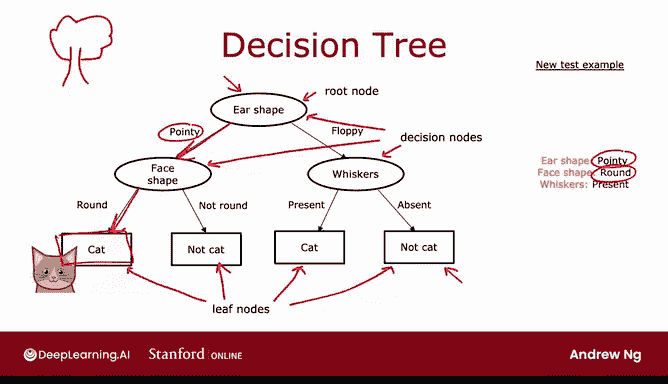
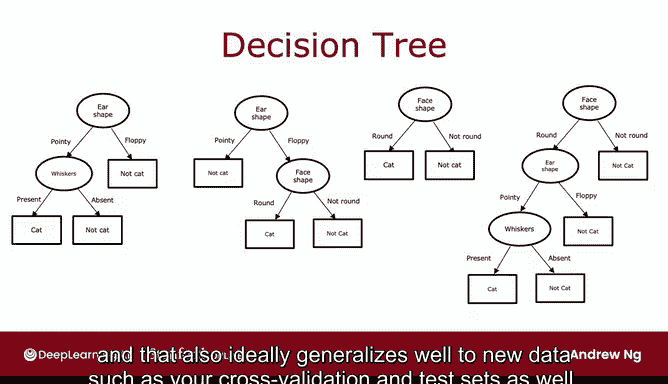

# 吴恩达《机器学习》｜machine-learning（中英字幕-deepseek翻译） - P92：50_04_01_决策树模型.zh_en - GPT中英字幕课程资源 - BV1MN4y1S7DE

Welcome to the final week of this course on advanced learning algorithms one of the learning algorithms that's very powerful why we use in many applications also used by many to win machine learning competitions is decision trees and tree ensembles despite all the successes of decision trees they somehow haven't received that much attention in academia and so you may not hear about decision trees nearly that much but it is a tool well worth having in your toolbox so in this week we'll learn about decision trees and you see how to get them to work for yourself let's dive in to explain how decision trees work I'm going to use as a running example this week a cat classification example。

You're running a cat adoption center and given a few features。

 you want to train a classifier to quickly tell you if an animal is a cat or not。

I have here 10 training examples。And associated with each of these 10 examples we're going to have features regarding the animal's ear shape face shape whether has whiskers and then the ground truth label that you want to predict is this animal cat So the first example has pointy ears round phase whiskers are present and it is a cat The second example has floppy ears the face shape is not round whiskers are present and yes that is a cat and so on for the rest of the examples This data set has five cats and five dogs in it。

And the input features， x are these three columns and the target output that you want to predict Y is this final column of is this a cat or not？

In this example， the features X take on categorical values In other words。

 the features take on just a few discrete values ear shapes are either pointy or floppy。

 the face shape is either round or not round and whiskers are either present or absent and this is a binary classification task。

Because the labels are also one or0。 for now， each of the features x1， x 2 and x 3。

Take on only two possible values， we'll talk about features that can take on more than two possible values。

 as well as continuous value features later in this week。So what is a decision tree？

Here's an example of a model that you might get after training a decision tree learning algorithm on the dataset that you just saw。

The model that is output by the learning algorithm looks like a tree。

And a picture like this is what computer scientists call a tree if it looks nothing like the biological trees that you see out there to you is okay。

 don't worry about it。We'll go through an example to make sure that this computer science definition of a makes sense to you as well。

Every one of these ovals or rectangles is called a node in the tree。

And the way this model works is if you have a new test example。

 she has a cat where the ear shape is pointy， face shape is round and whiskers are present。

 the way this model will look at this example and make a classification decision is we'll start with this example at this topmost node of the tree。

 this is called the root node of the tree。And we will look at the feature written inside。

 which is ear shape， based on the value of the ear shape of this example will either go left or go right。

The value of the ear shape of this example is pointy， and so we'll go down。The left。

Brane of the tree like so。And end up at this。Opval node over here。

We then look at the face shape of this example， which turns out to be round。

And so we will follow this arrow down over here。And the a will make an inference that it thinks this is a cat。

And so you get to this node and the algorithm will make a prediction that this is the cat What I've shown on this slide is one specific decision tree model。

To introduce a bit more terminology， this topmost node。In the tree is called the root node。

And all of these nodes， that is all of these oval shapes， but excluding the boxes at the bottom。

 all of these are called decision nodes。And decision notes because they look at a particular feature and then based on the value of the feature。

Causees you to decide whether the girl left or right down the tree。Finally。

 these nodes at the bottom， these rectangular boxes are called leaf node and they make a prediction if you haven't seen computer scientist definitions of trees before。

It may seem nonintuitive that the roots of the tree is at the top and the leaves of the tree are down at the bottom。

 maybe one way to think about this is this is more akin to an indoor hanging plant。

 which is why the roots are up top and then the leaves tend to fall down to the bottom of the tree。

In this slide I've shown just one example of a decision tree Here are a few others。

 This is a different decision tree for trying to classify cat versus not cat industry to make a classification decision you would again start at this topmost root node and depending on their ear shape of an example you go either left or right If the ear shape is pointedy then you look at the whiskers feature and depend on whether whiskers are present or absent you go left or right gain and classify cat versus not cat。

And just the fun， here's a second example of a decision tree， here's the third one。

 and here's the fourth one， and among these different decision trees。

 some will do better and some will do worse on the training set or on the cross a and the test sets。

So the job of the decision tree learning algorithm is out of all possible decision trees to try to pick one that hopefully does well on the training set and it also ideally generalizes well to new data such as do your crossvalid and test sets as well so seems like there are a lot of different decision trees one could build for a given application How do you get an algorithm to learn a specific decision tree based on a training set let's take a look at that in the next video。

