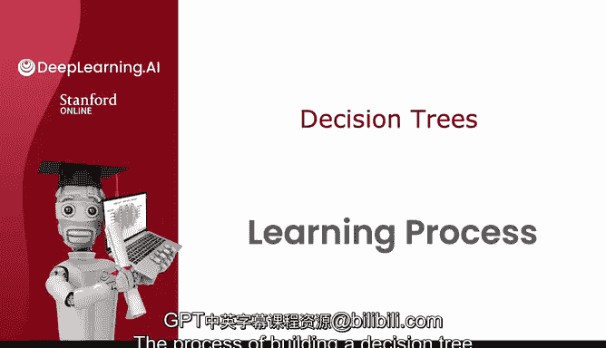
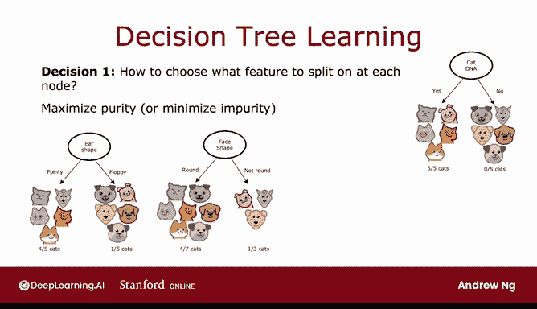
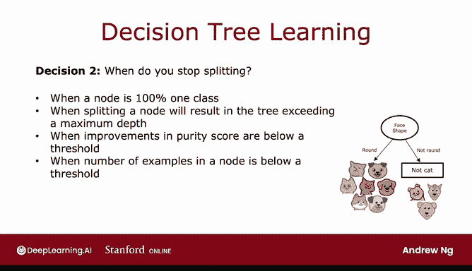

# 吴恩达《机器学习》｜machine-learning（中英字幕-deepseek翻译） - P93：51_04_02_学习过程.zh_en - GPT中英字幕课程资源 - BV1MN4y1S7DE

The process of building the decision tree， given a trading set has a few steps in this video let's take a look at the overall process of what you need to do to build a decision tree。

Given a training set of 10 examples of cats and dogs like you saw in the last video。

 the first step of decision tree learning is we have to decide what feature to use at the root node that is the first note at the very top of the decision tree。

Vi an algorithm that we'll talk about in the next few videos。

 let's say that we decide to pick as the feature in the root node， the ear shape feature。

What that means is we will decide to look at all of our training examples。

 all 10 training examples shown here and split them according to the value of the ear shape feature。

 in particular， let's pick out the five examples with pointy years and move them over down to the left。

And let's pick the five examples with flpp ears and move them down to the right The second step is focusing just on the left part or sometimes called the left branch of the decision tree to decide what node to put over there and in particular what feature do we want to split on or what feature do we want to usens。

V an algorithm that again we'll talk about later this week。

 let's say you decide to use the face shape feature there。

What we'll do now is take these five examples and split these five examples into two subsets based on their value of the face shape。

So we'll take the four examples out of these five with a round face shape and move them down to the left and the one example with a not round face shape and move it down to the right。

And finally we noticed that these four examples are all cats， all of four of them are cats。

 and so rather than splitttting further we create a leaf note that makes a prediction that things that get down to that know other cats and over here we noticed that none of the examples。

 zero to the one examples are cats， or alternatively 100% of the examples here are dogs。

And so we can create a leaf node here， that mixer prediction of not cat。

Having done this on the left part or the left branch of this decision tree。

 we now repeat a similar process on the right part or the right branch of this decision tree and focus attention on just these five examples which contains one cat 1 four dogs。

 and we would have to pick some feature over here to use to split these five examples further。

If we end up choosing the whiskers feature， we would then split these five examples based on whether whiskers are present or absent。

 like so。And you notice that one other one examples on the left are cats and zero other the four are cats。

 so each of these nodes is completely pure， meaning that it all cats all not cats and there's no longer a mix of cats and dogs and so we can create these leaf node making a cat prediction on the left and a not cat prediction here on the right。

 so this is a process of building a decision tree。Through this process。

 there were a couple key decisions that we had to make at various steps during the algorithm。

Let's talk through what those key decisions were and we'll keep on fleshing out the details of how to make these decisions in the next few videos。

The first key decision was。How do you choose what feature to use to split on at each node so at the root node as well as on the left branch and the right branch of the decision tree。

 we had to decide if there were a few examples at that note comprising a mix of cats and dogs do you want to split on the ear shape feature or the face shape feature or the whisks feature we'll see in the next video that decision trees will choose what feature to split on in order to try to maximize purity and by purity I mean you want to get to what subsets which are as close as possible to all cats or all dogs。

For example， if we had a feature that said does this animal have cat DNA。

 we don't actually have this feature， but if we did。

 we could have split on this feature at a root note。

 which would have resulted in five of five cats in the left branch and zero out the five cats in the right branch and both these left and right。

Substets of the data are completely pure， meaning that there's only one class。

 either cats only or not cats only in both of these left and right sub branchesranches。

 which is why the cat DNA feature， if we had this feature， would have been a great feature to use。

 but with the features that we actually have，We had to decide whether to split on ear shape。

 which resulted in four of the five examples on the left being cats。

 and one of the five examples on the right being cats。

 or face shape which resulted in four of the seven on the left and one of the three on the right。

 or whiskers， which resulted in three other four examples being cats on the left and two other six being not cats on the right。

And so the decision tree learning algorithm has to choose。Between ear shape， face shape and whiskers。

Which of these features results in the greatest purity of the labels on the left and right sub branchesches？

Because it is if you can get to a highly pure subset of。Examples。

 then you can either predict cat or predict not cat and get it mostly right so the next video on entropy will talk about how to estimate impurity and how to minimize impurity so the first decision we have to make when learning a decision tree is how to choose which feature to sp on in each node。

The second key decision you need to make when building a decision tree is to decide when do you stop splitting。

The criteria that we used just now was until I know there's either 100% all cats or 100% of dogs or not cats。

Because at that point， it seems natural to build a。

Leave note that just makes a classification prediction。Alternatively。

 you might also decide to stop splitmttting when splitting a note further will result in the tree exceeding a maximum depth。

 where the maximum depth that you allow the tree to grow to is a parameter that you could decide。

In a decision tree， the depth of a node is defined as the number of hops that it takes to get from the root node that is the node at the very top to that particular node。

So the root node takes zero hops to get to itself and is at depth zero。The notes below it are at de1。

 and the nose below it would be at Def 2。And so if you had decided that the maximum depth of the decision tree is say two。

 then you would decide not to split any nose below this level so that the tree never gets to depth three。

And one reason you might want to limit the death of the decision tree is to make sure first the tree doesn't get too big unwily。

 and second， by keeping the tree small， it makes it less prone to overfitting。

Another criteria you might use to decide to stop splitting might be if the improvements in the purity score。

 which you see in a later video are below a certain thresholds。

 so if splitting a note results in minimum improvements to purity or you see later is actually。

Decreases in impurity。 but if the gains are too small， they you might not bother again。

 both to keep the trees smaller and to reduce the risk of overfitting。And finally。

 if the number of examples at a note is below a certain threshold then you might also decide to stop splitting so for example。

 if at the root node we had split on the face shape feature then the right branch would have had just three training examples with one cat and two dogs and rather than splitting this into even smaller subsets。

 if you decided not to split further， sets of examples with just three or few examples then you would just treat the decision node and because there are mainly dogs。

 two other three are dogs here this would be a note that makes a prediction of not cat and again。

 one reason you might decide this is not worth splitting on is to keep the tree smaller and to avoid overfitting。

When I look at decision tree learning algorithms myself， sometimes I feel like， boy。

 theres a lot of different pieces and a lot of different things going on in this algorithm。

Part of the reason it might feel like that is in the evolution of decision trees。

 there was one researcher that proposed a basic version of decision trees and then a different researcher said。

 oh， we can modify this thing this way such as here's a new criteria for splitting。

 then a different researcher comes up with a different thing like oh maybe we should stop spliting when it reaches a certain maximum death and over the years different researchers came up with different refinements to the algorithm。

As a result of that， it does work really well， but when you look at all the details of how to implement a decisionry。

 it feels like there are a lot of different pieces such as why there's so many different ways to decide when to stop splitting So if it feels like a somewhat complicated。

 messy algorithm to you， it does to me too but these different pieces they do fit together into very effective learning algorithm and what you learn in this course is the key most important ideas of how to make it work well and then at the end of this week Ill also share with you some guidance。

 some suggestions of how to use open source packages so that you don't have to have two complicated a procedure for making all these decisions like how do I decide to stop splitting so that you really get these algorithms to work well for yourself but I want to reassure you that if this algorithm seems complicated and messy it frankly does to me too but it does work well。

Now， the next key decision that I want to dive more deeply into is how do you decide how to split at a node。

 so in the next video let's take a look at this definition of entropy。

 which would be a way for us to measure purity or more precisely impurity in the node。

 let's go on to the next video。