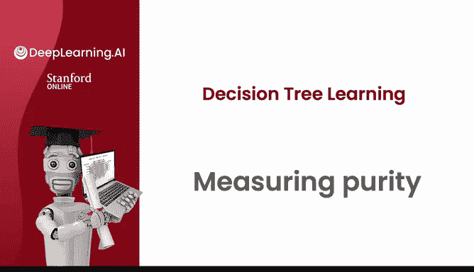
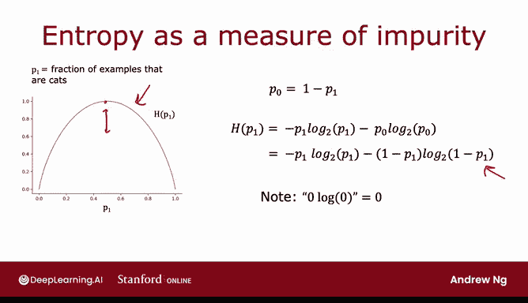

# 吴恩达《机器学习》｜machine-learning（中英字幕-deepseek翻译） - P94：52_04_01_测量纯度.zh_en - GPT中英字幕课程资源 - BV1MN4y1S7DE

In this video we'll look at a way of measuring the purity of a set of examples if the examples are or cats or a single class。

 then it's very pure if it iss all not cats， that's also very pure。

 but if it's somewhere in between how do you quantify how pure is the set of examples。

 let's take a look at the definition of entropy， which is a measure of the impurity of a set of data。

Given a set of six examples like this， we have three cats and three dogs。

 let's define P1 to be diraction of examples that our cats。

 that is diffraction of examples with a label1， that's what the Subscript1 indicates。

And so P1 in this example， is equal to3 out of six。

We're going to measure the impurity of a set of examples using a function called the entropy。

 which looks like this。The entropy function is conventionally denoted as capital H of this number P1。

And the function looks like this curve over here where the horizontal axis is P1。

 the fraction of cats in the sample。And the virtual axis is the value of the entropy。

So in this example where P1 is 3 out of 6 or 0。5， the value of the enpy of P1 would be equal to 1。

 and you notice that this curve is highest when your set of examples is 5050， so it's most imp。

As an impurity of one or really an entropy of one， when your set of examples is 5050。

 whereas in contrast， if your set of examples was either all cats or all not cats。

 then the entropy is zero。Let's just go through a few more examples to gain further intuition about entropy and how it works。

He has a different set of examples with five cats and one dog， so P1， dira of positive examples。

 the fraction of examples labeled one is5，6。And so。P1 is about 0。83。

 and if you read off that value at about 0。83。We find that the entropy of p1 is about 0。

65 and here I'm writing it only to two significant contits Here's one more example。

 this sample of six images has all cats so P1 is six other six because all six are cats and the entropy of P1 is this point over here which is zero and so we see that as you go from36 to six other six cats。

 the impurity decreases from one to zero or in other words the purity increases as you go from a 5050 mix of cats and dogs to all cats。

Let's look at a few more examples。Here's another sample with two cats and four dogs。 So P1 here is 2。

6， and which is one third。 And if you read off the。Entropy at 0。33， it turns out to be about 0。

92 and this is actually quite impure and in particular this set is more impure than this set because it's closer to a 5050 mix。

 which is why the impurity here is 0。92 as to 0。65。And finally， one last example。

 if we have a set of all six dos， then p1 is equal to0。

 and the entropy of p1 is just this numberer down here， which is equal to zero。

Does is a zero purity or disappear a completely pure set of all not cats or all dogs。 Now。

 let's look at the actual equation for the entropy function H of P1。

Recall that P1 is a fraction of examples that are equal to cats。

So if you have a sample that is two third cats， then that sample must have one third， not cats。

So let me define p0 to be equal to the fraction of examples that are not cats to be just equal to1 minus p1。

The entropy function is identified as negative P1 log P1。 and by convention， when computing。Entropy。

 we take logs to base 2 rather than to base E。And then minus p0 log base  two of p0。Alternatively。

 this is also equal to negative P1， log P1 minus。1 minus P1。Log。1 minus P1。

And if you were to plot this function in computer， you find that it would be exactly this function on the left。

And we take log base2 just to make the peak of this curve equal to one。

 if you were to take log of base E or the base of natural algorithms。

 then that just vertically scales dysfunction。And it'll still work。

 but the number has become a bit hard to interpret because the peak of the function isn't a nice round number like one anymore。

OneNot on computing this function。If P1 or p0 is equal to0。

 then an expression like this will look like zero log of zero and log of zero is technically undefined。

 is actually negative infinity。But by convention， for the purposes of computing entropy。

 willll take zero log  zero to be equal to zero， and that will correctly compute the entropy as0 or at1 to be equal to zero。

If you thinking that this definition of entropy looks a little bit like the definition of the logistic loss that we learned about in the last cause。

 there is actually a mathematical rationale of why these two formulas look so similar。

 but you don't have to worry about it and we won't get into it in this class。

 but applying this formula for entropy should work just fine when you're building a decision tree。

To summarize the entropy function is a measure of the impurity of a data。

 It stars from 0 goes up to one and then comes back down to0 as a function of the fraction of positive examples in your sample。

 there are other functions that look like this that go from zero up to one and then back down For example。

 if you look in open source packages you may also hear about something called the genie criteria which is another function that looks a lot like the entropy function and that will work well as well for building decision trees。

 but for the sake of simplicity in these videos I'm going to focus on using the entropy criteria which will usually work just fine for most applications。

Now that we have this definition of entropy in the next video。

 let's take a look at how you can actually use it to make decisions as to what feature to split on in the note of a decision tree。

