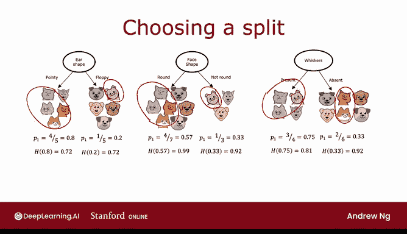
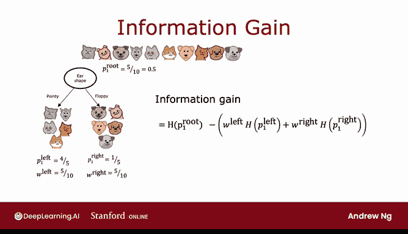

# 吴恩达《机器学习》｜machine-learning（中英字幕-deepseek翻译） - P95：53_04_02_选择分裂：信息增益.zh_en - GPT中英字幕课程资源 - BV1MN4y1S7DE

When building a decision tree， the way we'll decide what feature to split on at a node will be based on what choicer feature reduces entropy the most。

 reduces entropy or reduces impurity or maximizes purity。

In decision tree learning the reduction of entropy is called information gain。

 let's take a look in this video at how to compute information gain and therefore choose what feature to use to split on at each node in new decision tree。

Let's use the example of deciding what feature to use at the root note of the decision tree we're building just now for recognizing cats versus not cats。

If we had split using the ear shape feature at the root node， this is what we would have gotten。

Five examples on the left and five on the right， and on the left we would have four other the five cats。

So P1 would be equal to4/ fifths。All 0。8 and on the right， one other five are cats。

 so p1 is equal to 1 fifth， or 0。2。If you apply the entropy formula from the last video to this left subset of data and this right subset of data。

 we find that the degree of impurity on the left is entropy of 0。8， which is about 072。

And on the right， the entropy of 0。2 is turns out also to be 0。72。

So this would be the entropy at the left and right sub branches if we were to split on the ear shape feature。

 one other option would be to split on the face shape feature。

If we've done so then on the left four the seven examples would be cats so P1 is47s and on the right one third are cats。

 so p1 on the right is 1 thirdd， and the entropy of 47s and the entropy of 13d are 0。99 and 0。

92 so the degree of impurity in the left and right no seems much higher 0。99 and 0。92 compared to 0。

72 and 0。72。Finally， the third possible choice of feature to use the root to note would be the whiskers feature in which case you split based on whether whiskers are present or absent。

 in this case P1 on the left is three quarters， P1 on the right is 26 and the entrytropy values are as follows。

So the key question we need to answer is given these three options of a featured use at the root Note。

 which one do we think works best？It turns out that。

Rather thanre looking at these entropy numbers and comparing them。

It would be useful to take a weighted average of them and here's what I mean。

If there's a node with a lot of examples in it with high entropy。

 that seems worse than if there was a node with just a few examples in it with high entropy。

 because entropy as a measure of impurity is worse if you have a very large and impure data set compared to just a few examples in。

A branch of the tree that is very impure。So the key decision is of these three possible choices of features to use at the root note。

 which one do we want to use？Associated with each of these splits is two numbers。

 the entropy on the left subbrach and the entropy on the right subbrach。

And in order to pick from these， we like to actually combine these two numbers into a single number。

 so we can just pick of these three choices， which one does best and the way we're going to combine these two numbers is by taking weight and average because。

How important it is to have low entropy in say the left or right subbraranch also depends on how many examples went into the left or right subbraranch。

 because if there are a lot of examples in， say the left subbraranch。

 then it seems more important to make sure that that left subbraranchs entropy value is low。

So in this example we have five of the1 examples went to the left subranch so we can compute the weight of the average is5 of the 10 times the enp of 0。

8， and then add to that， five of the 10 examples also went to the right subranch。

Plus phi ten times the entropy of 0。2。Now， for this example in the middle。

The left sub branchch had received 7 out of 10 examples。

 And so we're going to compute 71s times the entropy of。0。57。Plus。

 the right sub branchch had three other 10 examples， so plus three1 times entropy of。

Open 3 fee of1 third。And finally， on the right， we'll compute。4our ten times ener 。

75 plus 61s times ener 。33。And so the way we will choose a split is by computing。

These three numbers and picking whichever one is lowest。

Because that gives us the left and right sub branchesches with the lowest average weighted entropy。

In the way that decision tree are built， we're actually going to make one more change to these formulas to stick to the convention in decision tree building。

 but it won't actually change the outcome。Which is rather than computing this weighted average entropy。

 we're going to compute the reduction in entropy compared to if we hadn't split at all。

 So if we go to the root note， remember that the root node we had started off with all 10 examples of the root note with five cats and five dogs and so at the root note。

 we had P1 equals 51s。Or 0。5。 and so the entropy of the roots node。HP of 0。

5 was actually equal to one， this was maximum imp purity because it was five cats and five dogs。

So the formula that we're actually going to use for choosing a split is not this weighted entropy at the left and right sub branches。

 instead is' going to be the entropy at the root node， which is entropy of 0。5 then minus。This。

Forula。And in this example， if you work on the map， it turns out to be 0。

28 for the face shape example， we can compute enpy at the root node enP of 0。5 minus this。

 which turns out to be 0。03， and for whiskers compute that which turns out to be 0。12。

These numbers that we just calculated 0。28，003 and open 12 these are called the information gain and what it measures is the reduction in entropy that you get in your tree resulting from making a split because the entropy was originally。

One， at the root node。And by making the split， you end up with a lower value of entropy。

 and the difference between those two values is the reduction in entropy， and that's 0。

28 in the case of splitting on the ear shape。So why do we bother to compute？

Reduction in entropy rather than just entropy at the left and right side branches。

 it turns out that one of the stopping criteria for deciding when to not bother to split any further is if the reduction in entropy is too small in which case you could decide you're just increasing the size of the tree unnecessarily and risking overfitting by splitting and just decide to not bother if the reduction in entropy is too small below a threshold In this example。

 splitttting on ear shape results in the biggest reduction in entropy 0。28 is bigger than 0。03 or 0。

12 and so we would choose to split on the ear shape feature at the root node。

On the next slide let's give a more formal definition of information gain and by the way。

 one additional piece of notation that we'll introduce also on the next slide is these numbers five tens and  five1s。

 I'm going to call this W left because that's the fraction of examples so went to the left branch and I'm going to call this W right because that's the fraction of examples that went to the right branch whereas for this middle example W left would be seven1s and W right will be three1s。

 so let's now write down the general formula for how the compute information gain。

Using the example of splitttting on the ear shape feature。

 let me define P1 left to be equal to the fraction of examples in the left subree that have a positive label that are cats and so in this example P1 left would be equal to four fish。

And also let me to find W left to be the fraction of examples。

 out of all the examples of the root note that went to the left subbrach， and so in this example。

 W left would be five1s。Similarly， let's define P1 right to B of all the examples in the right branch。

The fraction did are positive examples， and so with one or the five of these examples being cats。

 that would be one fifth and similarly W right is。Five tenths。

 di fraction of examples that went to the right sub branchch。

And let's also define P1 root to be the fraction of examples that are positive in the root node。

So in this case， this would be five， tens or 0。5。Information gain is then defined as the entropy。

Of P1 root， so what's the entropy at the roots node minus that weighted entropy calculation that we had on the previous slide。

 minus W left there would be 510s in example times the entropy apply to P1 left does entropy on the left sub branchch。

Plus， tell right。The fraction of examples that went in the right branch times entropy of p1 right。

 and so with this definition of entropy， you can calculate the information gain associated with choosing any particular feature to split on in the node and then out of all the possible features you could choose to split on you can then pick the one that gives you the highest information gain and that will。

Result in hopefully increasing the purity of your subsets of data that you get on the left and right sub branchesranches of your decision tree。

 and that will result in choosing a feature to switch on that increases the purity of your subsets of data in both the left and right sub branchesranches of your decision tree。

Now that you know how to calculate information gain or reduction in entropy。

 you know how to pick a feature to split on at a node。

 let's put all the things weve talked about together into the overall algorithm for building a decision tree given a training set。

 let's go see that in the next video。