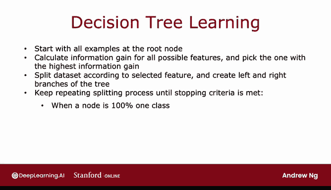
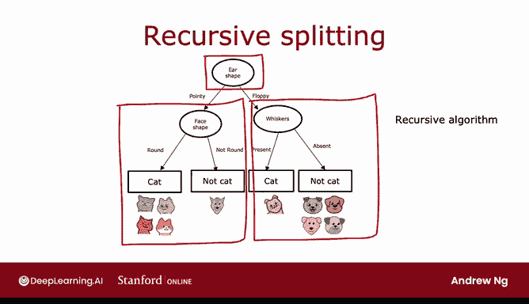

# 吴恩达《机器学习》｜machine-learning（中英字幕-deepseek翻译） - P96：54_04_03_整合实现.zh_en - GPT中英字幕课程资源 - BV1MN4y1S7DE

The information gain criteria lets you decide how to choose one feature to split at OneNote。

 let's take that and use that in multiple places through a decision tree in order to figure out how to build a large decision tree with multiple nodes。

Here's the overall process of building a decision tree。

 start with all training examples at the root node of a tree and calculate the information gain for all possible features and pick the feature to split on that gives the highest information gain having chosen this feature you would then split the data into two subsets according to the selected feature and create left and right branches of the tree and send the training examples to either the left or the right branch depending on the value of that feature for that example。

And this allows you to have made a split at the root node。After that。

 you would then keep on repeating the splitting process on the left branch of the tree。

 on the right branch of the tree and so on， and keep on doing that until a stopping criteria is met。

 where the stopping criteria can be when a node is 100% a single class。

 so one has reached entropy of zero。

Or when further splitting a note will cause a tree to exceed the maximum depth that you have set。

Or if the information gain from an additional s is less than a threshold。

Or if the number of examples in a node is below a threshold。

And so you would keep on repeating the split process until the stopping criteria。

That you have chosen， which could be one or more of these criteria is met。

Let's look at an illustration of how this process will work。

We started all of the examples at the root node and based on computing information gain for all three features。

 decide that ear shape is the best feature to split on based on that we create left and right sub branchesches and send the subset of the data with pointy versus floppy ears to the left and right sub branchesranches。

So let me cover up the root node and the right subbrach and just focus on the left subbrach where we have these five examples。

 let's the off splitttting criteria is to keep splitttting until everything in the node belongs to a single class。

 so either all cats or all dogs。We would look at this node and see if it meets the split criteria and it does not because there is a mix of cats and dogs here。

So the next step is to then pick a feature to split on。

 so we then go through the features one at a time and compute the information gain of each of those features as if this node were the new root node of a decision tree。

That was trained using just five training examples shown here。

So we would compute the information gain for splitting on the whiskers feature。

 the information gain on splitting on the face shape feature。

 and it turns out that the information gain for splitting on ear shape will be zero because all of these have the same pointy ear shape。

And between。Whiskers and face shape。Face shape turns out to have a highest information gain。

 so we're going to split on face shape and that allows us to build left and right subbraches as follows So for the left subbrarannch we check for the criteria for whether or not we should stop splitttting and we have all cats here and so the stopping criteria is met and we create a leaf node that makes a prediction of cat and for the right subbraranch we find that it is all dogs and so we will also stop splitttting since we've met the splitttting criteria and put the leaf node there that predicts not cat。

So having built out this left subte， we can now turn our attention to building the right subte。

Let me now again cover up the roots node and the entire left subre。To build up the right secretary。

 we have these five examples here。 And again， the first thing we do is check if the criteria to stop splitttting has been met。

 the criteria being whether or not all the examples are a single class， we've not met the criteria。

 And so we'll decide to。Keep splitttting in this right subbraranch as well and in fact。

 the procedure for building the right subbraranch will be a lot like as if you were training a decision tree learning algorithm from scratch where the data set you have comprises just these five training examples。

And so again， computing information gain for all of the possible features to split on。

You find that the whiskers feature use the highest information gain。 split the set of five examples。

 according to whether whiskers at present or absent。

 check if the criteria to stop splitting are met in the。

Left and right sub branchesches here and decide that they are。

 and so you end up with leaf node that predict cat and not cat。

And so this is the overall process for building the decision tree。

Notice that there's an interesting aspect of what we've done。

Which is after we decided what to split on at the root node。

 the way we built the left subte was by building a decision tree on a subset of five examples and the way we built the right subte was by again building a decision tree on a subset of five examples in computer signs this is an example of a recursive algorithm and all that means is the way you build a decision tree at the root is by building other smaller decision trees and the left and the right sub branchesches。

So recursion in computer science refers to writing code that calls itself。

 and the way this comes up in building a decision tree is you build the overall decision tree by building smaller subdision trees and including them all together。

So that's why if you look at software implementations of decision trees。

 you see sometimes references to a recursive algorithm。

But if you don't feel like you fully understood this concept of recursive algorithms。

 don't worry about it， you still be able to fully complete this week's assignments as well as use libraries to get decision trees to work for yourself。

 but if you're implementing a decision tree algorithm from scratch， then。

A reccursive algorithm turns out to be one of the steps you'd have to implement。 And by the way。

 you may be wondering how to choose the maximum depth parameter。

There aren't many different possible choices， but some of the Open Sos libraries will have good default choices that you can use。

One intuition is the larger the maximum dev， the bigger the decision tree you're willing to build。

 and this is a bit like fitting a higher degree polynomial or training a larger neural network It lets the decision tree learn a more complex model。

 but also increases the risk of overfitting if it fitting a very complex function to your data In theory。

 you could use trustval to pick parameters like the maximum dev where you try out different values the maximum depth and pick what works best on the trustvalation set。

 although in practice the open source libraries have even somewhat better ways to choose this parameter for you or another criteria that you can use to decide when to stop spitting is if。

The information gain from an additional split is less than a certain threshold。

So if any feature is sp on a cheese only a small reduction in entropy or a very small information gain。

 then you might also decide to not bother。And finally you can also decide to stop splitttting when the number of examples in the node is below a certain threshold so that's the process of building a decision tree now that you've learned the decision tree if you want to make a prediction。

 you can then follow the procedure that you saw in the very first video of this week where you take a new example。

 say a test example and started the route and keep on following the decisions down until you get to leave note which then makes a prediction。

Now that you know the basic decision tree learning algorithm in the next few videos。

 I'd like to go into some further refinements of this algorithm。

So far we've only used features that take on two possible values。

 but sometimes you have a feature that takes on categorical or discrete values。

 but maybe more than two values Let's take look in the next video at how to handle that case。

