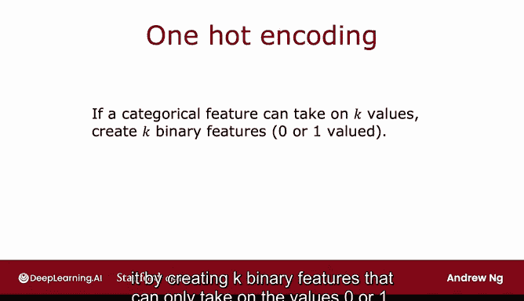

# 吴恩达《机器学习》｜machine-learning（中英字幕-deepseek翻译） - P97：55_04_04_使用分类特征的独热编码.zh_en - GPT中英字幕课程资源 - BV1MN4y1S7DE

In the example we've seen so far， each of the features could take on only one of two possible values。

 The ear shape was either pointy or floppy， the face shape was either round or not round and whiskers were either presence or absent。

 but what if you have features that can take on more than two discrete values In this video will look at how you can use one hot encoding to adjust features like that Here's a new training set for our pet adoption center application where all the data is the same except for the ear shape feature rather than ear shape only being pointy and floppy。

 it can now also take on an oval shape。

And so the ES shape feature is still a categorical value feature。

 but it can take on three possible values instead of just two possible values。

And this means that when you split on this feature， you end up creating three subsets of the data。

And end up building three sub branchesches for the tree。But in this video。

 I' like to describe a different way of addressing。Features they can take on more than two values。

 which is the use a one hot encoing。In particular， rather than using an ear shape feature they can take on any of three possible values。

 we're instead of going to create three new features。Where one feature is。

 does this animal have  point0 ears， a second is， does they have floppy ears， and the third is。

 does it have oval years？And so for the first example， whereas we previously had。

Ear shape has pointy。We are now instead， say that this animal。

Has a value for the pointier feature of1 and0 for Fopp and oval。

 whereas previously for the second example， we previously said it had oval years。

 now we'll say that it has a value of zero for pointy years because it doesn't have point of years。

 it also doesn't have flppy years but it does have oval years。

 which is why this value here is1 and so on for the rest of the examples in the dataset and so instead of one feature taking on three possible values with've now constructed three new features。

 each of which can take on only one of two possible values either zero or one。

In a little bit more detail， if a categorical feature can take on k possible values。

 K was 3 in an example， then we will replace it by creating k binary features that can only take on the values 01。

And you notice that among all of these three features， if you look at any row here。

 exactly one of the values is equal to one， and that's what gives this method of feature construction the name one hot encoding。

And because one of these features will always take on the value one。

 that's the hot feature and hence the name one hot tin clothing。And with this choice of features。

 we're now back to the original setting of where each feature only takes on one of two possible values。

 and so the decision free learning algorithm that we've seen previously will apply to this data with no further modifications。

Just as in the side， even though this week's material has been focused on training decision tree models。

The idea of using one hot encodings to encode categorical features also works for training neural networks。

In particular， if you were to take the face shape feature and replace round and not round with one and zero。

Where round gets matter 1， not round gets matter  zero， and so on。

 and for whiskers similarly replace present with one， an absence with zero。

Then notice that we have taken all the categorical features we had。

 where we had three possible values for ear shape， two for face shape and one for whiskers and encoded as a list of these five features。

 three from the one hot encoding of ear shape one from face shape and one for whiskers。

 and now this list of five features can also be fed to a neural network or to logistic regression to try to train a cat classifier。

So one hott encoding is a technique that works not just for decision tree learning。

 but also lets you encode categorical features using ones and zeros so that it can be fed as inputs to a neural network as well。

 which expects numbers as inputs。So that's it with a one hard encoding you can get your decision sheet to work on features that can take on more than two discrete values。

 and you can also apply this to neural network or linear regression or literency regression training。

But how about features that are numbers that can take on any value。

 not just a small number of discrete values in the next video。

 let's look at how you can get the decisionry to handle continuous value features that can be any number。

