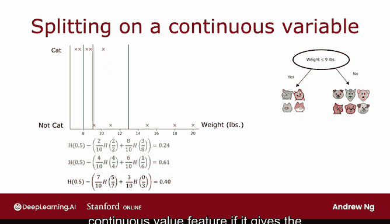

# 吴恩达《机器学习》｜machine-learning（中英字幕-deepseek翻译） - P98：56_04_05_连续值特征.zh_en - GPT中英字幕课程资源 - BV1MN4y1S7DE

Let's look at how you can modify decision tree to work with features that aren't just discrete value。

 but continuous value。 that is features that can be any number。 Let's start with an example。

 I have modified the cat adoption center dataset to add one more feature。

 which is the weight of the animal in pounds on average。

Between cats and dogs， cats are a little bit lighter than dogs。

 although there are some cats that are heavier than some dogs。

 but so the weight of an animal is a useful feature for deciding if it is a cat or not。

So how do you get a decision tree to use a feature like this the decision tree or any algorithm will proceed similarly as before。

Except that rather than considering splitting just on ear shape， face shape and whiskers。

 you have to consider splitting on ear shape， face shape whiskers or weight。

 and if splitttting on the weight feature gives better information gain than the other options。

 then you would split on the weight feature。But how do you decide how to split on the weight feature？

Let's take a look。Here's a plot of the data at the root node， are plotted on the horizontal axis。

 the weight to the animal and the vertical axis is。Cat on top and not cat below。

 So the vertical axis indicates the label Y being1 or0。

 The way we would split on the weight feature would be if we were to split the data based on whether or not the weight is less than or equal to some value。

 let's say8 or some of the number that will be the job of the learning algorithm to choose and what we should do when considering splitting on the weight feature is to consider。

Many different values of this threshold and then depict pick the one that is the best。

 and by the best， I mean the one that results in the best information gain。So in particular。

 if you are considering splitting the examples based on whether the weight is less than or equal to eight。

 then you would be splitting this data set into two subsets。

 where the subset on the left has two cats and a subset on the right has three cats and five dogs。

So if you were to calculate our usual information gain calculation。

You be computing the entropy at the root node， entropy of 0。5。Mine is。Now， two tenses。

Times entropy of the left split has two other two cats。

 So it should be of two other two plus the right split has。8 out of 10。

Examples and an entro PF that's of the eight examples on the right， three are cats， so entry are 38s。

 and this turns out to be 0。24。So this would be information gain if you were to split on whether the weight is less than equal to8。

But we should try other values as well。So what if you were to split on whether or not the weight is less than equal to9？

And that corresponds to this new line over here。And the information gain calculation becomes h of 0。

5 minus， so now we have four examples and lefts that all cats。

 so that's4 10 times entropy of4 4 plus six examples on the right of which you have one cat so that's six。

1 times h of 16。Which is equal to it turns out 0。61。

So the information gain here looks much better is 0。61 information gain。Which is much higher than 0。

24。Or we could try another value， say 13， and the calculation turns out to look like this。

 which is 0。40。In the more general case， we'll actually try not just three values。

 but multiple values along the X axises。And one convention would be to sort all of the examples according to the weight or according to the value on this feature。

 and take all the values that are admit points between the sorted list of training examples as a values for consideration for this threshold over here。

This way if you have 10 training examples， you will test nine different possible values for this threshold and then try to pick the one that gives you the highest information gain。

And finally， if the information gain from splitting on a given value of this threshold is better than the information gain from splitting on any other feature。

 then you will decide to split that node at that feature。And in this example。

 an information gain of 0。61 turns out to be higher than that of any other feature。

It turns out there are actually two thresholds and so assuming the algorithm chooses this feature to split on。

 you would end up splitting the data。According to whether or not。

 the weight of the animal is less than equal to9 pounds。

 and so you end up with two subsets of the data like this and you can then build recursively additional decision trees using these two subsets of the data to build out the rest of the tree。

 so to summarize to get a decision tree to work on continuous value features。

At every node when considering splits， you would just consider different values to splitmit on。

 carry out the usual information gain calculation， and decide to split on that continuous value feature if it gives the highest possible information gain。

So that's how you get the decision tree to work with continuous value features。

 try different thresholds， do the usual information gain calculation。

 and splitit on the continuous value feature with the selected threshold if it gives you the best possible information gain out of all possible features to split on。

And that's it for the required videos on the core decision tree algorithm After this there is an optional video you can watch or not that generalizes the decision tree learning algorithm to regression trees so far we've only talked about using decision trees to make predictions that are classifications predicting a discrete category such as cat or not cat but what if you have a regression problem where you want to predict a number in the next video I'll talk about a generalization of decision trees to handle that。

